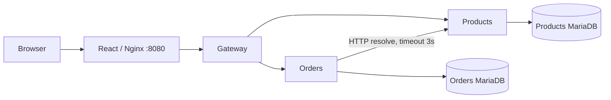

# Lab 01 — Mini Shop: đặc tả triển khai

## 1. Mục tiêu

Demo microservices bằng ứng dụng đặt hàng nhỏ: React + HTML/JSX + CSS + TypeScript; Node.js/Express; MariaDB; Docker Compose. JavaScript là đầu ra biên dịch TypeScript. Hai service nghiệp vụ có lifecycle và database riêng. Không cần Kubernetes cho lab một máy.

Phạm vi: danh sách sản phẩm, giỏ hàng, đặt hàng, danh sách/chi tiết đơn và quản trị sản phẩm. Ngoài phạm vi: đăng nhập, thanh toán, kho hàng, vận chuyển, broker và giao dịch phân tán. Trang quản trị không xác thực chỉ dành cho máy local; dữ liệu khách hàng là dữ liệu giả dùng trong lab.

## 2. Kiến trúc và sở hữu

Sáu container: frontend, gateway, products, orders, products-db, orders-db. Chỉ frontend publish `127.0.0.1:8080`. Nginx proxy `/api`, SPA fallback hỗ trợ deep link. Gateway định tuyến whitelist, không public `/internal` hoặc health nội bộ. Hai mạng database riêng; Orders không tham gia mạng Products DB và ngược lại. Service-to-service dùng mạng backend. DB user riêng, không quyền chéo.

Một monorepo hỗ trợ phát triển; mỗi backend build và triển khai riêng qua Docker build arg. Không chia sẻ entity/repository. Hai database container dùng volume độc lập, không dùng MariaDB cài trên host, không xung đột cổng 3306.

## 3. Màn hình và UX

| URL | Yêu cầu |
|---|---|
| `/` | Tối thiểu 5 sản phẩm seed, tên, mô tả, giá VND, trạng thái, thêm vào giỏ; tìm kiếm local |
| `/cart` | Sửa số lượng 1–99, xóa, tạm tính, tên/email, submit, trạng thái chờ và lỗi |
| `/orders` | Danh sách mới nhất trước; phân trang 10 đơn; empty/error/loading |
| `/orders/:id` | Snapshot mặt hàng và giá, người đặt, tổng tiền, thời điểm |
| `/admin/products` | Thêm/sửa tên, mô tả, giá, bật/tắt bán; lỗi validation |

Điều hướng có trạng thái đang chọn, responsive desktop/mobile, label rõ cho input, nút submit disabled khi đang gửi. Cart lưu localStorage và kiểm tra dữ liệu khi đọc. Frontend không gửi giá làm căn cứ tính tiền. Tạm tính có thể khác giá server khi quản trị vừa đổi giá; UI thông báo giá chốt ở lúc tạo đơn.

## 4. Dữ liệu

Products DB: `products(id CHAR(36) PK, name VARCHAR(150), description TEXT, price_vnd BIGINT UNSIGNED, is_active BOOLEAN, created_at DATETIME(3), updated_at DATETIME(3))`.

Orders DB:
- `orders(id CHAR(36) PK, customer_name VARCHAR(100), customer_email VARCHAR(254), total_vnd BIGINT UNSIGNED, status VARCHAR(20), idempotency_key VARCHAR(100) UNIQUE, request_hash CHAR(64), created_at DATETIME(3))`.
- `order_items(id CHAR(36) PK, order_id FK, product_id CHAR(36), product_name VARCHAR(150), unit_price_vnd BIGINT UNSIGNED, quantity INT, subtotal_vnd BIGINT UNSIGNED)`.

`product_id` không có FK xuyên service. Giá/tên snapshot không đổi khi sửa sản phẩm. Giá 1–1.000.000.000 VND; tối đa 20 dòng khác nhau x 99 sản phẩm, tổng tiền nằm trong miền số nguyên an toàn JS. DB dùng utf8mb4, InnoDB. Migration v1 tạo bảng nếu chưa có; seed theo ID cố định, chỉ thêm bản ghi chưa có, không ghi đè chỉnh sửa. Migration v1 không phải công cụ nâng cấp schema tương lai: phiên bản mới phải thêm migration riêng.

## 5. Hợp đồng API

JSON camelCase; response lỗi `{error:{code,message}, requestId}`. Header `X-Request-Id` được gateway xác thực độ dài/ký tự hoặc tạo mới và truyền xuống service. Body tối đa 32 KiB. UUID đúng định dạng cho ID; unknown body fields bị từ chối.

| Method | Endpoint public | Body / response |
|---|---|---|
| GET | `/api/products` | `{items: Product[]}`; gồm trạng thái để admin dùng; shop chỉ hiện active |
| GET | `/api/products/:id` | Product hoặc 404 |
| POST | `/api/products` | `{name,description,priceVnd,isActive}` → 201 Product |
| PATCH | `/api/products/:id` | Ít nhất một field thuộc body tạo → 200 Product |
| POST | `/api/orders` | `{customerName,customerEmail,items:[{productId,quantity}]}` + Idempotency-Key → 201 Order; replay → 200 |
| GET | `/api/orders?page=1&pageSize=10` | `{items,total,page,pageSize}`; page >=1, pageSize 1–50 |
| GET | `/api/orders/:id` | Order với `items` hoặc 404 |

Products private: `POST /internal/products/resolve`, `{ids:UUID[]}`, 1–20 ID → `{items:Product[]}`; ID thiếu trả 404. Service health: `/health/live` process sống; `/health/ready` database SELECT 1 thành công (gateway chỉ kiểm tra chính process). Orders readiness không phụ thuộc Products để đơn cũ vẫn đọc được khi Products lỗi.

Mã lỗi: 400 input/JSON sai; 404 thiếu resource/route; 409 sản phẩm ngừng bán hoặc key khác body; 413 body quá lớn; 503 dependency/DB lỗi; 500 lỗi ngoài dự kiến. Không trả SQL/password/stack trace.

## 6. Tạo đơn, idempotency và lỗi

1. Validate key 8–100 ký tự `[A-Za-z0-9_-]`, body, UUID, số lượng, dòng trùng.
2. Chuẩn hóa tên/email và sắp xếp dòng theo productId; SHA-256 canonical body.
3. Tìm đơn bằng key trước khi gọi Products. Cùng hash trả lại snapshot cũ; khác hash trả 409.
4. Resolve sản phẩm qua HTTP với AbortSignal timeout 3 giây. Thiếu → 404, inactive → 409, lỗi mạng/timeout → 503.
5. Tính giá server và tổng, mở transaction cục bộ, insert order và items, commit.
6. Unique key xử lý race: rollback loser, đọc đơn đã commit và so hash. Không giữ DB transaction trong lúc gọi mạng.
7. Nếu response bị mất sau commit, retry cùng key trả lại đơn; frontend giữ key cùng payload qua reload cho đến khi thành công hoặc nội dung đổi.

Gateway timeout 8 giây. Không tự retry POST tạo đơn. Khi Products dừng, đơn mới lỗi trong thời gian hữu hạn; đọc đơn cũ vẫn hoạt động. DB mất kết nối → 503, pool kết nối lại khi DB phục hồi. Bootstrap retry DB tối đa 30 lần x 2 giây, sau đó thoát khác 0 để Docker restart.

## 7. Vận hành

Docker dùng Node 24, MariaDB 11.8, Nginx Alpine; lockfile cố định dependencies npm. Tag image khóa major/minor, chưa khóa digest. Healthcheck và `depends_on: service_healthy`; database volume persistent. Biến mật khẩu lấy từ `.env`; `.env.example` chỉ có giá trị demo. Log JSON stdout gồm service, method, path, status, duration, requestId; không log body khách hàng.

Không `down -v` trong verify thông thường. Script chaos chỉ thao tác container thuộc Compose project `lab01-mini-shop`, có finally/trap để phục hồi. Test API tạo dữ liệu có tên tiền tố Test; không xóa dữ liệu khác. Không thực thi thao tác trên MariaDB host.

## 8. Nghiệm thu

Build TypeScript/frontend pass; unit test pass; integration API với DB thật pass; browser E2E desktop/mobile pass; Compose sáu container healthy; qua gateway đọc/ghi được; kiểm thử lỗi Products, recovery, persistence và rebuild Products không restart Orders. Chi tiết và bằng chứng trong TEST-PLAN.md, TASKS.md, docs/VERIFICATION.md.

## 9. Tài liệu tham chiếu

- Docker Compose startup/health: https://docs.docker.com/compose/how-tos/startup-order/
- mysql2 promise/prepared statements: https://sidorares.github.io/node-mysql2/docs
- Vite: https://vite.dev/guide/
