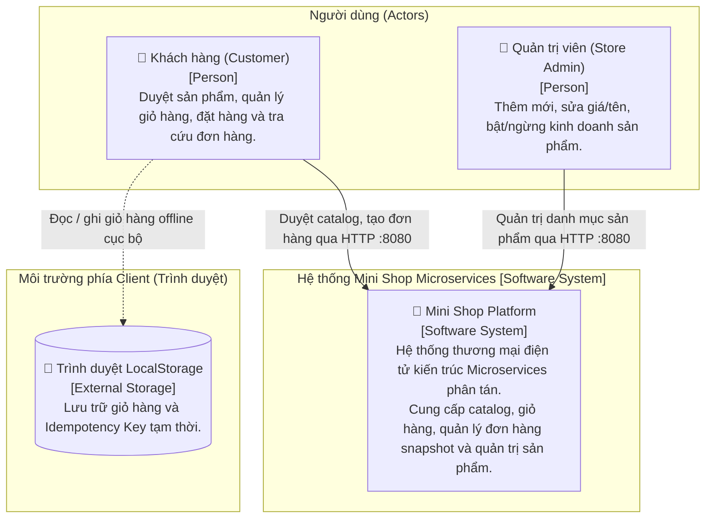
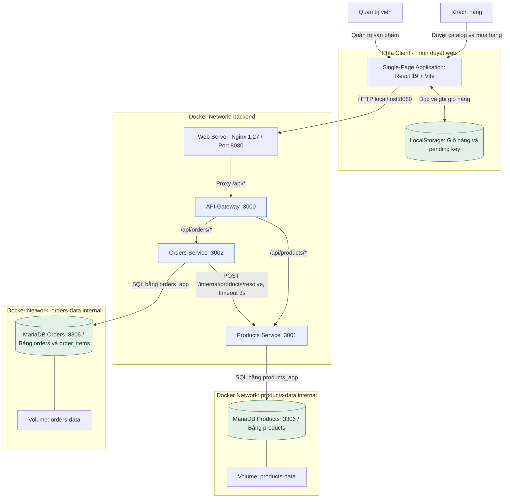
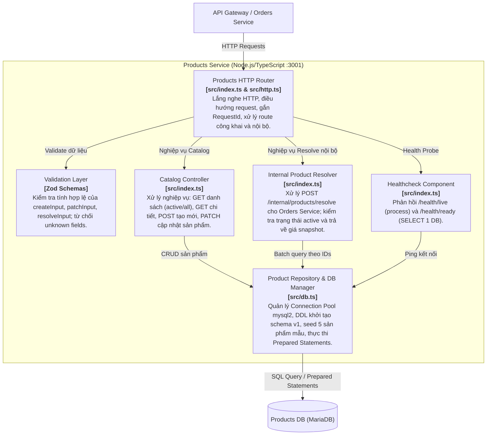
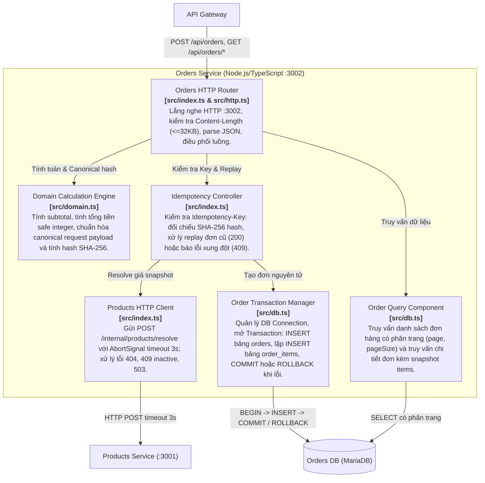
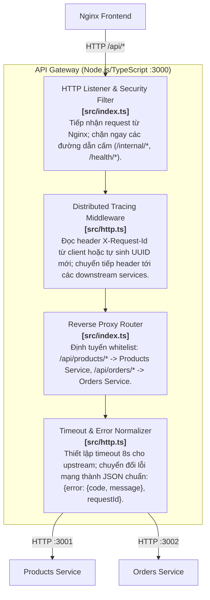
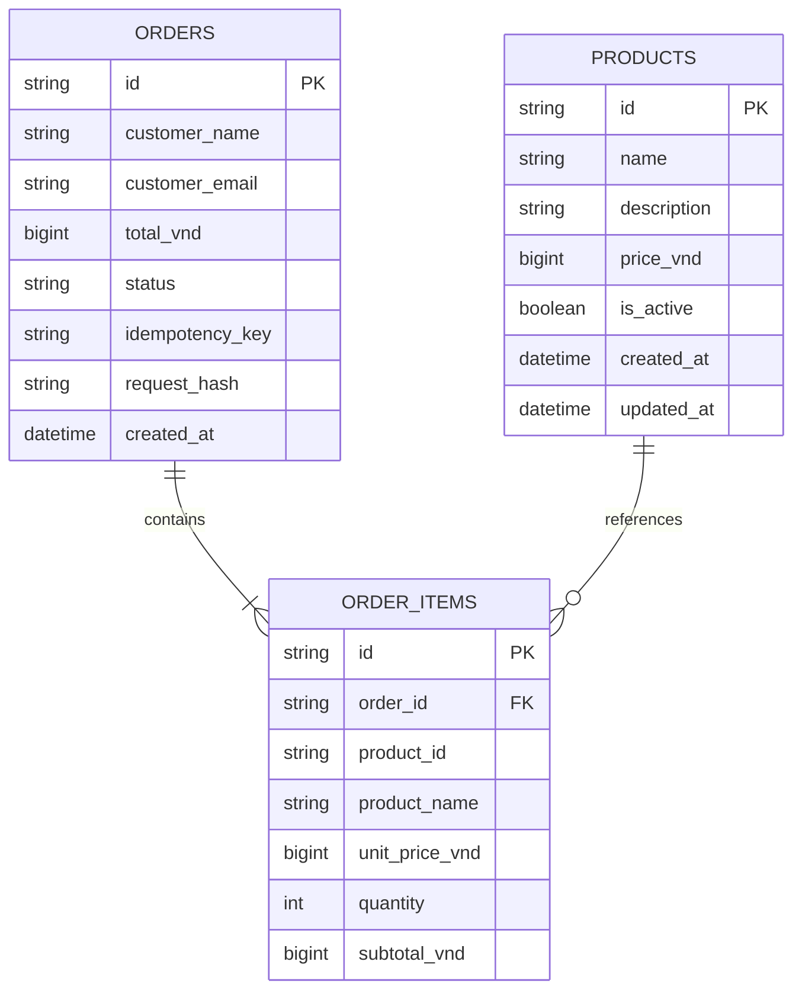

# Mô hình kiến trúc C4 — Mini Shop (Lab 01)

Tài liệu này chuẩn hóa kiến trúc hệ thống **Mini Shop Microservices** theo phương pháp **C4 Model** (Context, Container, Component, Code). Mô hình C4 giúp trực quan hóa kiến trúc phần mềm ở các cấp độ phóng to (zoom levels) khác nhau từ bối cảnh kinh doanh đến chi tiết thành phần mã nguồn.

---

## 1. C4 Level 1: System Context Diagram (Bối cảnh hệ thống)

Biểu đồ bối cảnh hệ thống mô tả mối quan hệ giữa người dùng (Actors) và hệ thống Mini Shop trong phạm vi tổng thể, cùng với các ranh giới ngoại vi.

### 1.1. Sơ đồ System Context

### 1.2. Bảng mô tả thành phần Bối cảnh

| Phần tử | Loại | Vai trò & Trách nhiệm |
|---|---|---|
| **Khách hàng (Customer)** | Person | Người mua hàng trực tuyến: tìm kiếm sản phẩm, quản lý giỏ hàng, thực hiện checkout và tra cứu trạng thái/chi tiết đơn hàng. |
| **Quản trị viên (Store Admin)** | Person | Nhân viên vận hành cửa hàng: tạo sản phẩm mới, cập nhật giá niêm yết, đổi tên/mô tả hoặc ngừng kinh doanh sản phẩm. |
| **Mini Shop Platform** | Software System | Hệ thống phần mềm chính của đồ án Lab 01, chạy hoàn toàn trên Docker Compose cục bộ, cung cấp toàn bộ API và giao diện Web. |
| **Trình duyệt LocalStorage** | External Client Storage | Vùng nhớ lưu trữ trạng thái giỏ hàng và Idempotency Key pending tại máy người dùng để chống mất dữ liệu khi reload hoặc rớt mạng. |

---

## 2. C4 Level 2: Container Diagram (Mô hình Container ứng dụng)

Mô hình Container phân tách hệ thống thành các khối thực thi độc lập (dịch vụ, ứng dụng frontend, cơ sở dữ liệu), xác định giao thức giao tiếp và phân vùng mạng (network isolation).

### 2.1. Sơ đồ Container

### 2.2. Bảng phân tích chi tiết các Container

| Container | Công nghệ | Cổng & Network | Trách nhiệm kiến trúc |
|---|---|---|---|
| **Single-Page Application (SPA)** | React 19, TypeScript, Vite | Trình duyệt Client | Render giao diện người dùng, điều hướng client-side, quản lý giỏ hàng và xử lý retry idempotent khi mất mạng. |
| **frontend (Nginx)** | Nginx 1.27 Alpine | `127.0.0.1:8080:80` (host) Network: `backend` | Đóng vai trò Reverse Proxy duy nhất mở ra máy host; phân phối file HTML/JS/CSS tĩnh và chuyển tiếp các request `/api/*` vào Gateway. |
| **gateway** | Node.js 24, TypeScript | Port `3000` Network: `backend` | Điểm vào tập trung (API Gateway pattern): định tuyến whitelist, phát sinh/chuyển tiếp `X-Request-Id`, áp đặt timeout 8s, ẩn hoàn toàn các API `/internal/*`. |
| **products** | Node.js 24, TypeScript | Port `3001` Networks: `backend`, `products-data` | Quản lý vòng đời sản phẩm, seed dữ liệu ban đầu, cung cấp endpoint nội bộ `/internal/products/resolve` để snapshot giá cho Orders. |
| **orders** | Node.js 24, TypeScript | Port `3002` Networks: `backend`, `orders-data` | Tiếp nhận checkout, phối hợp gọi Products để chốt giá snapshot, kiểm soát Idempotency Key chống trùng lặp và điều phối Database Transaction cục bộ. |
| **products-db** | MariaDB 11.8 InnoDB | Port `3306` (nội bộ) Network: `products-data` | Cơ sở dữ liệu riêng của Products Service. Lưu trên volume `products-data`. Không mở port ra host. |
| **orders-db** | MariaDB 11.8 InnoDB | Port `3306` (nội bộ) Network: `orders-data` | Cơ sở dữ liệu riêng của Orders Service. Lưu trên volume `orders-data`. Không mở port ra host. |

---

## 3. C4 Level 3: Component Diagrams (Mô hình thành phần bên trong Service)

Cấp độ này đi sâu vào cấu trúc module mã nguồn của từng Microservice backend:

### 3.1. Thành phần của Products Service (`services/products`)

### 3.2. Thành phần của Orders Service (`services/orders`)

### 3.3. Thành phần của API Gateway (`services/gateway`)

---

## 4. C4 Level 4: Code & Data Entity Model (Mô hình Dữ liệu)

Mô hình dữ liệu vật lý thể hiện rõ nguyên lý **Database-per-Service**: hai cơ sở dữ liệu hoàn toàn độc lập, không có khóa ngoại (Foreign Key) vật lý xuyên qua ranh giới dịch vụ.

### Chi tiết các trường dữ liệu theo Schema vật lý

| Bảng (Database) | Cột | Kiểu SQL | Ràng buộc | Ý nghĩa kiến trúc |
|---|---|---|---|---|
| **products** *(Products DB)* | `id` | `CHAR(36)` | PK | UUID v4 định danh sản phẩm |
| | `name` | `VARCHAR(150)` | NOT NULL | Tên sản phẩm |
| | `description` | `TEXT` | NULL | Mô tả chi tiết |
| | `price_vnd` | `BIGINT UNSIGNED` | NOT NULL | Giá bán niêm yết hiện tại |
| | `is_active` | `BOOLEAN` | DEFAULT true | Trạng thái kinh doanh |
| | `created_at` / `updated_at` | `DATETIME(3)` | NOT NULL | Dấu thời gian (timestamp) |
| **orders** *(Orders DB)* | `id` | `CHAR(36)` | PK | UUID v4 định danh đơn hàng |
| | `customer_name` | `VARCHAR(100)` | NOT NULL | Tên người nhận |
| | `customer_email` | `VARCHAR(254)` | NOT NULL | Email người nhận |
| | `total_vnd` | `BIGINT UNSIGNED` | NOT NULL | Tổng tiền thanh toán an toàn (Safe Integer) |
| | `status` | `VARCHAR(20)` | NOT NULL | Trạng thái (`COMPLETED`) |
| | `idempotency_key` | `VARCHAR(100)` | UNIQUE | Khóa chống trùng đơn hàng |
| | `request_hash` | `CHAR(64)` | NOT NULL | SHA-256 canonical hash của payload |
| | `created_at` | `DATETIME(3)` | NOT NULL | Thời điểm tạo đơn |
| **order_items** *(Orders DB)* | `id` | `CHAR(36)` | PK | UUID v4 định danh dòng mặt hàng |
| | `order_id` | `CHAR(36)` | FK | Liên kết bảng `orders` (CASCADE DELETE nội bộ) |
| | `product_id` | `CHAR(36)` | NOT NULL | **Tham chiếu logic** sang Products (không tạo FK vật lý) |
| | `product_name` | `VARCHAR(150)` | NOT NULL | **Snapshot** tên sản phẩm tại thời điểm mua |
| | `unit_price_vnd` | `BIGINT UNSIGNED` | NOT NULL | **Snapshot** đơn giá tại thời điểm mua |
| | `quantity` | `INT` | NOT NULL | Số lượng (1–99) |
| | `subtotal_vnd` | `BIGINT UNSIGNED` | NOT NULL | Thành tiền dòng mặt hàng |

### Điểm nhấn thiết kế dữ liệu Microservices:
1. **Zero Cross-DB Foreign Keys:** `order_items.product_id` chỉ lưu mã định danh logic kiểu chuỗi, không tạo `FOREIGN KEY` sang `products.id` vì hai bảng nằm ở 2 container MariaDB khác nhau.
2. **Price & Name Snapshot:** Cột `product_name` và `unit_price_vnd` trong `order_items` lưu lại dữ liệu ngay tại thời điểm thanh toán. Dù Quản trị viên có đổi giá hoặc đổi tên sản phẩm ở `products`, dữ liệu lịch sử đơn hàng ở `orders` vẫn được bảo toàn nguyên vẹn.

---

## 5. Ma trận ánh xạ các đặc trưng Microservices vào C4 Model

| Đặc trưng Microservices | Vị trí thể hiện trong C4 Model | Cách hiện thực trong Lab 01 |
|---|---|---|
| **Database-per-service** | C4 Level 2 (Container) & Level 4 (Data) | Hai container MariaDB riêng biệt (`products-db`, `orders-db`) trên hai network Docker độc lập (`products-data`, `orders-data`). |
| **API Gateway Pattern** | C4 Level 2 (Container) & Level 3 (Gateway) | Container `gateway` làm cổng tập trung, che giấu cấu trúc mạng nội bộ, quản lý timeout và chuyển tiếp `X-Request-Id`. |
| **Independent Deployment** | C4 Level 2 (Container) | Các container có Dockerfile/build args riêng, triển khai độc lập bằng `docker compose up -d --build --no-deps products` mà không gián đoạn Orders. |
| **Fault Isolation** | C4 Level 2 & Level 3 (Components) | Khi `products` ngừng hoạt động, `orders` vẫn phục vụ đọc đơn cũ (HTTP 200). Thao tác tạo đơn mới trả về lỗi 503 có kiểm soát trong 3s/8s. |
| **Idempotent Consumer** | C4 Level 3 (Orders Components) | Component `Idempotency Controller` dùng SHA-256 hash và unique key trong DB để đảm bảo an toàn khi client retry hoặc gửi trùng lặp. |
| **Local Transaction Atomicity** | C4 Level 3 (Orders Transaction Manager) | Sử dụng transaction nội bộ trong phạm vi `orders-db` (ghi `orders` và các `order_items`). Tự động ROLLBACK sạch sẽ nếu có lỗi phát sinh. |
