# Mini Shop — Dataflow theo từng use case

Sơ đồ đối chiếu với code thực tế trong `services/`, `frontend/src/main.tsx`, cấu hình Nginx và Compose. Không có message broker, event bus hay database dùng chung trong bản demo này.

**Cách đọc:** mũi tên liền là request/lệnh; mũi tên nét đứt là response/kết quả; `alt` là nhánh điều kiện; `loop` là thao tác lặp; vùng transaction chỉ thuộc Orders DB. Các bước phía frontend diễn ra trong trình duyệt, Nginx chỉ phục vụ file tĩnh và reverse proxy.

**Quy tắc chung:** Nginx giữ nguyên `/api`; Gateway bỏ `/api` trước khi chuyển đến service. Gateway tạo hoặc nhận `X-Request-Id`, chuyển tiếp xuống service; Orders truyền cùng ID khi gọi Products. Gateway không kết nối database. Orders gọi Products trực tiếp qua HTTP nội bộ, không đi vòng qua Gateway.

## 00 — Tổng quan đường đi và quyền sở hữu dữ liệu

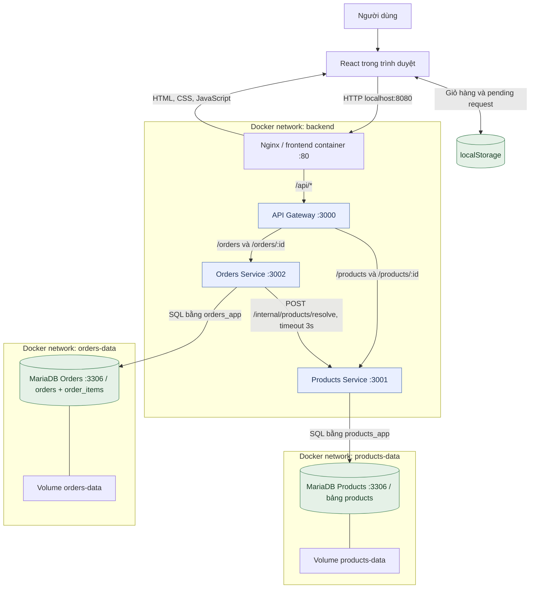

Chỉ `frontend` publish cổng host `127.0.0.1:8080` mặc định. Hai MariaDB đều dùng cổng 3306 **bên trong container khác nhau**, không xung đột MariaDB host. Chỉ Products tham gia network Products DB; chỉ Orders tham gia network Orders DB. `order_items.product_id` là tham chiếu logic, không có foreign key sang Products DB.

## 01 — Xem và tìm kiếm sản phẩm

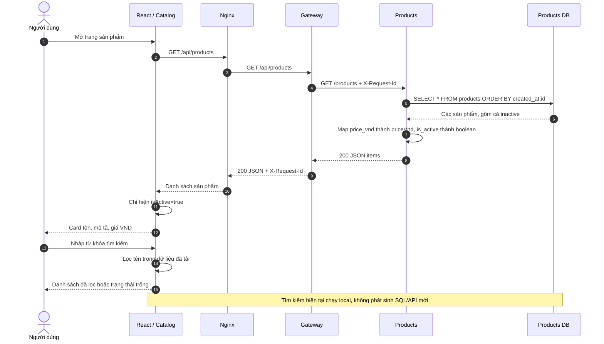

API dùng chung cho catalog và admin. Admin giữ cả sản phẩm ngừng bán. Nếu API lỗi, frontend hiển thị lỗi và nút thử lại. `GET /api/products/:id` cũng có trong backend: Products validate UUID, SELECT theo ID, trả 200 hoặc 404; frontend hiện chưa có màn hình chi tiết sản phẩm riêng.

## 02 — Thêm, sửa số lượng và xóa giỏ hàng

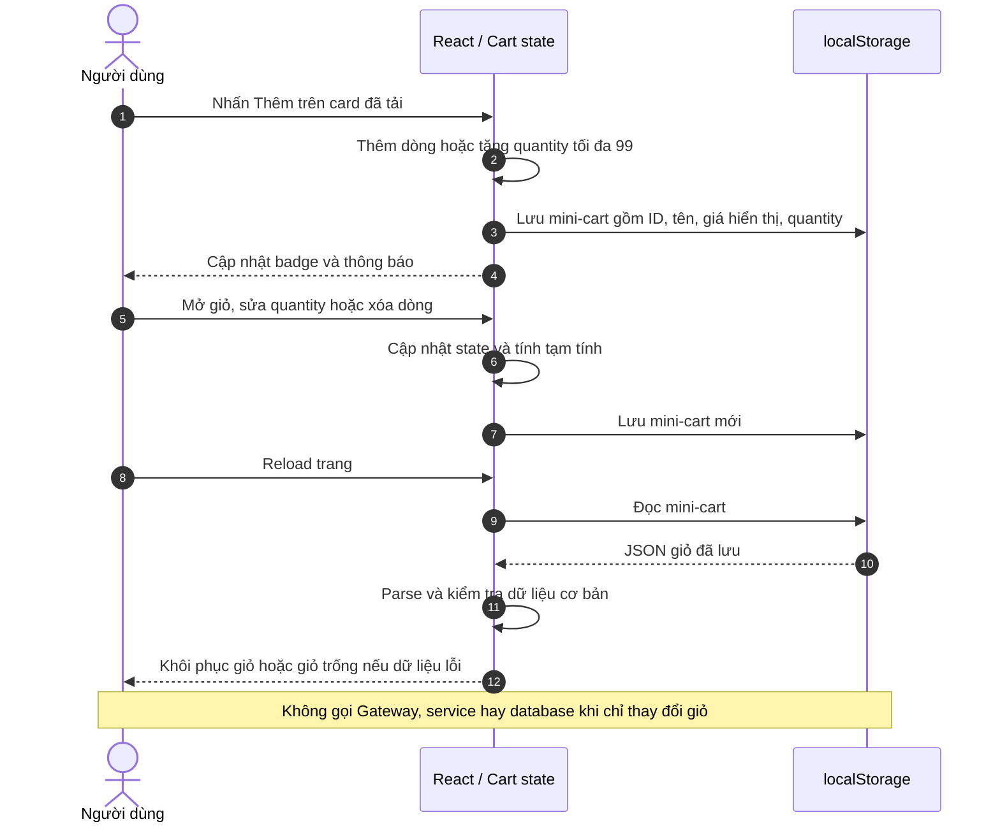

Giá trong giỏ chỉ phục vụ hiển thị; Orders sẽ lấy lại giá từ Products khi đặt hàng. Giỏ chỉ thuộc trình duyệt hiện tại, chưa đồng bộ nhiều thiết bị. Đơn giới hạn 20 dòng sản phẩm khác nhau.

## 03 — Quản trị: tạo sản phẩm

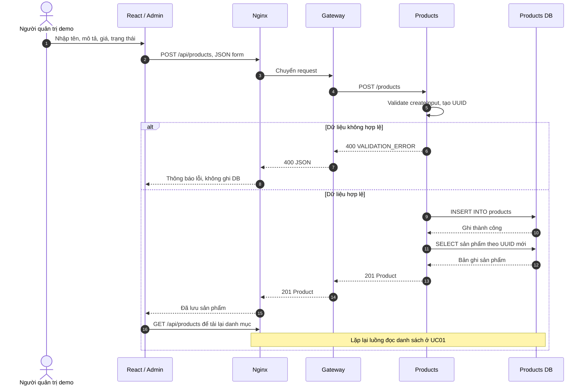

Chỉ Products DB thay đổi; Orders không nhận sự kiện và Orders DB không bị cập nhật. Đây là quản trị demo local, chưa có bước xác thực/kiểm tra role.

## 04 — Quản trị: sửa giá, tên hoặc ngừng bán

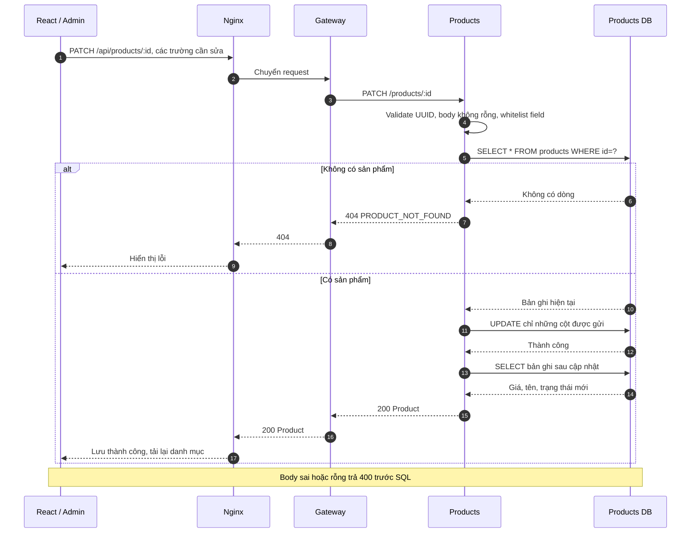

Frontend admin hiện gửi đủ bốn trường; backend PATCH hỗ trợ cập nhật từng phần. `isActive=false` ẩn sản phẩm khỏi catalog sau khi tải lại và khiến checkout mới trả 409 nếu giỏ còn chứa sản phẩm đó. **Đơn đã tạo giữ nguyên snapshot**, vì luồng này không ghi Orders DB. Các SQL của thao tác sửa sản phẩm không được bọc trong một transaction nhiều câu lệnh riêng.

## 05 — Tạo đơn mới thành công: dataflow đầy đủ

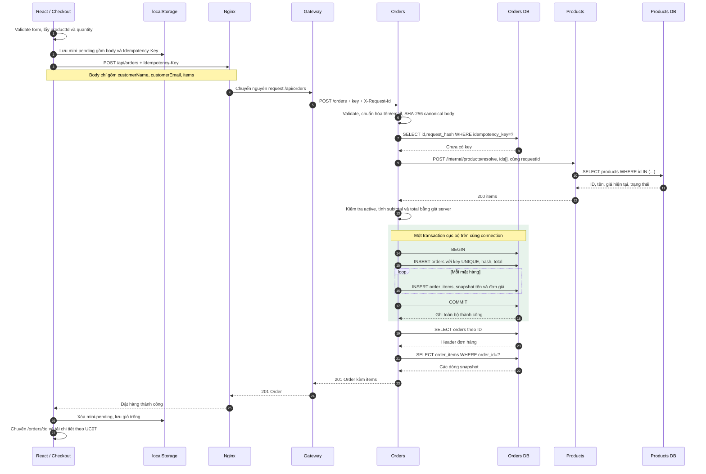

Giá chốt là giá Products trả về tại lần resolve. Orders **chỉ đọc Products qua API**, không trực tiếp truy vấn Products DB. Không có bước trừ tồn kho hay ghi ngược Products. Lời gọi HTTP diễn ra **trước BEGIN**, tránh giữ transaction trong thời gian chờ mạng.

## 06 — Xem danh sách đơn và phân trang

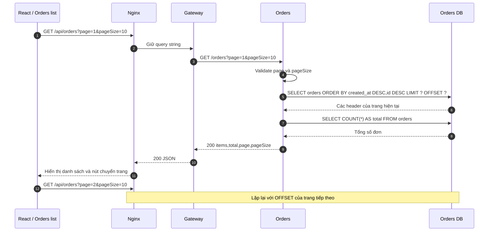

Không đọc `order_items` cho màn hình danh sách; không gọi Products. Hai SELECT danh sách/count không ở cùng transaction snapshot nên có thể lệch nhẹ khi có đơn được tạo đồng thời. Đây là giới hạn của pagination hiện tại, không phải dữ liệu được cache ở Gateway.

## 07 — Xem chi tiết đơn và giá snapshot

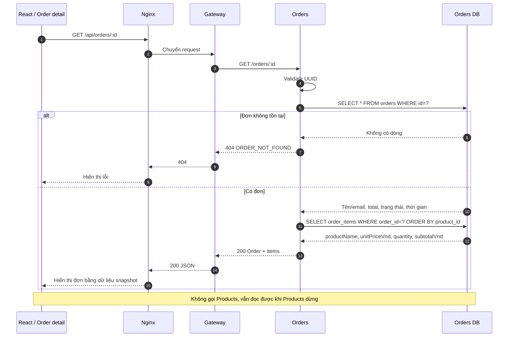

Khi reload trực tiếp `/orders/:id`, Nginx trả `index.html` bằng SPA fallback, React khởi động rồi gọi API như sơ đồ. Đường dẫn trang và đường dẫn `/api/orders/:id` có vai trò khác nhau.

## 08 — Gửi lại đơn sau mất phản hồi: idempotency

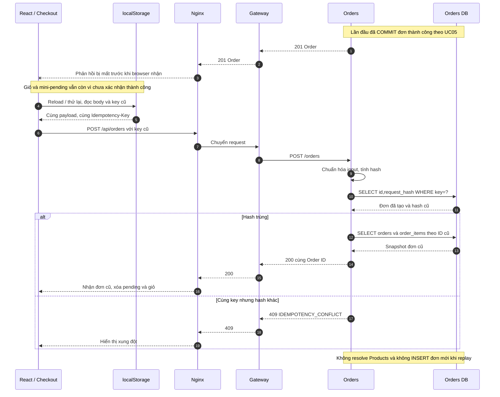

Gateway không tự retry POST. Frontend giữ key khi body không đổi; thay đổi nội dung sẽ sinh key mới. Nhánh 409 cùng key/body khác chủ yếu bảo vệ client khác hoặc request API thủ công. Replay vẫn có thể thành công khi Products đang tắt.

## 09 — Hai yêu cầu tạo đơn đồng thời cùng key

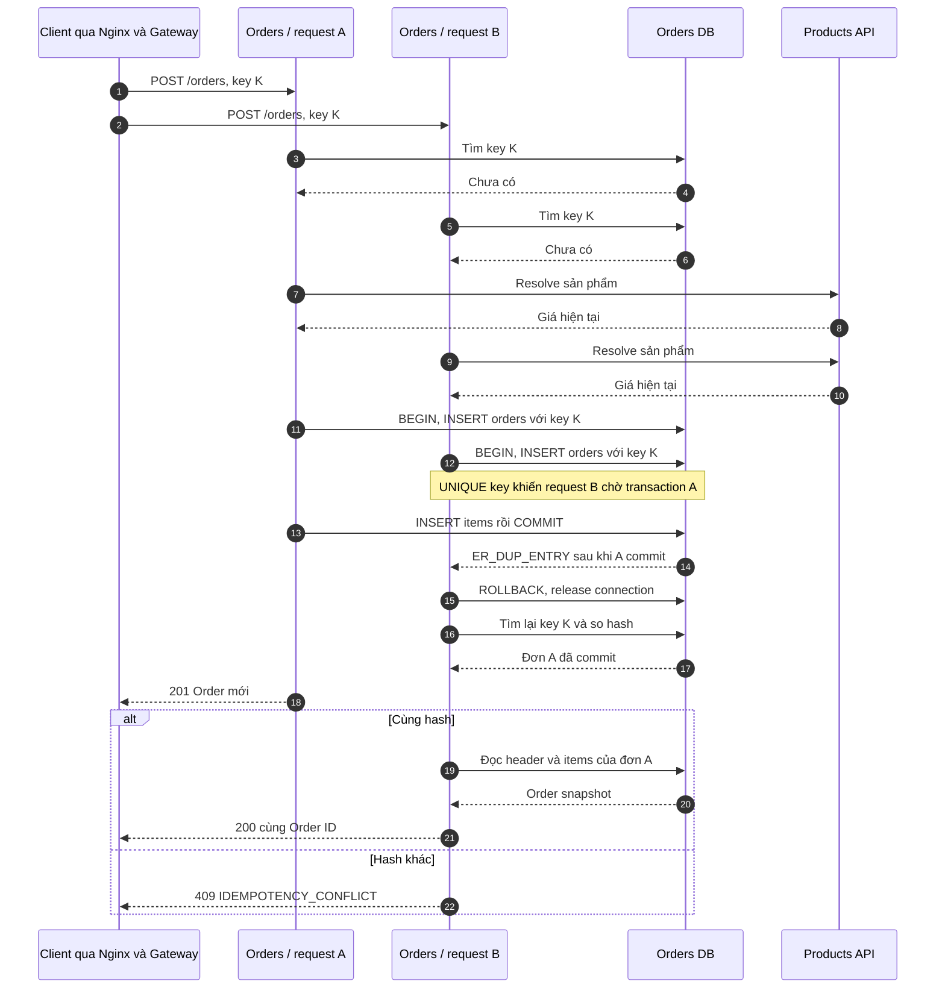

Hai participant Orders là **hai request handler**, không hàm ý có hai container Orders. Sơ đồ minh họa một thứ tự xen kẽ hợp lệ; request thắng không cố định. Trong test, 6 request cùng key tạo đúng một đơn. Nếu A rollback thay vì commit, B có thể tiếp tục insert thành công. Gateway/Nginx được gộp vào client ở sơ đồ này để tập trung vào race database.

## 10 — Checkout lỗi do Products hoặc sản phẩm không hợp lệ

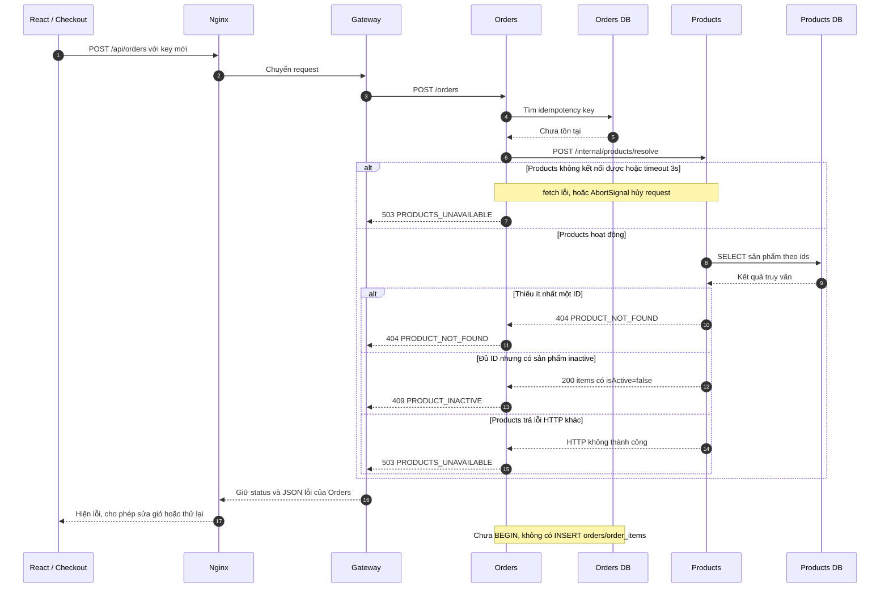

Nhánh này chỉ mô tả các tình huống lỗi; đủ sản phẩm active sẽ đi tiếp UC05. Trường hợp Orders/Gateway không đáp ứng: Gateway có timeout 8 giây và trả `503 SERVICE_UNAVAILABLE`; Nginx chờ upstream 10 giây, ánh xạ 502/504 sang JSON 503. Mất response không chứng minh transaction chưa commit: client phải giữ key để retry an toàn theo UC08.

## 11 — Lỗi ghi item: rollback toàn bộ đơn

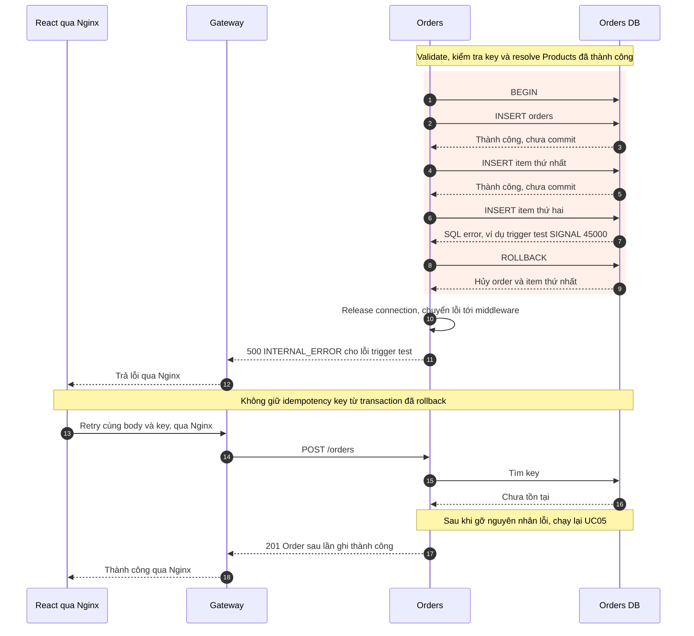

Sơ đồ mô tả lỗi statement **trước COMMIT** và rollback thành công. Lỗi mạng đúng lúc COMMIT có thể khiến client không biết kết quả; retry cùng key vẫn là cách phân giải. Không cần rollback Products DB vì checkout chỉ đọc dữ liệu ở đó. Bài test `verify-transaction.mjs` thực sự chặn item thứ hai, xác nhận số order/item không tăng và sau đó retry thành công.

## 12 — Healthcheck và readiness theo service

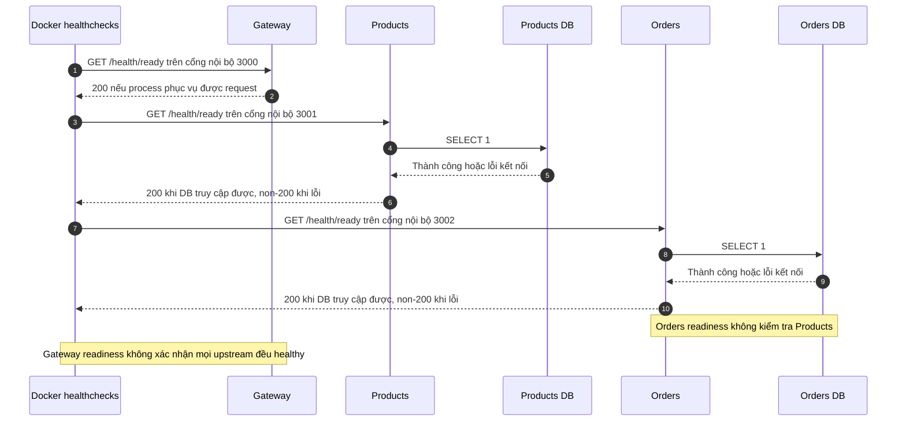

`/health/live` chỉ cho biết process trả lời; `/health/ready` ở service database kiểm tra SELECT 1. Docker healthcheck không đi qua Gateway public. Frontend có healthcheck HTTP `/`; mỗi MariaDB chạy `healthcheck.sh --connect --innodb_initialized`. Khi startup, Compose chờ database healthy rồi service, Gateway, frontend. Thứ tự startup không tạo ra sự phụ thuộc bắt buộc cho mọi use case khi runtime.

## Bảng tóm tắt data ownership theo use case

| Use case | Gateway | Products | Products DB | Orders | Orders DB | localStorage |
|---|---|---|---|---|---|---|
| Xem sản phẩm | Route | Truy vấn/map | Đọc | — | — | — |
| Tìm kiếm sau tải | — | — | — | — | — | — |
| Sửa giỏ | — | — | — | — | — | Đọc/ghi giỏ |
| Tạo/sửa sản phẩm | Route | Validate/ghi | Đọc + ghi | — | — | — |
| Đặt đơn mới | Route | Resolve | Đọc | Validate/tính tiền | Đọc key + ghi transaction + đọc kết quả | Pending + xóa giỏ khi thành công |
| Xem đơn | Route | — | — | Truy vấn snapshot | Đọc | — |
| Replay key đã có | Route | — | — | So hash/trả snapshot | Chỉ đọc | Đọc pending |
| Race key mới | Route | Resolve từng request nếu cần | Đọc | Transaction + replay loser | UNIQUE/commit/rollback | Tùy client |

## Liên kết code và bằng chứng

- [Gateway routing và timeout](../services/gateway/src/index.ts)
- [Products API, SELECT/INSERT/UPDATE](../services/products/src/index.ts)
- [Orders transaction, replay, resolve và truy vấn đơn](../services/orders/src/index.ts)
- [Validation, hash và tính tiền](../services/orders/src/domain.ts)
- [Frontend và localStorage](../frontend/src/main.tsx)
- [Nginx](../frontend/nginx.conf), [Compose](../compose.yaml)
- [Kết quả kiểm thử](VERIFICATION.md)
