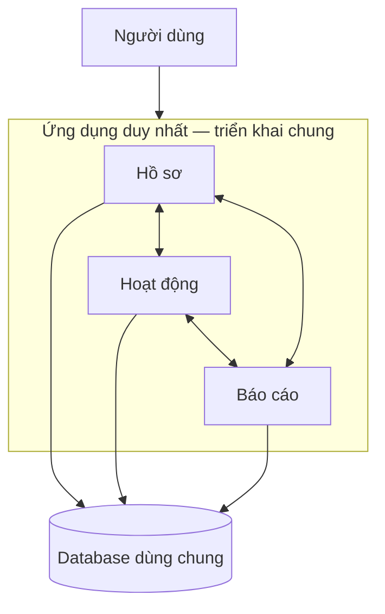
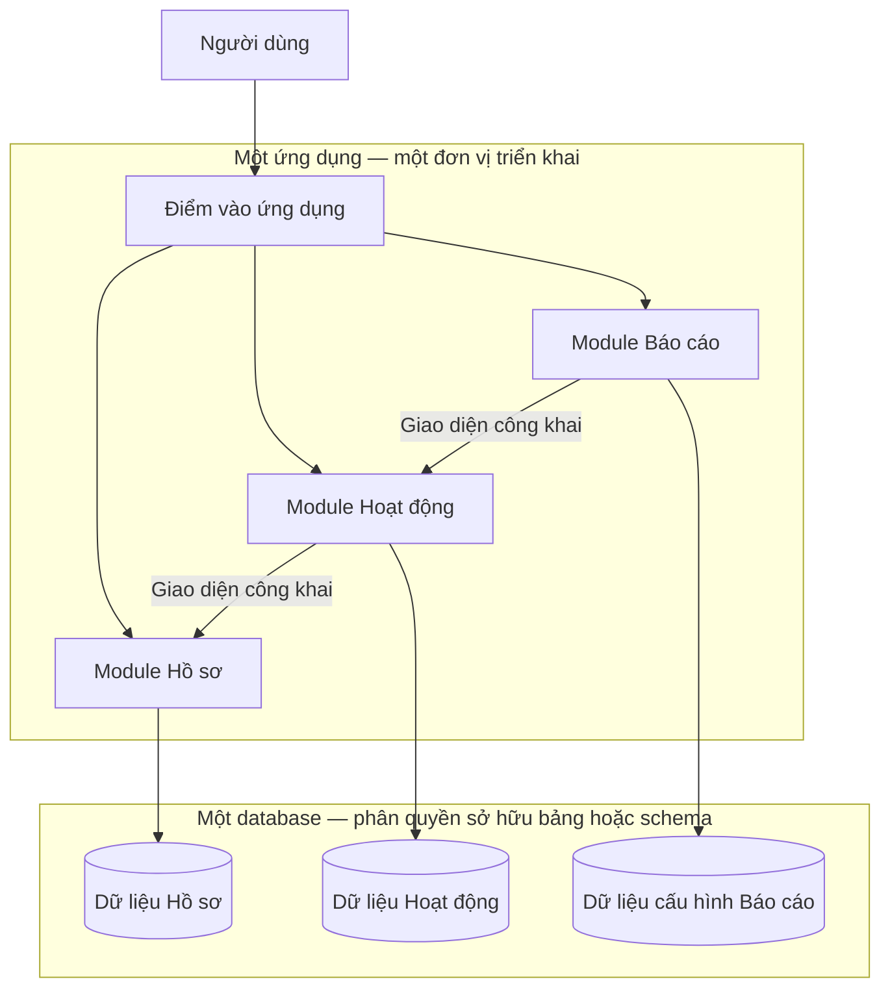
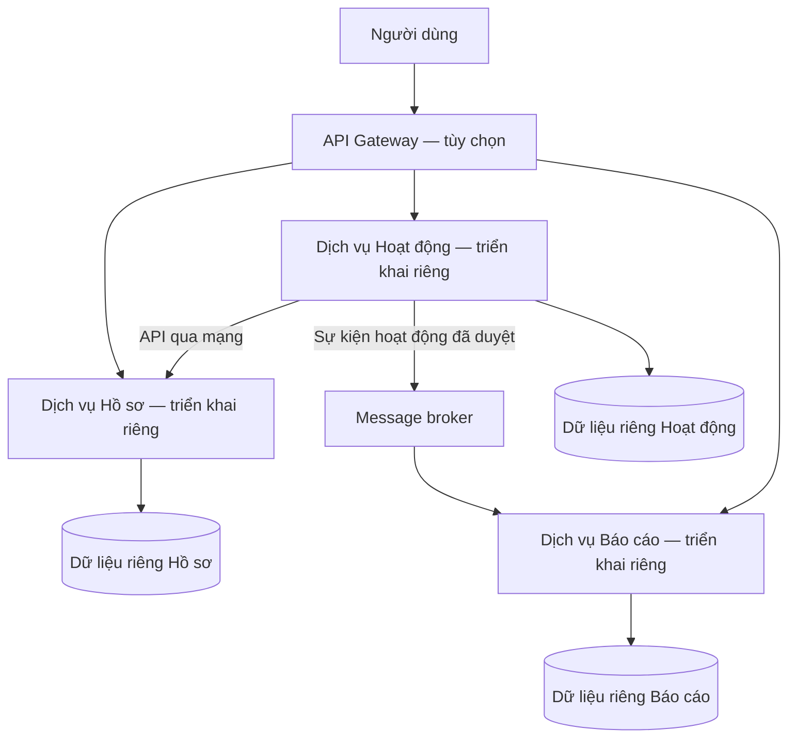

# Báo cáo Topic 1: Monolith vs Modular Monolith vs Microservices

Phạm vi: Topic 1 trong **“Bài tập tại lớp - Kiến trúc phần mềm.html”**, kết hợp yêu cầu chung và gợi ý trình bày của đề. Nội dung dưới đây là bản chuẩn bị báo cáo; nhóm cần kiểm tra, chọn ý đưa lên slide và diễn giải bằng lời của mình theo yêu cầu của giảng viên.

## A. Danh sách công việc và câu hỏi cần trả lời

### 1. Công việc cần thực hiện

- Giải thích ba kiến trúc và vấn đề thiết kế mà chúng giải quyết.
- Trả lời đủ tám câu hỏi của Topic 1.
- Vẽ sơ đồ so sánh ba kiến trúc, thể hiện ranh giới triển khai và cách truy cập dữ liệu.
- Lập bảng so sánh theo đúng bảy tiêu chí tối thiểu của đề.
- Chọn **một hệ thống chung**, mô tả cách tổ chức theo từng kiến trúc.
- Phân tích ưu điểm, nhược điểm, rủi ro và những đánh đổi.
- Kết luận khi nào nên dùng, không nên dùng từng kiến trúc; đề xuất cho MVP và giải thích.
- Chuẩn bị 5–7 slide, ít chữ, có sơ đồ và bảng; trình bày trong 15–20 phút.

### 2. Tám câu hỏi bắt buộc của Topic 1

| Mã | Câu hỏi | Phần trả lời |
|---|---|---|
| Q1 | Monolith là gì? | Slide 2 |
| Q2 | Modular Monolith là gì? | Slide 2 |
| Q3 | Microservices là gì? | Slide 2 |
| Q4 | Monolith khác Modular Monolith ở điểm nào? | Slide 2, 3, 5 |
| Q5 | Modular Monolith khác Microservices ở điểm nào? | Slide 2, 3, 5 |
| Q6 | Vì sao Microservices không phải lúc nào cũng là lựa chọn tốt? | Slide 6 |
| Q7 | Vì sao Modular Monolith thường phù hợp với MVP hoặc hệ thống còn nhỏ? | Slide 7 |
| Q8 | Rủi ro nếu thiết kế Monolith không có module rõ ràng là gì? | Slide 6 |

### 3. Các câu hỏi chung và kết luận phải có

- Kiến trúc giải quyết vấn đề gì? → Slide 1.
- Các thành phần tương tác ra sao? → Slide 3–4.
- Ưu điểm, nhược điểm chính là gì? → Slide 5–6.
- Khi nào nên dùng và không nên dùng từng loại? → Slide 7.
- MVP nên chọn kiến trúc nào, vì sao? → Slide 7.

Đề không cung cấp mẫu báo cáo văn bản cố định. Cấu trúc bảy slide sau bám theo thứ tự gợi ý: vấn đề → khái niệm → sơ đồ → ví dụ → đánh đổi → kết luận. Tổng thời lượng: **19 phút**.

## B. Nội dung báo cáo theo cấu trúc trình bày

### Slide 1 — Vấn đề cần giải quyết (2 phút)

**Câu hỏi chính:** Tổ chức hệ thống thế nào để phát triển nhanh, dễ thay đổi và mở rộng phù hợp với nguồn lực?

Ví dụ xuyên suốt: **ứng dụng quản lý hoạt động giảng viên** có ba nhóm chức năng:

- **Hồ sơ:** quản lý thông tin giảng viên, khoa và bộ môn.
- **Hoạt động:** tạo khai báo, gửi duyệt, duyệt hoặc từ chối hoạt động.
- **Báo cáo:** tổng hợp hoạt động đã duyệt và điểm theo học kỳ.

Giả định để lựa chọn kiến trúc: đây là MVP do một nhóm nhỏ phát triển, yêu cầu còn thay đổi, chưa có bằng chứng cần mở rộng hay triển khai độc lập từng chức năng. Đây là giả định của báo cáo, không phải dữ kiện được đề cung cấp.

Ba kiến trúc đưa ra cách cân bằng khác nhau giữa **đơn giản khi vận hành**, **ranh giới nghiệp vụ rõ ràng** và **khả năng triển khai độc lập**. Không có lựa chọn tốt nhất cho mọi hệ thống.

### Slide 2 — Khái niệm và khác biệt cốt lõi (4 phút)

**Q1. Monolith là gì?**

Ứng dụng được xây dựng và triển khai như một đơn vị. Các chức năng thường chạy chung tiến trình và gọi nhau trực tiếp. Sửa một chức năng thường dẫn đến build và triển khai lại ứng dụng.

Monolith vẫn có thể phân lớp, chia module, chạy nhiều bản sao và dùng nhiều database. “Monolith” không đồng nghĩa với code lộn xộn hay chỉ chạy trên một máy.

**Q2. Modular Monolith là gì?**

Là một dạng monolith được chia thành các module nghiệp vụ có trách nhiệm, giao diện và quyền sở hữu dữ liệu rõ ràng. Module trao đổi qua giao diện công khai, hạn chế phụ thuộc vào chi tiết bên trong của nhau; toàn ứng dụng vẫn triển khai chung. [Tham khảo về ranh giới module](https://milanjovanovic.tech/articles/modular-monolith).

Ví dụ: module Báo cáo gọi giao diện của Hoạt động để lấy danh sách đã duyệt, thay vì tự sửa bảng hoạt động. Chỉ chia thư mục theo tên chức năng chưa đủ nếu code vẫn truy cập tùy tiện vào nội bộ module khác.

**Q3. Microservices là gì?**

Hệ thống gồm các dịch vụ theo năng lực nghiệp vụ, có thể triển khai độc lập. Mỗi dịch vụ quản lý logic và dữ liệu của mình; các dịch vụ giao tiếp qua mạng bằng API hoặc thông điệp. [Microsoft: kiến trúc Microservices](https://learn.microsoft.com/en-us/azure/architecture/microservices/).

**Q4. Monolith khác Modular Monolith ở đâu?**

Khác biệt chính là **mức độ tổ chức và bảo vệ ranh giới bên trong**, không phải số đơn vị triển khai. Trong bài so sánh này, cột “Monolith” chỉ monolith thông thường chưa cưỡng chế ranh giới module nghiệp vụ; Modular Monolith là trường hợp được tổ chức chặt chẽ hơn.

**Q5. Modular Monolith khác Microservices ở đâu?**

Module của Modular Monolith gọi nhau trong cùng ứng dụng và phát hành chung. Microservices có ranh giới tiến trình, giao tiếp qua mạng và phát hành riêng; vì vậy phải xử lý thêm lỗi mạng và phối hợp dữ liệu phân tán.

### Slide 3 — Sơ đồ so sánh ba kiến trúc (4 phút)

Các sơ đồ dùng cùng ba nhóm chức năng. Database được vẽ theo một phương án điển hình, không phải quy định về số máy chủ vật lý.

**1. Monolith thông thường**

Các phần có thể gọi và dùng dữ liệu của nhau khá tự do. Điều này tiện lúc đầu nhưng dễ tạo phụ thuộc khó kiểm soát khi chức năng tăng lên.

**2. Modular Monolith**

Mũi tên giữa module là lời gọi trong tiến trình, không bắt buộc dùng HTTP. Quyền sở hữu dữ liệu được bảo vệ bằng giao diện, quy tắc phụ thuộc và kiểm tra kiến trúc; có thể bổ sung quyền database khi phù hợp. Cả ứng dụng vẫn chia sẻ tài nguyên tiến trình và lịch triển khai.

**3. Microservices**

Sơ đồ chọn sự kiện cho cập nhật báo cáo; Microservices không bắt buộc phải có broker hoặc gateway. Dữ liệu riêng nghĩa là dịch vụ sở hữu và kiểm soát truy cập; có thể dùng chung máy chủ database nhưng tách database/schema và quyền. Truy cập dữ liệu dịch vụ khác qua hợp đồng, không ghi trực tiếp bảng của nhau. [Microsoft: quyền sở hữu dữ liệu theo dịch vụ](https://learn.microsoft.com/en-us/dotnet/architecture/microservices/architect-microservice-container-applications/data-sovereignty-per-microservice).

### Slide 4 — Một hệ thống, ba cách tổ chức (4 phút)

**Tình huống chung:** giảng viên khai báo một hoạt động, trưởng bộ môn duyệt, hệ thống cập nhật báo cáo điểm học kỳ.

| Kiến trúc | Cách tổ chức ứng dụng quản lý hoạt động giảng viên | Luồng duyệt và báo cáo |
|---|---|---|
| Monolith | Một ứng dụng, có thể chia Controller–Service–Repository; các chức năng sử dụng chung mô hình dữ liệu. | Hàm duyệt kiểm tra quyền, đổi trạng thái và lưu database. Báo cáo truy vấn dữ liệu đã duyệt trực tiếp. |
| Modular Monolith | Các module Hồ sơ, Hoạt động, Báo cáo có giao diện riêng; triển khai chung. | Hoạt động kiểm tra quyền, lưu kết quả duyệt. Báo cáo gọi giao diện truy vấn của Hoạt động rồi tổng hợp; không truy cập repository nội bộ của Hoạt động. |
| Microservices | Ba dịch vụ, pipeline triển khai và dữ liệu do từng dịch vụ sở hữu. | Hoạt động lưu kết quả duyệt và bản ghi outbox trong một giao dịch cục bộ. Tiến trình gửi sự kiện từ outbox đến broker; Báo cáo nhận sự kiện và cập nhật dữ liệu tổng hợp riêng. |

**Giải thích ví dụ Microservices:** outbox giúp tránh trường hợp database đã ghi “đã duyệt” nhưng sự kiện bị mất do lỗi giữa bước lưu và gửi. Bên nhận xử lý lặp an toàn theo mã sự kiện, tránh cộng điểm hai lần khi thông điệp được gửi lại. Cần xử lý cả sự kiện hủy duyệt hoặc sửa hoạt động để số liệu không bị sai.

Với cách báo cáo dựa trên sự kiện này, màn hình hoạt động có thể hiện “đã duyệt” trước khi báo cáo cập nhật. Đó là sự đánh đổi của **nhất quán cuối cùng**; không phải mọi thao tác trong Microservices đều bắt buộc có độ trễ dữ liệu. [Microsoft: quản lý dữ liệu giữa các dịch vụ](https://learn.microsoft.com/en-us/azure/architecture/microservices/design/data-considerations).

**Ví dụ thay đổi yêu cầu:** thêm quy tắc tính điểm mới. Monolith có thể cần sửa nhiều nơi nếu logic bị phân tán. Modular Monolith gom thay đổi vào module sở hữu quy tắc nhưng vẫn triển khai toàn ứng dụng. Microservices có thể triển khai riêng dịch vụ liên quan nếu hợp đồng với các dịch vụ khác vẫn tương thích.

### Slide 5 — Bảng so sánh theo đúng mẫu tối thiểu (1,5 phút)

| Tiêu chí | Monolith | Modular Monolith | Microservices |
|---|---|---|---|
| **Cách tổ chức code** | Một ứng dụng; thường chia lớp kỹ thuật, ranh giới nghiệp vụ có thể chưa rõ. | Một ứng dụng chia module nghiệp vụ; giao diện và phụ thuộc được kiểm soát. | Nhiều dịch vụ theo nghiệp vụ; hợp đồng API/thông điệp rõ ràng. Có thể dùng một hoặc nhiều repository. |
| **Cách triển khai** | Build và triển khai toàn ứng dụng. | Build và triển khai toàn ứng dụng dù chỉ đổi một module. | Từng dịch vụ có thể build, triển khai và quay lui phiên bản riêng, trong giới hạn tương thích hợp đồng và dữ liệu. |
| **Database** | Thường dùng chung; một database không phải điều kiện bắt buộc. | Thường dùng chung hạ tầng database, phân quyền sở hữu bảng/schema theo module. | Dữ liệu do từng dịch vụ sở hữu; không bắt buộc mỗi dịch vụ có một máy chủ database riêng. |
| **Độ phức tạp** | Khởi đầu và vận hành đơn giản; phụ thuộc code có thể tăng khó kiểm soát. | Vận hành tương đối đơn giản; cần công sức thiết kế và giữ ranh giới module. | Phức tạp hơn về mạng, triển khai, giám sát và phối hợp dữ liệu. |
| **Khả năng bảo trì** | Dễ với ứng dụng nhỏ; khó khi logic đan xen. | Thay đổi và kiểm thử theo module thuận lợi nếu giữ đúng ranh giới. | Thuận lợi trong từng dịch vụ; thay đổi xuyên dịch vụ và kiểm thử tích hợp khó hơn. |
| **Khả năng mở rộng** | Tăng tài nguyên hoặc chạy thêm bản sao toàn ứng dụng; cần xử lý trạng thái dùng chung. | Tương tự Monolith; thường chưa mở rộng tài nguyên riêng từng module. | Có thể tăng số bản sao cho dịch vụ cần tải cao; hiệu quả vẫn phụ thuộc database và luồng gọi. |
| **Phù hợp với MVP không?** | Có, nhất là bản thử nghiệm rất nhỏ hoặc ngắn hạn. | Có, thường hợp lý khi MVP có nhiều nghiệp vụ và dự kiến phát triển tiếp. | Thường chưa cần với nhóm nhỏ; phù hợp nếu có nhu cầu độc lập rõ ràng và năng lực vận hành sẵn. |

### Slide 6 — Ưu điểm, nhược điểm và rủi ro (1,5 phút)

| Kiến trúc | Ưu điểm chính | Nhược điểm / đánh đổi |
|---|---|---|
| Monolith | Ít thành phần vận hành; dễ theo dõi luồng gọi; giao dịch dữ liệu tập trung thuận tiện. | Mọi chức năng chung vòng đời triển khai; lỗi nghiêm trọng trong tiến trình có thể ảnh hưởng toàn ứng dụng. |
| Modular Monolith | Ranh giới nghiệp vụ rõ nhưng vẫn giữ triển khai đơn giản; dễ khoanh vùng logic thay đổi. | Phải duy trì kỷ luật module; vẫn dùng chung tiến trình, tài nguyên và lịch phát hành. |
| Microservices | Triển khai và mở rộng từng dịch vụ; các nhóm có thể sở hữu dịch vụ tương đối độc lập. | Tăng chi phí vận hành và kiểm thử; lỗi mạng và phụ thuộc chuỗi có thể gây lỗi lan truyền nếu thiếu cơ chế bảo vệ. |

**Q6. Vì sao Microservices không phải lúc nào cũng tốt?**

Với ví dụ này, một thao tác duyệt đơn giản có thể kéo theo API, broker, xử lý gửi lại và đồng bộ báo cáo. Nhóm phải dành thời gian cho giám sát, truy vết và khôi phục lỗi thay vì chỉ phát triển nghiệp vụ. Khi chưa cần phát hành hay mở rộng riêng, lợi ích có thể không bù chi phí. Tách dịch vụ sai ranh giới còn khiến một thay đổi phải sửa và phát hành nhiều dịch vụ cùng lúc. [Microsoft: lợi ích và thách thức](https://learn.microsoft.com/en-us/azure/architecture/microservices/).

**Q8. Monolith không có module rõ ràng gặp rủi ro gì?**

- Logic kiểm tra và tính điểm bị lặp ở nhiều nơi, dễ cho kết quả không nhất quán.
- Thay đổi bảng hoặc hàm dùng chung có thể làm hỏng chức năng tưởng như không liên quan.
- Khó kiểm thử riêng từng nghiệp vụ vì phụ thuộc chéo và phụ thuộc vòng.
- Nhiều người sửa cùng vùng code gây xung đột; người mới khó xác định nơi cần thay đổi.
- Nếu cần tách dịch vụ sau này, phải tháo gỡ cả phụ thuộc code lẫn dữ liệu.

### Slide 7 — Khi nào dùng và đề xuất cho MVP (2 phút)

| Kiến trúc | Khi nào nên dùng? | Khi nào không nên ưu tiên? |
|---|---|---|
| Monolith thông thường | Prototype, công cụ nội bộ nhỏ, nghiệp vụ đơn giản, cần kiểm chứng ý tưởng nhanh. | Hệ thống dài hạn nhiều nghiệp vụ mà code đã phụ thuộc chéo; nên củng cố ranh giới module. |
| Modular Monolith | Nhóm nhỏ hoặc vừa, nghiệp vụ có thể chia module, muốn bảo trì tốt với vận hành đơn giản. Có thể dùng lâu dài nếu đáp ứng yêu cầu. | Có yêu cầu thực tế về triển khai, mở rộng hoặc cô lập lỗi độc lập mà một tiến trình chung không đáp ứng được. |
| Microservices | Nhiều nhóm cần phát hành riêng; tải giữa các nghiệp vụ khác biệt rõ; có năng lực tự động hóa triển khai và vận hành hệ thống phân tán. | MVP đơn giản, nhóm ít người, ranh giới nghiệp vụ còn biến động, chưa có nhu cầu độc lập đủ mạnh. |

**Q7 và đề xuất MVP:** Với các giả định ở Slide 1, nhóm đề xuất **Modular Monolith** cho ứng dụng quản lý hoạt động giảng viên.

Lý do: Hồ sơ, Hoạt động và Báo cáo đã có trách nhiệm tương đối rõ; chia module giúp tránh trộn logic ngay từ đầu. Một đơn vị triển khai giảm công vận hành và giúp nhóm nhỏ phát triển nhanh. Các lời gọi nội bộ thuận tiện hơn cho việc thay đổi yêu cầu ở giai đoạn MVP.

Cách áp dụng vừa đủ: ba module, giao diện công khai rõ ràng, mỗi module sở hữu dữ liệu của mình, một pipeline triển khai; kiểm tra phụ thuộc để ngăn truy cập vào nội bộ module khác. Không cần mô phỏng mọi cơ chế của hệ thống phân tán trong MVP.

Nếu sau này Báo cáo có tải lớn và cần phát hành riêng, có thể cân nhắc tách module này thành dịch vụ trước. Cần đo tải và chi phí phối hợp trước khi quyết định. Việc tách không tự động: vẫn phải xử lý hợp đồng, chuyển dữ liệu, lỗi mạng và tính nhất quán.

**Kết luận trình bày:** Chọn Monolith để đơn giản hóa một bài toán nhỏ; chọn Modular Monolith để giữ ranh giới nghiệp vụ trong một ứng dụng; chọn Microservices khi lợi ích của triển khai và mở rộng độc lập đủ lớn để bù chi phí phân tán. Với MVP đang xét, Modular Monolith là lựa chọn cân bằng.

## C. Đối chiếu yêu cầu trước khi trình bày

| Yêu cầu / tiêu chí đánh giá | Nội dung đã chuẩn bị |
|---|---|
| Hiểu đúng khái niệm — 2 điểm | Slide 2; làm rõ Modular Monolith là một dạng Monolith. |
| Giải thích vấn đề kiến trúc giải quyết — 2 điểm | Slide 1; tốc độ phát triển, bảo trì và mở rộng. |
| Sơ đồ rõ ràng — 2 điểm | Slide 3; ba sơ đồ có ranh giới triển khai và dữ liệu. |
| Ví dụ cụ thể — 2 điểm | Slide 4; cùng một ứng dụng và cùng luồng duyệt hoạt động. |
| Ưu, nhược điểm, đánh đổi — 1 điểm | Slide 5–6; bảng đủ bảy tiêu chí bắt buộc. |
| Rõ ràng, đúng thời lượng — 1 điểm | Dàn ý bảy slide, dự kiến 19 phút; cần diễn tập thực tế. |

Khi làm slide, đưa các ý chính và hình lên màn hình; dùng phần diễn giải của báo cáo làm lời thuyết trình. Các sơ đồ Mermaid có thể xuất thành hình để chèn vào slide. Điểm số trên là trọng số của đề, không phải điểm tự chấm.
