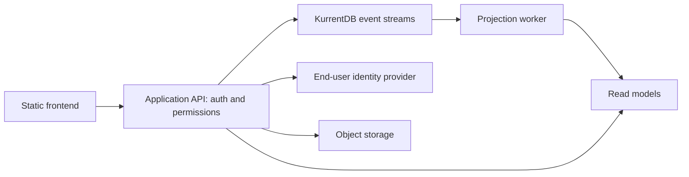

# KurrentDB Docker evaluation and migration plan

This stack builds ScriptHammer's static frontend and runs a separate KurrentDB
node. **The app does not use KurrentDB yet.** Its existing Supabase integrations
and data are unchanged. No local Node.js, pnpm, .NET SDK, or database installation
is required.

## Run

From the repository root:

```bash
docker compose -p scripthammer-kurrent -f docker-compose.kurrent.yml pull kurrentdb
docker compose -p scripthammer-kurrent -f docker-compose.kurrent.yml build web
docker compose -p scripthammer-kurrent -f docker-compose.kurrent.yml up -d --wait
docker compose -p scripthammer-kurrent -f docker-compose.kurrent.yml ps
bash scripts/smoke-kurrentdb.sh
```

- Web: <http://localhost:8080>
- KurrentDB UI and HTTP/gRPC endpoint: <http://localhost:2113>
- Future backend connection inside this Compose network:
  `kurrentdb://kurrentdb:2113?tls=false`
- Host-side SDK connection: `kurrentdb://localhost:2113?tls=false`

The smoke script writes one uniquely named synthetic stream and verifies its
event payload. It uses curl inside the DB container, with no local SDK.

Ports bind to loopback. This DB configuration disables TLS and authentication for
local evaluation. A production deployment needs TLS, credentials, stream access
controls, backups and restore verification. The single node has no HA failover.

Data and logs live in named Docker volumes. Stop without deleting data:

```bash
docker compose -p scripthammer-kurrent -f docker-compose.kurrent.yml down
```

Use `KURRENT_APP_PORT` and `KURRENTDB_PORT` to change host ports. If the app origin
changes, also set `KURRENT_APP_ORIGIN` before building; sitemap and browser
configuration are generated at build time. For example:

```bash
KURRENT_APP_PORT=8081 KURRENT_APP_ORIGIN=http://localhost:8081 \
  docker compose -p scripthammer-kurrent -f docker-compose.kurrent.yml up -d --build --wait
```

Compose reads the existing `.env` for public Supabase build arguments. Only
`NEXT_PUBLIC_SUPABASE_URL` and `NEXT_PUBLIC_SUPABASE_ANON_KEY` are passed through.
Without those, the frontend still renders, but backend features are unavailable.
Service-role keys and DB credentials must never be frontend build arguments.
Changing public configuration requires rebuilding the web image.

The web image contains Nginx and the generated `out/` files. It does not run
`next start`: this project uses `output: 'export'`. Its build runs in a separate
image filesystem, away from the existing development server's `.next` directory.

If this machine already has the project's development image, reuse its toolchain
to avoid downloading another Node image:

```bash
docker compose -p scripthammer-kurrent -f docker-compose.kurrent.yml build \
  --build-arg BUILD_IMAGE=scripthammer-scripthammer web
```

Always pass `-p scripthammer-kurrent`: an existing `COMPOSE_PROJECT_NAME` in `.env`
overrides the Compose file's `name` and could otherwise share development resources.

The default build uses `node:22-bookworm-slim`; the existing development Dockerfile
and `docker-compose.yml` remain the development workflow.

## Free edition

The tested registry image reports **KurrentDB 26.1.1**. Compose pins its digest;
it does not silently follow future `latest` releases. Licensing changes in 26.2
are included below for upgrade planning.

Kurrent's documentation says a single-node self-hosted deployment is free and
does not need a license key. Starting with 26.2, multi-node clustering requires
an Enterprise license. Archiving and encryption at rest also require Enterprise;
verify the feature matrix for the exact image version you deploy. This is a
self-hosted installation, not a promise of free managed cloud hosting.

Sources:

- [Docker installation and configuration](https://docs.kurrent.io/server/v26.2/quick-start/installation)
- [Version-specific licensing explanation](https://kurrentdb.kurrent.io/blog/licensing-in-kurrentdb-v26-2-and-beyond-what-s-free-and-what-s-licensed/)

## Why changing a connection string is insufficient

KurrentDB stores ordered event streams. It is not a PostgreSQL-compatible server
and does not implement the Supabase client API. In this repository:

- `src/contexts/AuthContext.tsx` and `src/lib/auth/` use Supabase Auth.
- Messaging services use tables, RPCs, RLS, and Supabase subscriptions.
- `src/services/messaging/providers/` offers Supabase and .NET adapters, but the
  .NET API still uses EF Core/Npgsql against the same PostgreSQL schema.
- Payments, administration, profile uploads, encryption keys and GDPR workflows
  also call Supabase directly.
- Payment secrets/webhooks currently live in Supabase Edge Functions.

KurrentDB's own authentication protects the database. The application still needs
an end-user identity provider, session handling, password reset and OAuth flows.

## Suggested migration



1. **Pilot messaging behind the existing provider interface.** Keep Supabase Auth
   during the pilot. Implement API operations for conversations and messages with
   KurrentDB's server SDK. Browser clients call the API; they never receive DB
   credentials. Reuse the existing .NET endpoint contract where practical.
2. **Model events and read views.** Examples: `ConversationCreated`,
   `MemberAdded`, `MessageSent`, `MessageEdited`, `MessageDeleted`. Preserve the
   client-generated message ID, encrypted payloads and key versions. Use expected
   stream revisions for concurrent writes. Choose explicit read models for inbox
   listing, profile search and admin reports; KurrentDB queries do not replace
   all existing relational joins and RLS policies automatically.
3. **Preserve behavior before switching reads.** Enforce authorization in the API,
   then test membership, sender-only edits and their time window, message
   ordering, retries/idempotency, offline sync and group key rotation. Existing
   provider conformance tests are a starting point. Deliver updates through an
   authenticated WebSocket/SSE gateway or polling.
4. **Import and cut over deliberately.** Define event schemas and versioning,
   import a copy of representative existing records with stable IDs, replay
   projections, compare counts/content and test concurrent writes. Use an outbox
   or another explicit handoff protocol if old and new stores run in parallel.
   Keep a rollback route until the pilot passes.
5. **Replace remaining Supabase services separately.** Pick an identity provider
   and object store, migrate profiles/connections/keys, move payment webhooks and
   administration behind the API, and replace direct Supabase calls. Define
   deletion/retention for immutable events before moving personal data; store
   sensitive content externally or design encryption-key deletion as appropriate.

Pilot acceptance: the same user-visible messaging contract passes against the
new API, old data is accounted for, replay rebuilds read models, and backups can
be restored. Only then expand the migration to the rest of the application.
