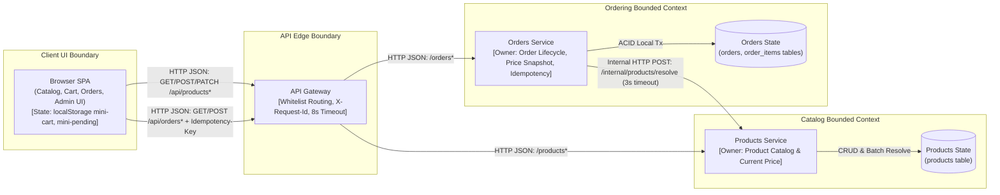
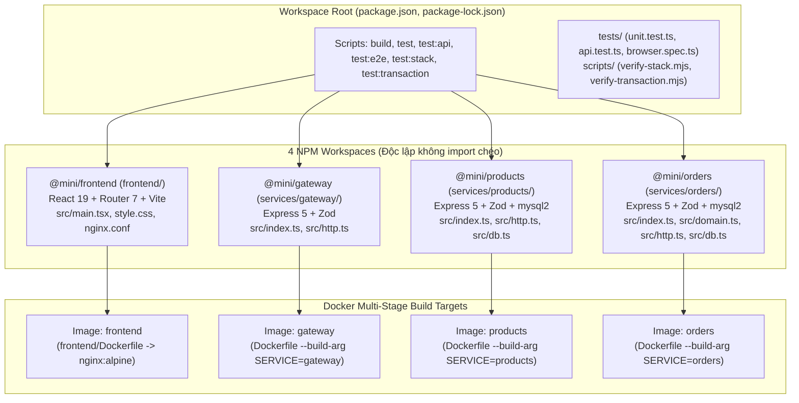
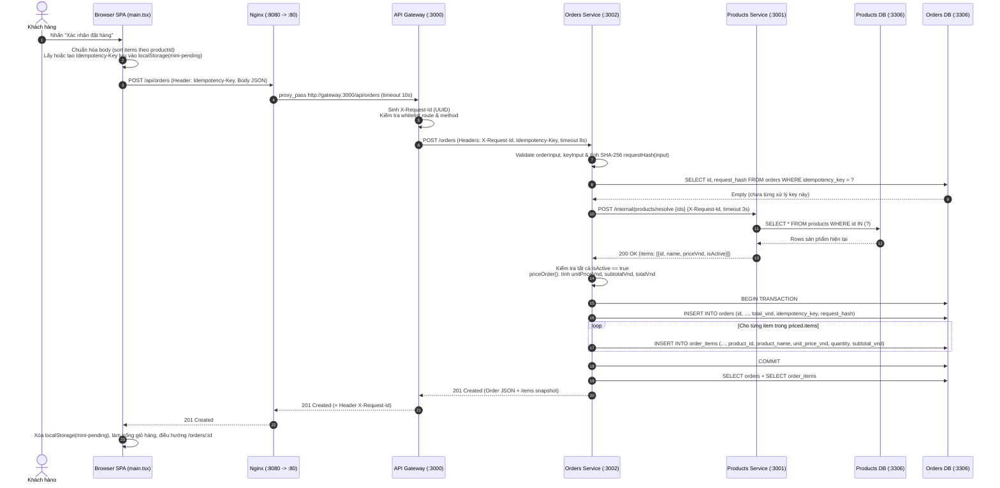
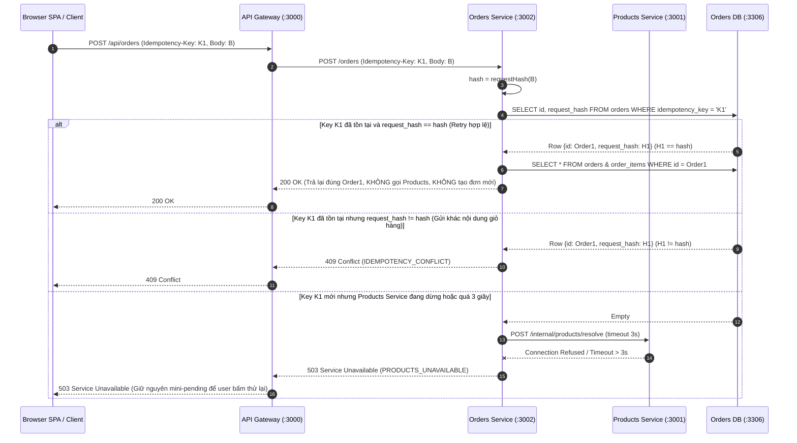
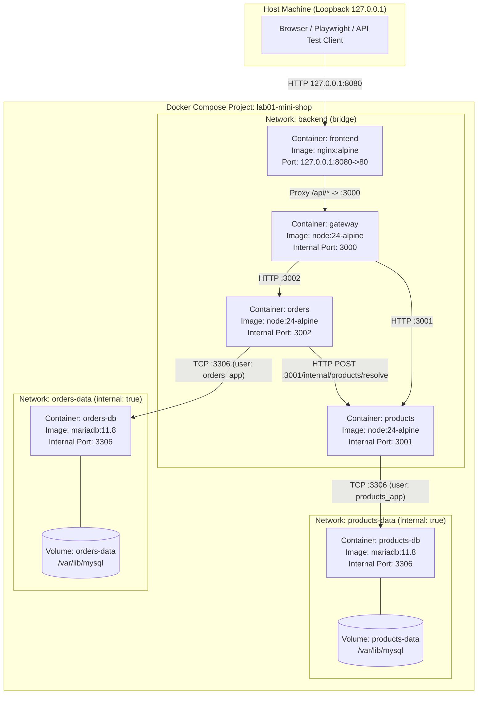
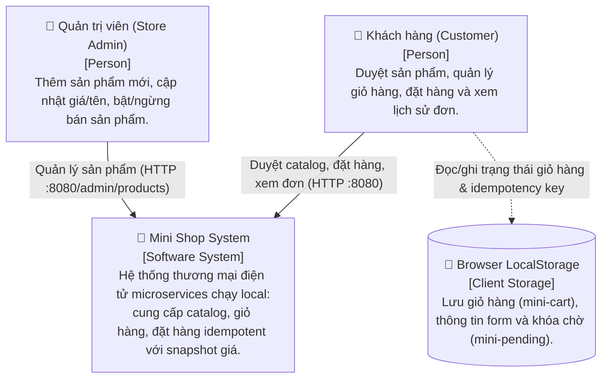
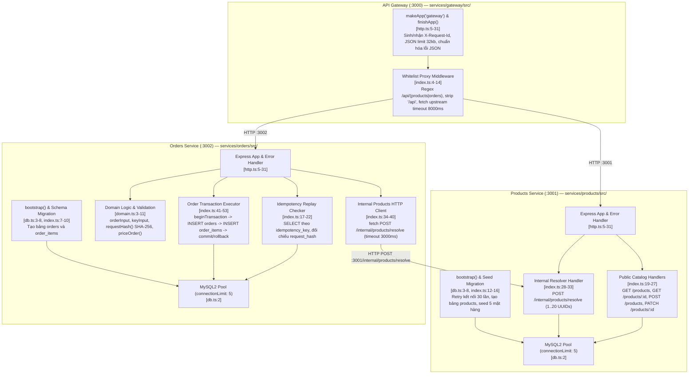
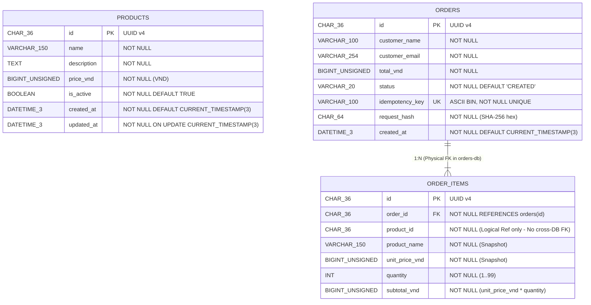

# 01 — Kiến thức áp dụng: 4+1 View Model, C4 Model & Data Model (Mini Shop)

Tài liệu này trình bày cơ sở lý thuyết **Architecture Representation** và áp dụng trực tiếp vào hệ thống **Mini Shop** (`topics/02-architecture-representation/projects/mini-shop/source/`), bao gồm:
1. Phân biệt Stakeholder, Concern, View, Notation và C4 Zoom Level.
2. Mô hình **4+1 View Model** (Logical, Development, Process, Physical/Deployment, +1 Scenarios).
3. Mô hình **C4 Model** (Level 1 Context, Level 2 Container, Level 3 Component, Level 4 Code).
4. **Database Schema / Data Model**: Database-per-service, Price Snapshot và Idempotency Key.

---

## 0. Nền tảng: View vs. Notation/UML vs. C4 Zoom Level

Trước khi đi vào các sơ đồ, cần phân biệt rõ 3 khái niệm thường bị nhầm lẫn khi biểu diễn kiến trúc:

| Khái niệm | Định nghĩa | Ví dụ trong Mini Shop | Lưu ý khi vấn đáp |
|---|---|---|---|
| **View (Góc nhìn kiến trúc)** | Cách biểu diễn một phần hệ thống nhằm giải quyết một tập **Concerns (mối quan tâm)** của một nhóm **Stakeholders** cụ thể (ISO/IEC/IEEE 42010). | Logical View, Process View, Development View, Deployment View, Security/Concurrency View. | **4 biểu đồ UML KHÔNG PHẢI là 4 Views**. Một View có thể dùng nhiều loại sơ đồ + bảng + lời giải thích. |
| **Notation / Diagram (Ký hiệu biểu diễn)** | Ngôn ngữ/công cụ hình học dùng để vẽ một View. | Boxes and Arrows, UML Sequence Diagram, ER Diagram, Mermaid Flowchart. | Mọi hộp và mũi tên phải có **legend**, **nhãn giao thức (HTTP/SQL)**, **hướng gọi** và **diễn giải bằng chữ**. |
| **C4 Zoom Level (Cấp độ phóng đại)** | Cách phân rã cấu trúc tĩnh theo 4 độ thu phóng từ tổng quan đến chi tiết (Simon Brown): Context $\rightarrow$ Container $\rightarrow$ Component $\rightarrow$ Code. | L1: Mini Shop System; L2: 6 Docker containers + SPA; L3: Modules trong Gateway/Products/Orders; L4: Functions/Types/Tables. | C4 mạnh về cấu trúc tĩnh theo độ phóng đại, nhưng **không tự thay thế** Process View (concurrency/timeout), Deployment View chi tiết hay Data Schema. |

### Ma trận Stakeholder & Concern (Stakeholder/Concern Matrix)

| Stakeholder | Mối quan tâm chính (Concerns) | View giải quyết |
|---|---|---|
| **Khách hàng (Customer)** | Duyệt sản phẩm nhanh, đặt hàng không bị trừ/tạo đơn trùng khi mạng chập chờn, xem lại đơn cũ đúng giá lúc mua. | Logical View, Process View (+1 Scenarios). |
| **Quản trị viên (Store Admin)** | Thêm/sửa giá sản phẩm, ngừng kinh doanh mặt hàng mà không làm sai lệch lịch sử đơn hàng đã bán. | Logical View, Data Model (Price Snapshot). |
| **Lập trình viên (Developer)** | Ranh giới module/package, hướng phụ thuộc (dependency direction), contract API/DB, dễ build/test độc lập từng service. | Development View, C4 Level 3 & Level 4, Component Mapping. |
| **Kỹ sư vận hành (Operator / DevOps)** | Cấu trúc container, port public vs internal, cô lập mạng (network isolation), healthcheck, volume lưu trữ và khả năng deploy/khôi phục độc lập. | Physical/Deployment View, C4 Level 2, Runbook. |
| **Kiến trúc sư / Giảng viên đánh giá** | Sự nhất quán giữa sơ đồ và code thật, tính đúng đắn của giao dịch phân tán, xử lý lỗi/timeout (fault isolation) và các đánh đổi (trade-offs). | Toàn bộ 4+1 Views, Security & Concurrency View, Trade-offs. |

---

## PHẦN 1: 4+1 VIEW MODEL (Kruchten) ÁP DỤNG VÀO MINI SHOP

Mô hình **4+1 View Model** của Philippe Kruchten tổ chức kiến trúc thành 4 góc nhìn chính và dùng các kịch bản (**+1 Scenarios**) làm chất keo kết nối xuyên suốt.

---

### 1.1. Logical View (Góc nhìn Logic / Chức năng nghiệp vụ)

* **Mối quan tâm:** Hệ thống cung cấp những năng lực nghiệp vụ (functional capabilities) nào? Trách nhiệm (responsibility), ranh giới miền (domain ownership) và hợp đồng giao tiếp (API contract) giữa các khối chức năng ra sao?
* **Diễn giải kiến trúc:**
  * Hệ thống chia thành 2 miền nghiệp vụ độc lập (**Catalog/Products Domain** và **Order Management Domain**), đứng sau một **API Gateway** và giao diện **Browser SPA**.
  * **Products Domain** sở hữu vòng đời và giá niêm yết hiện tại của sản phẩm.
  * **Orders Domain** sở hữu vòng đời đơn hàng, thông tin người mua, tính toán tổng tiền, khóa chống trùng (`Idempotency-Key`) và bản chụp giá tại thời điểm mua (`OrderItem Snapshot`).
  * Giao tiếp giữa Client $\rightarrow$ Gateway và Gateway $\rightarrow$ Services là **HTTP/JSON đồng bộ**. Khi tạo đơn, `Orders` gọi trực tiếp `Products` qua endpoint nội bộ `POST /internal/products/resolve` (không vòng lại qua Gateway).



---

### 1.2. Development View (Góc nhìn Phát triển / Tổ chức mã nguồn & Build)

* **Mối quan tâm:** Mã nguồn được chia thành các workspace/package như thế nào? Hướng phụ thuộc lúc compile/build ra sao? Làm sao tránh coupling mã nguồn giữa các microservice?
* **Diễn giải kiến trúc:**
  * Dự án sử dụng **npm workspaces** (`package.json` gốc khai báo `"workspaces": ["frontend", "services/*"]`), gồm 4 package độc lập: `@mini/frontend`, `@mini/gateway`, `@mini/products`, `@mini/orders`.
  * **Shared-nothing code ở tầng runtime:** Các service backend **không import chung một shared internal package** lúc runtime; mỗi service tự đóng gói `http.ts` và `db.ts` riêng cùng `tsconfig.json` riêng. Nhờ vậy, thay đổi ở một service không vô tình làm hỏng build hoặc ép buộc redeploy service khác.
  * **Multi-stage Docker build:**
    * `frontend/Dockerfile`: Stage 1 (`node:24-alpine`) chạy `npm ci` và `npm run build --workspace=@mini/frontend` tạo static bundle `frontend/dist`; Stage 2 (`nginx:alpine`) chỉ copy `nginx.conf` và `dist/`.
    * `Dockerfile` gốc (cho 3 backend): Nhận build arg `ARG SERVICE` (`gateway` | `products` | `orders`), biên dịch TypeScript sang `services/${SERVICE}/dist/index.js`, chạy `npm prune --omit=dev` và đóng gói image runtime chạy dưới quyền user không đặc quyền `USER node`.



| Workspace Package | Thư mục nguồn | Dependencies chính | Điểm vào biên dịch (`dist/`) | Docker Build Context & Arg |
|---|---|---|---|---|
| `@mini/frontend` | `frontend/` | `react`, `react-dom`, `react-router-dom`, `vite` | `frontend/dist/index.html` + assets | `frontend/Dockerfile` |
| `@mini/gateway` | `services/gateway/` | `express`, `zod` | `services/gateway/dist/index.js` | `Dockerfile` (`SERVICE=gateway`) |
| `@mini/products` | `services/products/` | `express`, `mysql2`, `zod` | `services/products/dist/index.js` | `Dockerfile` (`SERVICE=products`) |
| `@mini/orders` | `services/orders/` | `express`, `mysql2`, `zod` | `services/orders/dist/index.js` | `Dockerfile` (`SERVICE=orders`) |

---

### 1.3. Process View (Góc nhìn Tiến trình / Runtime, Concurrency, Timeout & Transaction)

* **Mối quan tâm:** Các tiến trình (processes) giao tiếp đồng bộ/bất đồng bộ ra sao? Timeout ở từng chặng là bao nhiêu? Ranh giới Transaction và xử lý đồng thời (concurrency / race condition) hoạt động thế nào?
* **Diễn giải kiến trúc:**
  1. **Chuỗi Timeout phân tầng (Layered Timeouts):**
     * Nginx $\rightarrow$ Gateway: `proxy_read_timeout 10s` (`frontend/nginx.conf:10`).
     * Gateway $\rightarrow$ Products/Orders: `AbortSignal.timeout(8000)` — 8 giây (`services/gateway/src/index.ts:11`).
     * Orders $\rightarrow$ Products (`/internal/products/resolve`): `AbortSignal.timeout(3000)` — 3 giây (`services/orders/src/index.ts:35`).
     * *Ý nghĩa:* Timeout trong phải nhỏ hơn timeout ngoài ($3\text{s} < 8\text{s} < 10\text{s}$) để `Orders` kịp bắt lỗi khi `Products` treo và trả về mã `503 PRODUCTS_UNAVAILABLE` có cấu trúc trước khi Gateway hoặc Nginx cắt kết nối thô.
  2. **Quản lý kết nối & Concurrency:**
     * Mỗi service DB (`products`, `orders`) khởi tạo một `mysql.createPool` với `connectionLimit: 5`, `connectTimeout: 2000` (`db.ts:2`).
     * Khi có 2 request đặt hàng gửi đồng thời cùng một `Idempotency-Key`, nếu cả hai cùng vượt qua bước `SELECT` kiểm tra ban đầu (`replay()`), cả hai sẽ mở transaction và `INSERT INTO orders`. Ràng buộc `UNIQUE` trên cột `idempotency_key` tại MariaDB sẽ chặn request thứ hai bằng lỗi `ER_DUP_ENTRY`. Code tại `services/orders/src/index.ts:48-52` bắt `ER_DUP_ENTRY`, thực hiện `conn.rollback()`, rồi gọi lại `replay(key, hash)` để trả về đúng đơn hàng vừa được request thứ nhất commit.

#### Sequence 1: Luồng đặt hàng (Checkout) thành công & Snapshot giá



#### Sequence 2: Luồng Replay / Xung đột Idempotency Key & Lỗi Products Timeout/Down



---

### 1.4. Physical / Deployment View (Góc nhìn Vật lý / Triển khai)

* **Mối quan tâm:** Hệ thống chạy trên những container, network, port và volume nào? Cơ chế cô lập mạng (network isolation) và khởi động theo thứ tự phụ thuộc (healthcheck readiness) được cấu hình ra sao?
* **Diễn giải kiến trúc (`compose.yaml`):**
  * Toàn bộ hệ thống gồm **6 containers**, **3 mạng Docker** (`backend`, `products-data`, `orders-data`) và **2 Docker volumes** (`products-data`, `orders-data`).
  * **Điểm mở duy nhất ra máy host:** Container `frontend` bind `127.0.0.1:${WEB_PORT:-8080}:80`. Cả 5 container còn lại (`gateway`, `products`, `orders`, `products-db`, `orders-db`) **không publish bất kỳ port nào ra host**.
  * **Cô lập mạng dữ liệu (`internal: true`):**
    * Mạng `products-data` (`internal: true`): Chỉ chứa `products` và `products-db`. Container `orders` hoặc `gateway` không có đường mạng tới `products-db`.
    * Mạng `orders-data` (`internal: true`): Chỉ chứa `orders` và `orders-db`. Container `products` hoặc `gateway` không có đường mạng tới `orders-db`.
  * **Chuỗi khởi động có điều kiện (`depends_on: condition: service_healthy`):**
    * `products-db` & `orders-db` (`healthcheck.sh --connect --innodb_initialized`) $\rightarrow$ `products` & `orders` (`/health/ready` thực thi `SELECT 1`) $\rightarrow$ `gateway` (`/health/ready`) $\rightarrow$ `frontend` (`wget --spider http://127.0.0.1/`).



---

### 1.5. Scenarios (+1 View — Kịch bản kết nối 4 Views)

| Mã kịch bản | Tên kịch bản (+1 Scenario) | Logical View | Development View | Process View | Physical / Deployment View | Bằng chứng kiểm chứng |
|---|---|---|---|---|---|---|
| **S01** | **Duyệt & tìm kiếm sản phẩm** | `SPA` $\rightarrow$ `Gateway` $\rightarrow$ `Products` | `frontend/src/main.tsx` (`Catalog`), `services/products/src/index.ts` | `GET /api/products` (timeout 8s); lọc `isActive` và từ khóa ngay trên RAM trình duyệt | `Browser` $\rightarrow$ `frontend:80` $\rightarrow$ `gateway:3000` $\rightarrow$ `products:3001` $\rightarrow$ `products-db:3306` | `tests/api.test.ts`, `tests/browser.spec.ts` |
| **S02** | **Đặt hàng & chốt giá Snapshot** | `Orders` phối hợp `Products` để chốt đơn | `services/orders/src/index.ts`, `domain.ts` (`priceOrder`) | `POST /orders` $\rightarrow$ `POST /internal/products/resolve` (3s) $\rightarrow$ Local SQL Transaction (`orders` + `order_items`) | Đi qua mạng `backend` rồi ghi vào `orders-db` trên mạng `orders-data` | Tạo đơn xong đổi giá ở Admin, đơn cũ vẫn giữ nguyên `unitPriceVnd` |
| **S03** | **Đổi giá sản phẩm & xem lại đơn cũ** | Tách biệt quyền sở hữu dữ liệu giữa `Products` và `Orders` | `PATCH /products/:id` vs `GET /orders/:id` | Cập nhật `products.price_vnd` không chạm tới `order_items.unit_price_vnd`; đọc đơn cũ không gọi `Products` | `orders` chỉ truy vấn `orders-db`, hoàn toàn độc lập với `products` | `tests/api.test.ts` (kiểm tra snapshot bất biến sau PATCH giá) |
| **S04** | **Retry đơn hàng với cùng Idempotency Key** | Đảm bảo tính Idempotent khi mạng lỗi/double-submit | `services/orders/src/domain.ts` (`requestHash`), `index.ts` (`replay`) | Kiểm tra `idempotency_key` + `request_hash` SHA-256; trả `200 OK` với đơn đã tạo hoặc `409 IDEMPOTENCY_CONFLICT` nếu khác body | Unique constraint trên `orders.idempotency_key` trong `orders-db` | `tests/api.test.ts` (replay trả cùng `order.id`, cùng key khác body trả 409) |
| **S05** | **Sự cố `Products` sập & Phục hồi** | Cô lập lỗi (Fault Isolation) giữa đọc đơn và tạo đơn | Error handling trong `services/orders/src/index.ts:35-38` | `GET /api/orders/:id` vẫn `200 OK`; `POST /api/orders` trả `503 PRODUCTS_UNAVAILABLE` trong $\le 3\text{s}$ | `docker compose stop products` $\rightarrow$ kiểm tra $\rightarrow$ `docker compose start products` | `scripts/verify-stack.mjs` (`npm run test:stack`) |

---

## PHẦN 2: C4 MODEL (LEVEL 1 $\rightarrow$ LEVEL 4)

> [!NOTE]
> Phần dưới đây tổng hợp đầy đủ 4 cấp độ C4 của Mini Shop và **đã hiệu đính chính xác theo mã nguồn thực tế** (sửa các điểm lệch trong tài liệu cũ như giá trị mặc định của `orders.status` là `'CREATED'`, `products.description` là `TEXT NOT NULL`, và `order_items.order_id` không khai báo `ON DELETE CASCADE`).

### 2.1. C4 Level 1 — System Context Diagram (Bối cảnh hệ thống)



### 2.2. C4 Level 2 — Container Diagram (Mô hình Container)

Xem sơ đồ tại mục **1.4 (Physical/Deployment View)** và bảng tóm tắt 7 khối thực thi (1 Browser SPA + 6 Docker Containers):

1. **Browser SPA (`@mini/frontend` trên trình duyệt):** React 19 + React Router 7, giữ state giỏ hàng và `Idempotency-Key` trong `localStorage`, gọi API cùng origin `/api/*`.
2. **`frontend` Container (Nginx 1.27 Alpine, `:8080->:80`):** Phục vụ static bundle `/usr/share/nginx/html`, fallback SPA `/index.html`, và reverse proxy `/api/` sang `http://gateway:3000`.
3. **`gateway` Container (Node.js 24, `:3000`):** Kiểm tra whitelist đường dẫn `/api/(products|orders)`, gắn `X-Request-Id`, chuyển tiếp `Idempotency-Key`, áp timeout 8 giây, chặn toàn bộ `/internal/*` từ bên ngoài.
4. **`products` Container (Node.js 24, `:3001`):** Cung cấp CRUD `/products` và API nội bộ `POST /internal/products/resolve`, tự động tạo bảng và seed 5 sản phẩm mẫu khi khởi động.
5. **`orders` Container (Node.js 24, `:3002`):** Xử lý tạo đơn hàng có kiểm tra `Idempotency-Key`, gọi sang `products` lấy giá snapshot (timeout 3 giây), ghi giao dịch nguyên tử vào `orders-db`.
6. **`products-db` Container (MariaDB 11.8, `:3306` trên mạng `products-data`):** Lưu bảng `products`.
7. **`orders-db` Container (MariaDB 11.8, `:3306` trên mạng `orders-data`):** Lưu bảng `orders` và `order_items`.

### 2.3. C4 Level 3 — Component Diagram (Bên trong từng Microservice)



### 2.4. C4 Level 4 — Code Level (Hàm, Kiểu dữ liệu & Thuật toán cốt lõi)

Ở mức Code (Level 4), các ký hiệu mã nguồn quan trọng nhất cần chỉ ra khi vấn đáp:

1. **Hàm chuẩn hóa & băm yêu cầu `requestHash(body: OrderInput)`** tại [`services/orders/src/domain.ts:7`](../source/services/orders/src/domain.ts#L7):
   ```ts
   export function requestHash(body: OrderInput) {
     return createHash('sha256')
       .update(JSON.stringify({
         ...body,
         items: [...body.items].sort((a, b) => a.productId.localeCompare(b.productId))
       }))
       .digest('hex');
   }
   ```
   * **Ý nghĩa:** Sắp xếp mảng `items` theo `productId` trước khi `JSON.stringify` và băm `sha256` (64 ký tự hex), đảm bảo 2 payload có cùng danh sách mặt hàng nhưng khác thứ tự phần tử vẫn cho ra cùng một mã băm.
2. **Hàm tính giá và đóng băng Snapshot `priceOrder(input: OrderInput, products: Product[])`** tại [`services/orders/src/domain.ts:8-11`](../source/services/orders/src/domain.ts#L8-L11):
   * Lấy `p.name` gán vào `productName`, lấy `p.priceVnd` gán vào `unitPriceVnd`, nhân `p.priceVnd * item.quantity` ra `subtotalVnd` và cộng dồn `totalVnd`. Không bao giờ tin giá tiền từ phía Client gửi lên.
3. **Hàm kiểm tra Idempotency `replay(key: string, hash: string)`** tại [`services/orders/src/index.ts:17-22`](../source/services/orders/src/index.ts#L17-L22):
   * Truy vấn `SELECT id, request_hash FROM orders WHERE idempotency_key=?`. Nếu không có trả `null`; nếu có nhưng `request_hash !== hash` ném lỗi `HttpError(409, ..., 'IDEMPOTENCY_CONFLICT')`; nếu khớp trả lại nguyên đơn hàng bằng `get(rows[0].id)`.

---

## PHẦN 3: DATABASE SCHEMA / DATA MODEL CHI TIẾT

### 3.1. Sơ đồ Thực thể — Liên kết (ER Diagram phân tách theo ranh giới Database)

> [!IMPORTANT]
> Trong kiến trúc **Database-per-Service**, **tuyệt đối không có khóa ngoại vật lý (Physical Foreign Key) nối giữa `orders-db` và `products-db`**. Cột `order_items.product_id` chỉ là một **tham chiếu logic (Logical Reference)** lưu UUID của sản phẩm.



---

### 3.2. DDL Thực tế từ Mã nguồn

#### A. Schema của `products-db` ([`services/products/src/index.ts:13`](../source/services/products/src/index.ts#L13))

```sql
CREATE TABLE IF NOT EXISTS products(
  id CHAR(36) PRIMARY KEY,
  name VARCHAR(150) NOT NULL,
  description TEXT NOT NULL,
  price_vnd BIGINT UNSIGNED NOT NULL,
  is_active BOOLEAN NOT NULL DEFAULT TRUE,
  created_at DATETIME(3) NOT NULL DEFAULT CURRENT_TIMESTAMP(3),
  updated_at DATETIME(3) NOT NULL DEFAULT CURRENT_TIMESTAMP(3) ON UPDATE CURRENT_TIMESTAMP(3)
) ENGINE=InnoDB;
```

#### B. Schema của `orders-db` ([`services/orders/src/index.ts:8-9`](../source/services/orders/src/index.ts#L8-L9))

```sql
CREATE TABLE IF NOT EXISTS orders(
  id CHAR(36) PRIMARY KEY,
  customer_name VARCHAR(100) NOT NULL,
  customer_email VARCHAR(254) NOT NULL,
  total_vnd BIGINT UNSIGNED NOT NULL,
  status VARCHAR(20) NOT NULL DEFAULT 'CREATED',
  idempotency_key VARCHAR(100) CHARACTER SET ascii COLLATE ascii_bin NOT NULL UNIQUE,
  request_hash CHAR(64) NOT NULL,
  created_at DATETIME(3) NOT NULL DEFAULT CURRENT_TIMESTAMP(3)
) ENGINE=InnoDB;

CREATE TABLE IF NOT EXISTS order_items(
  id CHAR(36) PRIMARY KEY,
  order_id CHAR(36) NOT NULL,
  product_id CHAR(36) NOT NULL,
  product_name VARCHAR(150) NOT NULL,
  unit_price_vnd BIGINT UNSIGNED NOT NULL,
  quantity INT NOT NULL,
  subtotal_vnd BIGINT UNSIGNED NOT NULL,
  FOREIGN KEY(order_id) REFERENCES orders(id)
) ENGINE=InnoDB;
```

---

### 3.3. Giải thích 3 Cơ chế Dữ liệu Trọng tâm

#### 1. Mẫu Database-per-Service (Mỗi dịch vụ một cơ sở dữ liệu riêng)
* **Triển khai thực tế:**
  * `products` kết nối tới container `products-db` qua mạng nội bộ `products-data` bằng tài khoản riêng `products_app`.
  * `orders` kết nối tới container `orders-db` qua mạng nội bộ `orders-data` bằng tài khoản riêng `orders_app`.
* **Lợi ích kiến trúc:**
  * **Loose Coupling (Giảm phụ thuộc):** Thay đổi schema bảng `products` không bao giờ khóa bảng (table lock) hoặc làm gãy câu truy vấn SQL của `orders`.
  * **Fault Isolation (Cô lập lỗi):** Khi `products-db` hoặc `products` gặp sự cố, `orders-db` vẫn hoạt động bình thường để phục vụ tra cứu danh sách và chi tiết các đơn hàng đã đặt.
  * **Independent Scaling & Security:** Mỗi DB có connection pool, volume lưu trữ, mật khẩu và vùng mạng riêng biệt.
* **Chi phí / Đánh đổi:** Không thể thực hiện câu lệnh `JOIN` SQL giữa `orders` và `products`, không có Foreign Key xuyên service, và phải sao chép dữ liệu cần thiết (snapshot) hoặc gọi HTTP nội bộ khi tạo đơn.

#### 2. Tính chất Snapshot Dữ liệu (Price & Name Snapshot khi Checkout)
* **Vấn đề nghiệp vụ:** Nếu `order_items` chỉ lưu `product_id` và `quantity`, thì khi Admin tăng giá sản phẩm từ `89.000 ₫` lên `150.000 ₫` hoặc đổi tên sản phẩm, mọi hóa đơn lịch sử của khách hàng đã mua trước đó sẽ bị hiển thị sai giá và sai tổng tiền. Ngoài ra, mỗi lần xem đơn hàng lại phải gọi sang `Products Service`.
* **Giải pháp trong Mini Shop:**
  * Tại thời điểm xử lý `POST /orders`, `Orders Service` gọi `POST /internal/products/resolve` sang `Products Service` để lấy thông tin hiện hành (`name`, `priceVnd`, `isActive`).
  * Nếu sản phẩm đang `isActive === true`, hàm `priceOrder()` tính toán và ghi cứng `product_name`, `unit_price_vnd`, `subtotal_vnd` vào bảng `order_items` cùng `total_vnd` vào bảng `orders`.
* **Hệ quả kiểm chứng được:**
  1. Bất biến lịch sử: Sau khi đơn hàng đã `COMMIT`, việc Admin cập nhật `price_vnd` hay tắt `is_active = false` ở `Products Service` không làm thay đổi dữ liệu đơn hàng cũ.
  2. Tự chủ khi đọc (Read Autonomy): API `GET /orders` và `GET /orders/:id` chỉ đọc từ `orders-db`, hoàn toàn không phụ thuộc `Products Service`.

#### 3. Cơ chế Idempotency Key & Chống trùng lặp đơn hàng
* **Vấn đề kỹ thuật:** Khi khách hàng nhấn "Xác nhận đặt hàng", nếu mạng chập chờn hoặc phản hồi chậm làm người dùng bấm lại lần 2 (retry), hệ thống không có Idempotency sẽ tạo ra 2 đơn hàng trùng nhau.
* **Cơ chế kết hợp Client + Server + Database trong Mini Shop:**
  1. **Tại Client (`frontend/src/main.tsx:38-40`):** Trước khi gửi `POST /api/orders`, SPA chuẩn hóa JSON body và kiểm tra `localStorage.getItem('mini-pending')`. Nếu body giống hệt lần gửi đang dở dang trước đó, SPA tái sử dụng lại `Idempotency-Key` cũ; nếu khác mới sinh `crypto.randomUUID()`. Khi nhận phản hồi thành công, SPA xóa `mini-pending`.
  2. **Tại Server (`services/orders/src/index.ts:17-22, 32-33`):**
     * Validate header `Idempotency-Key` theo regex `/^[A-Za-z0-9_-]{8,100}$/`.
     * Tính `hash = requestHash(input)` (SHA-256 trên payload đã sort `items` theo `productId`).
     * Gọi `replay(key, hash)` kiểm tra trong bảng `orders`:
       * Nếu chưa có `idempotency_key`: Tiến hành gọi `Products` và mở transaction tạo đơn mới.
       * Nếu đã có `idempotency_key` và `request_hash === hash`: Trả về ngay `200 OK` kèm toàn bộ thông tin đơn hàng đã tạo trước đó (không tạo đơn thứ hai).
       * Nếu đã có `idempotency_key` nhưng `request_hash !== hash`: Trả về `409 Conflict` (`IDEMPOTENCY_CONFLICT`) để ngăn lỗi client dùng nhầm cùng một key cho hai giỏ hàng khác nhau.
  3. **Tại Database (`services/orders/src/index.ts:8, 48-52`):**
     * Cột `idempotency_key VARCHAR(100) CHARACTER SET ascii COLLATE ascii_bin NOT NULL UNIQUE` đảm bảo tính duy nhất phân biệt hoa-thường ở mức InnoDB index.
     * Nếu hai request trùng key đến đồng thời (race condition), request về đích sau khi `INSERT` sẽ gặp lỗi `ER_DUP_ENTRY`, tự động `rollback()` và gọi lại `replay(key, hash)` để trả về kết quả đồng nhất.
