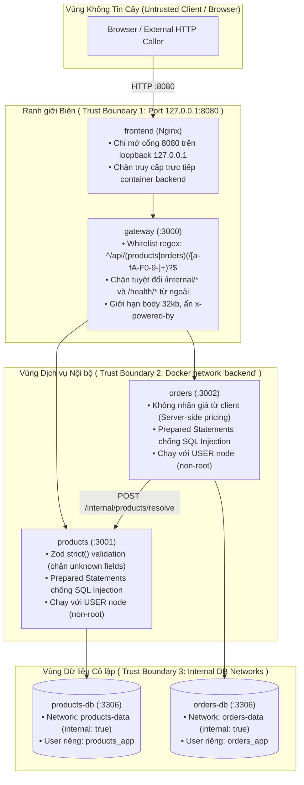
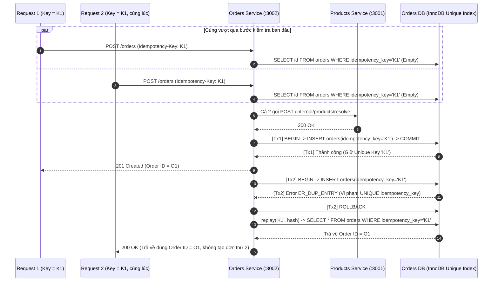

# 03 — Chi tiết Triển khai, Security & Concurrency View (Mini Shop)

Tài liệu này đi sâu vào cơ chế hoạt động bên trong mã nguồn:
1. Luồng xử lý chi tiết kèm vị trí hàm/dòng code (`file:line`).
2. **Security View (Góc nhìn Bảo mật & Trust Boundaries)**: Phân biệt kiểm soát đã có thật và phần đề xuất bổ sung.
3. **Concurrency & Transaction View (Góc nhìn Đồng thời & Giao dịch)**: Xử lý race condition trên `Idempotency-Key`, rollback nguyên tử và cô lập lỗi.

---

## 1. Chi tiết Luồng Hoạt động theo Code Thực tế

### 1.1. Luồng Tracing Xuyên suốt bằng `X-Request-Id`
* **Tại Gateway (`services/gateway/src/http.ts:7-14`):**
  * Kiểm tra `req.get('x-request-id')`. Nếu khớp `/^[a-zA-Z0-9_-]{1,100}$/` thì dùng lại, ngược lại gọi `randomUUID()`.
  * Gán vào `res.locals.requestId` và header phản hồi `res.set('X-Request-Id', id)`.
  * Khi kết thúc response (`res.on('finish')`), ghi 1 dòng JSON log ra stdout: `{service, requestId, method, path, status, durationMs}`.
* **Chuyển tiếp từ Gateway sang Upstream (`services/gateway/src/index.ts:9-11`):**
  * Truyền header `'X-Request-Id': res.locals.requestId` và `'Idempotency-Key'` xuống `products` hoặc `orders`.
* **Chuyển tiếp từ Orders sang Products (`services/orders/src/index.ts:35`):**
  * Khi `POST /orders` gọi `POST /internal/products/resolve`, `orders` đính kèm `'X-Request-Id': res.locals.requestId`.
  * **Kết quả:** Một thao tác đặt hàng của người dùng tạo ra đúng **3 dòng log có cùng `requestId`** tại `gateway`, `orders` và `products`, cho phép truy vết toàn bộ đường đi của request.

---

### 1.2. Luồng Giao dịch Cục bộ (Local ACID Transaction) & Rollback trong `Orders Service`
Tại [`services/orders/src/index.ts:41-53`](../source/services/orders/src/index.ts#L41-L53):

```ts
const priced = priceOrder(input, data.items), id = randomUUID(), conn = await pool.getConnection();
let duplicate = false;
try {
  await conn.beginTransaction();
  await conn.execute(
    'INSERT INTO orders(id,customer_name,customer_email,total_vnd,idempotency_key,request_hash) VALUES(?,?,?,?,?,?)',
    [id, input.customerName, input.customerEmail, priced.totalVnd, key, hash]
  );
  for (const i of priced.items)
    await conn.execute(
      'INSERT INTO order_items(id,order_id,product_id,product_name,unit_price_vnd,quantity,subtotal_vnd) VALUES(?,?,?,?,?,?,?)',
      [randomUUID(), id, i.productId, i.productName, i.unitPriceVnd, i.quantity, i.subtotalVnd]
    );
  await conn.commit();
} catch (err: any) {
  await conn.rollback();
  if (err.code === 'ER_DUP_ENTRY') duplicate = true; else throw err;
} finally {
  conn.release();
}
```

* **Tính nguyên tử (Atomicity):** Bảng `orders` và tất cả các dòng `order_items` được ghi trên cùng một kết nối `conn` trong khối `beginTransaction()` ... `commit()`. Nếu bất kỳ lệnh `INSERT INTO order_items` nào gặp lỗi (được kiểm chứng tự động qua `scripts/verify-transaction.mjs`), lệnh `conn.rollback()` hủy bỏ cả dòng `orders` vừa chèn trước đó.
* **Giải phóng tài nguyên:** Khối `finally { conn.release(); }` đảm bảo kết nối luôn được trả về pool (`connectionLimit: 5`), chống rò rỉ kết nối (connection leak) khi có ngoại lệ.

---

## 2. Security View (Ranh giới Tin cậy & Kiểm soát Bảo mật)

> [!WARNING]
> **Nguyên tắc trung thực khi vấn đáp:** Phải tách bạch rõ **Kiểm soát đã có thật trong code (Implemented Controls)** và **Kiểm soát chưa có / đề xuất mở rộng (Proposed Controls)**. Không gọi mạng nội bộ Docker (`internal: true`) là cơ chế xác thực người dùng (Authentication).



### Bảng phân loại Kiểm soát Bảo mật (Có thật vs. Đề xuất mở rộng)

| Hạng mục bảo mật | Trạng thái | Vị trí trong Code / Cấu hình | Giải thích chi tiết |
|---|---|---|---|
| **1. Server-side Price Integrity (Chống giả mạo giá từ Client)** | **ĐÃ CÓ THẬT** | `services/orders/src/domain.ts:3,8-11` | Schema `orderInput` chỉ nhận `{productId, quantity}` (với `.strict()`). Nếu client cố gửi kèm trường `priceVnd: 1`, Zod sẽ từ chối ngay (`400 VALIDATION_ERROR`). Giá luôn được lấy từ `Products Service` ở phía server. |
| **2. Chặn Endpoint nội bộ (`/internal/*`)** | **ĐÃ CÓ THẬT** | `services/gateway/src/index.ts:5-6` | Gateway chỉ cho phép đường dẫn khớp `/^\/api\/(products\|orders)(?:\/[a-fA-F0-9-]+)?$/`. Mọi request từ ngoài gọi `/api/internal/products/resolve` đều bị trả `404 NOT_FOUND`. |
| **3. Chống SQL Injection & Mass Assignment** | **ĐÃ CÓ THẬT** | `services/*/src/index.ts` | Toàn bộ truy vấn có tham số đều dùng `pool.execute('... WHERE id=?', [id])` (Prepared Statements) và schema Zod `.strict()` chặn chèn trường lạ. |
| **4. Giới hạn kích thước Payload & Non-root Container** | **ĐÃ CÓ THẬT** | `http.ts:6,15`, `Dockerfile:19` | `express.json({limit: '32kb'})` chống tấn công làm cạn bộ nhớ bằng JSON lớn (`413 BODY_TOO_LARGE`); container backend chạy dưới quyền `USER node`. |
| **5. Cô lập mạng Database & Least Privilege DB User** | **ĐÃ CÓ THẬT** | `compose.yaml:57-59, 71-74, 97-100` | Mạng `products-data` và `orders-data` đặt `internal: true`. `orders` dùng user `orders_app` và không có kết nối mạng sang `products-db`. |
| **6. Authentication / Authorization cho trang Admin (`/admin/products`)** | **CHƯA CÓ (Giới hạn có chủ đích)** | `frontend/src/main.tsx:47`, `README.md:25,88` | Hiện tại `POST /api/products` và `PATCH /api/products/:id` mở tự do cho mục đích demo local. **Đề xuất mở rộng:** Bổ sung xác thực JWT/Session tại Gateway và kiểm tra quyền `role=admin` trước khi cho phép `POST/PATCH /products`. |
| **7. Xác thực Service-to-Service (mTLS / Internal Token)** | **CHƯA CÓ (Đề xuất mở rộng)** | `services/orders/src/index.ts:35` | Trong mạng `backend`, `orders` gọi `products` qua HTTP thường. **Đề xuất mở rộng:** Dùng mTLS (Service Mesh) hoặc Internal HMAC/Service Token cho `/internal/*`. |

---

## 3. Concurrency View (Góc nhìn Xử lý Đồng thời & Race Conditions)

### Kịch bản 1: Hai Request Đặt hàng Trùng `Idempotency-Key` Đến Cùng Lúc (Race Condition)



### Kịch bản 2: Admin Đổi Giá Trong Lúc Khách Đang Xem Giỏ Hàng (Stale Client Price vs. Server Snapshot)
* **Hiện tượng:** Khách hàng thêm sản phẩm A vào giỏ lúc giá `89.000 ₫` (`localStorage` lưu `89000`). Trước khi khách bấm đặt hàng, Admin đổi giá sản phẩm A thành `120.000 ₫`.
* **Cách hệ thống xử lý (`services/orders/src/index.ts:35-41`):**
  * Giao diện giỏ hàng ghi rõ chú thích: *"Giá chính thức được xác nhận khi tạo đơn."* (`frontend/src/main.tsx:42`).
  * Khi khách nhấn đặt hàng, `Orders Service` gọi `Products Service` lấy giá mới nhất tại thời điểm xử lý (`120.000 ₫`) để tính `total_vnd` và lưu snapshot vào `order_items`.
  * Nếu Admin vừa chuyển sản phẩm sang trạng thái **Ngừng bán (`isActive = false`)**, `Orders Service` từ chối tạo đơn với mã `409 Conflict` (`PRODUCT_INACTIVE`: *"Có sản phẩm đã ngừng bán. Vui lòng cập nhật giỏ hàng."*).
