# 01. Nền tảng Biểu diễn Kiến trúc: 4+1 View Model, C4 Model & Data Model — Online Boutique

Tài liệu này tái dựng đầy đủ kiến trúc của hệ thống mã nguồn mở **Google Online Boutique (`microservices-demo`, phiên bản `v0.10.7`, commit `38e7348eb289eb5b87c0c6e8cb19ced0449dc389`)** theo tiêu chuẩn của **Mục 5 — Thế Anh (`docs/TEAM-ASSIGNMENT.md`)** và **Mục 4 (`docs/INVENTORY.md`)**.

---

## Phần 0: Stakeholder Matrix & Phân biệt View — Model — Notation — C4 Zoom Level

### 0.1. Phân biệt cốt lõi trong Biểu diễn Kiến trúc
1. **Architecture View (Góc nhìn kiến trúc):** Tập hợp các phần tử kiến trúc và quan hệ giữa chúng được chọn lọc để giải quyết một nhóm **mối quan tâm (Concerns)** cụ thể của một số **bên liên quan (Stakeholders)**.
2. **Model vs. Notation (Mô hình vs. Ký pháp):**
   - **4 UML Diagrams KHÔNG đồng nghĩa với 4 Views:** Việc vẽ một Class Diagram, Sequence Diagram, Package Diagram và Deployment Diagram không tự động tạo thành 4+1 Views nếu không chỉ rõ mối quan tâm kiến trúc (boundary, state ownership, runtime failure, network isolation).
   - **Boxes and Arrows + 4+1 Views + C4 Zoom Levels:** Trong tài liệu này, chúng ta dùng **4+1 View Model (Kruchten)** làm khung trục chính để tách bạch 5 mối quan tâm, kết hợp với **C4 Model (Simon Brown)** làm 4 cấp độ phóng đại (Zoom Levels: Context $\rightarrow$ Container $\rightarrow$ Component $\rightarrow$ Code), và bổ sung **Data Model / Security & Concurrency View**.

### 0.2. Bảng Ma trận Stakeholder & Concern (Stakeholder/Concern Matrix)

| Stakeholder (Bên liên quan) | Mối quan tâm chính (Concerns) | View giải quyết chính | Minh chứng cụ thể trong Online Boutique |
| :--- | :--- | :--- | :--- |
| **Customer (Khách mua hàng)** | Duyệt danh mục nhanh, đổi tiền tệ chính xác, giỏ hàng giữ được sản phẩm theo phiên, thanh toán mượt mà. | **Scenarios (+1)** & **Logical View** | Cookie `shop_session-id` (`src/frontend/middleware.go`), `PlaceOrder()` trả về `OrderResult` kèm mã vận đơn `shipping_tracking_id`. |
| **Software Architect / Tech Lead** | Phân ranh giới 11 dịch vụ, hợp đồng giao tiếp đa ngôn ngữ, luồng điều phối (Orchestration), khả năng chịu lỗi khi dịch vụ phụ trợ chết. | **Logical View**, **Process View**, **C4 Level 2 & 3** | Hợp đồng `protos/demo.proto` (`package hipstershop`), `checkoutservice` làm Orchestrator, `frontend` bỏ qua lỗi của `recommendationservice` và `adservice`. |
| **Developer (Backend / Polyglot Dev)** | Tổ chức mã nguồn theo 5 ngôn ngữ, cách sinh mã gRPC (codegen) từ file `.proto`, cấu trúc build Docker. | **Development View**, **C4 Level 3 & 4** | 11 thư mục độc lập trong `src/`, các script `genproto.sh`, multi-stage `Dockerfile` cho Go, C#, Node.js, Python, Java. |
| **DevOps / SRE / Operator** | Cấu hình Pod, Deployment, Service, cổng mạng, biến môi trường, health probes, giới hạn CPU/RAM và bảo mật container. | **Physical / Deployment View**, **Security View** | `release/kubernetes-manifests.yaml`: 11 Deployments + 1 Redis Deployment, `grpc` readiness/liveness probes, `securityContext` (`runAsNonRoot: true`, `readOnlyRootFilesystem: true`). |
| **Data Engineer / QA** | Trạng thái lưu ở đâu, cấu trúc dữ liệu nhị phân Protobuf trong Redis, dữ liệu tĩnh JSON và hành vi khi truy cập đồng thời. | **Data Model / Schema**, **Concurrency View** | `RedisCartStore.cs` lưu `userId -> Cart.ToByteArray()`, `products.json` (9 sản phẩm), `currency_conversion.json` (tỷ giá ECB). |

---

## Phần 1: Mô hình 4+1 Góc nhìn Kiến trúc (Kruchten's 4+1 View Model)

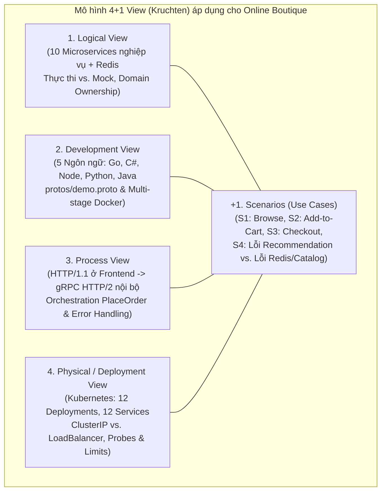

---

### 1.1. Logical View (Góc nhìn Logic)

**Mối quan tâm:** Hệ thống bao gồm những dịch vụ nghiệp vụ nào? Trách nhiệm, hợp đồng giao tiếp (gRPC Contract), quyền sở hữu dữ liệu (Data Ownership) của từng dịch vụ là gì? Dịch vụ nào xử lý trạng thái thật và dịch vụ nào là mô phỏng (Mock/Stateless)?

#### Sơ đồ Logical View
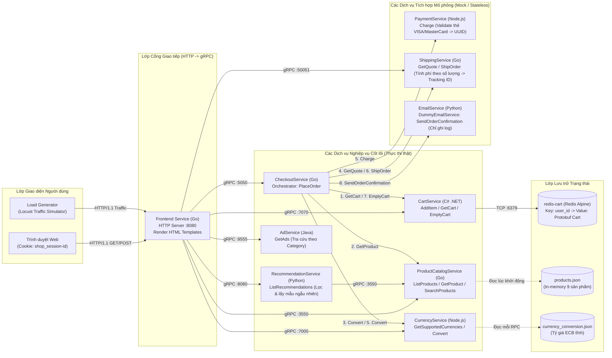

#### Phân tích chi tiết Logical View (Đối chiếu thực tế Code vs. Mock)
1. **Điểm vào duy nhất (`frontend`):** Là dịch vụ duy nhất nhận HTTP/1.1 từ trình duyệt (`GET /`, `GET /product/{id}`, `POST /cart`, `GET /cart`, `POST /cart/checkout`). `frontend` không chứa logic tính giá hay lưu trữ mà đóng vai trò **API Gateway / BFF (Backend-for-Frontend)** gọi gRPC tới 7 dịch vụ nội bộ và render HTML bằng `html/template`.
2. **Dịch vụ điều phối trung tâm (`checkoutservice`):** Đóng vai trò **Synchronous Orchestrator** cho nghiệp vụ đặt hàng (`PlaceOrder`). Nó không có database riêng mà điều phối tuần tự 6 dịch vụ khác (`cartservice`, `productcatalogservice`, `currencyservice`, `shippingservice`, `paymentservice`, `emailservice`).
3. **Phân biệt rõ Dịch vụ Thật vs. Dịch vụ Mock (Yêu cầu bắt buộc trong `TEAM-ASSIGNMENT.md` dòng 63):**
   - **Có lưu trữ / xử lý dữ liệu thật:**
     - `cartservice` (`C#`): Đọc/ghi trạng thái giỏ hàng thật vào `redis-cart` qua giao thức Redis TCP cổng `6379`.
     - `productcatalogservice` (`Go`): Đọc danh mục 9 sản phẩm từ `products.json`, thực hiện tìm kiếm chuỗi (`strings.Contains`) và tra cứu theo ID thật.
     - `currencyservice` (`Node.js`): Chuyển đổi tiền tệ toán học chính xác (`units` và `nanos`) dựa trên bảng tỷ giá Châu Âu (`currency_conversion.json`).
     - `recommendationservice` (`Python`): Gọi gRPC sang `productcatalogservice` lấy toàn bộ danh sách sản phẩm, loại trừ các sản phẩm đang có trong giỏ/trang hiện tại và lấy mẫu ngẫu nhiên tối đa 5 sản phẩm (`random.sample` tại `recommendation_server.py:79`).
     - `adservice` (`Java`): Lưu `ImmutableListMultimap<String, Ad>` trong bộ nhớ (`AdService.java:121`), trả về quảng cáo khớp với từ khóa danh mục (`context_keys`) hoặc chọn ngẫu nhiên 2 quảng cáo.
   - **Dịch vụ Mô phỏng (Mock / Stateless — không gọi cổng thanh toán, hãng vận chuyển hay SMTP thật):**
     - `paymentservice` (`Node.js`): Kiểm tra định dạng số thẻ bằng `simple-card-validator`, chỉ chấp nhận thẻ **VISA** hoặc **MasterCard** còn hạn (`charge.js:74-80`), sau đó sinh ngẫu nhiên `uuidv4()` làm `transaction_id` và ghi log — **không trừ tiền thật**.
     - `shippingservice` (`Go`): Tính phí vận chuyển giả lập theo công thức số lượng mặt hàng (`quote.go`) và sinh mã vận đơn `tracking_id` giả lập dạng chữ cái + số (`tracker.go`) — **không lưu vận đơn vào DB**.
     - `emailservice` (`Python`): Chạy ở chế độ `DummyEmailService` (`email_server.py:108-119`), khi nhận RPC `SendOrderConfirmation` chỉ ghi log `A request to send order confirmation email to ... has been received` — **không kết nối máy chủ SMTP**.

---

### 1.2. Development View (Góc nhìn Phát triển)

**Mối quan tâm:** Mã nguồn được tổ chức như thế nào? Làm sao 5 ngôn ngữ lập trình khác nhau (Go, C#, Node.js, Python, Java) có thể giao tiếp đồng nhất? Quy trình sinh mã (Codegen) và đóng gói Docker image diễn ra ra sao?

#### Sơ đồ Development View (Cấu trúc Polyglot & Hợp đồng Protobuf)
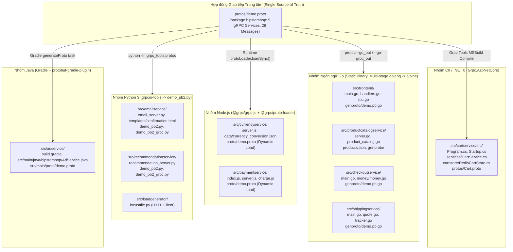

#### Bảng Ánh xạ Cấu trúc Mã nguồn & Cơ chế Build (`src/*`)

| Thư mục Mã nguồn | Ngôn ngữ / Runtime | Cơ chế dùng Protobuf (`demo.proto`) | Quản lý Dependency | Cấu trúc `Dockerfile` |
| :--- | :--- | :--- | :--- | :--- |
| `src/frontend/` | Go (`1.23+`) | Biên dịch trước ra `genproto/demo.pb.go` & `demo_grpc.pb.go` (`genproto.sh`) | `go.mod` / `go.sum` | Multi-stage: `golang:alpine` (`go build -o /go/bin/frontend`) $\rightarrow$ `alpine` kèm `templates/` & `static/` |
| `src/checkoutservice/` | Go (`1.23+`) | Biên dịch trước ra `genproto/demo.pb.go` | `go.mod` / `go.sum` | Multi-stage: `golang:alpine` $\rightarrow$ `alpine` (chỉ chứa 1 file thực thi `/src/checkoutservice`) |
| `src/productcatalogservice/` | Go (`1.23+`) | Biên dịch trước ra `genproto/demo.pb.go` | `go.mod` / `go.sum` | Multi-stage: `golang:alpine` $\rightarrow$ `alpine` kèm `/src/products.json` |
| `src/shippingservice/` | Go (`1.23+`) | Biên dịch trước ra `genproto/demo.pb.go` | `go.mod` / `go.sum` | Multi-stage: `golang:alpine` $\rightarrow$ `alpine` (`/src/shippingservice`) |
| `src/cartservice/src/` | C# / .NET | `cartservice.csproj` dùng `<Protobuf Include="protos\Cart.proto" GrpcServices="Both" />` sinh code lúc build | `cartservice.csproj` (NuGet) | Multi-stage: `mcr.microsoft.com/dotnet/sdk` (`dotnet publish`) $\rightarrow$ `dotnet/aspnet` |
| `src/currencyservice/` | Node.js | Nạp động lúc khởi chạy bằng `@grpc/proto-loader` (`server.js:91-103`) | `package.json` (npm) | Multi-stage: `node:alpine` cài native deps $\rightarrow$ copy `node_modules`, `server.js`, `data/`, `proto/` |
| `src/paymentservice/` | Node.js | Nạp động lúc khởi chạy bằng `@grpc/proto-loader` (`server.js:55-67`) | `package.json` (npm) | Multi-stage: `node:alpine` $\rightarrow$ copy `index.js`, `server.js`, `charge.js`, `proto/` |
| `src/recommendationservice/` | Python 3 | Sinh tĩnh `demo_pb2.py` & `demo_pb2_grpc.py` bằng `grpc_tools.protoc` | `requirements.txt` (pip) | Multi-stage: `python:slim` cài wheel $\rightarrow$ chạy `python recommendation_server.py` |
| `src/emailservice/` | Python 3 | Sinh tĩnh `demo_pb2.py` & `demo_pb2_grpc.py` | `requirements.txt` (pip) | Multi-stage: `python:slim` $\rightarrow$ chạy `python email_server.py` kèm `templates/` |
| `src/adservice/` | Java (`JDK 21`) | Gradle plugin `com.google.protobuf` sinh class `hipstershop.Demo` & `AdServiceGrpc` lúc build | `build.gradle` (Gradle) | Multi-stage: `eclipse-temurin` (`./gradlew installDist`) $\rightarrow$ runtime image chạy `/app/bin/AdService` |
| `src/loadgenerator/` | Python 3 (Locust) | Không dùng gRPC; gửi HTTP/1.1 trực tiếp tới `frontend` | `requirements.txt` | Image chứa `locustfile.py`, chạy `locust --host="http://${FRONTEND_ADDR}" --headless` |

> **Đặc trưng kiến trúc Development View:** Các microservice hoàn toàn **Share-Nothing về mặt mã nguồn thư viện** (ngay cả các dịch vụ cùng viết bằng Go như `frontend` và `checkoutservice` cũng có bản copy package `money/` riêng, được ghi chú rõ tại comment `src/checkoutservice/main.go:181-182`: *"this method is duplicated in other microservices using Go since they are not sharing packages"*). Điều này giúp mỗi dịch vụ có thể build, nâng cấp thư viện và deploy hoàn toàn độc lập, chỉ ràng buộc duy nhất qua hợp đồng `protos/demo.proto`.

---

### 1.3. Process View (Góc nhìn Tiến trình & Luồng Thời gian chạy)

**Mối quan tâm:** Ở thời điểm runtime, một thao tác của người dùng kích hoạt những lời gọi RPC nào? Thứ tự tuần tự ra sao? Dịch vụ nào giữ kết nối lâu dài (persistent gRPC channel)? Khi một dịch vụ con bị lỗi thì tiến trình xử lý và trả lỗi như thế nào?

#### Sequence 1: Luồng Duyệt Trang chủ & Xem Chi tiết Sản phẩm (`Browse Flow`)
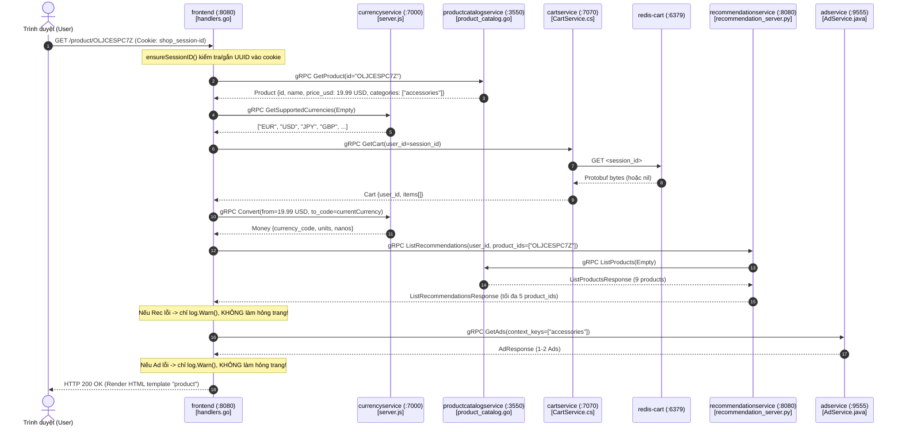

#### Sequence 2: Luồng Thêm vào Giỏ hàng (`Add-to-Cart Flow`)
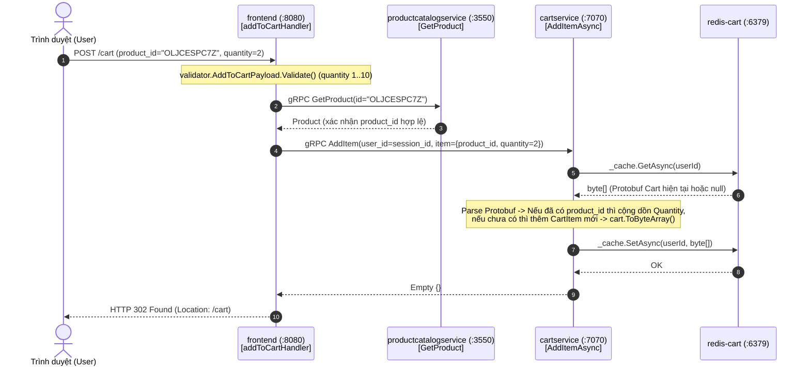

#### Sequence 3: Luồng Đặt hàng — Điều phối Tập trung (`Checkout Orchestration Flow — PlaceOrder`)
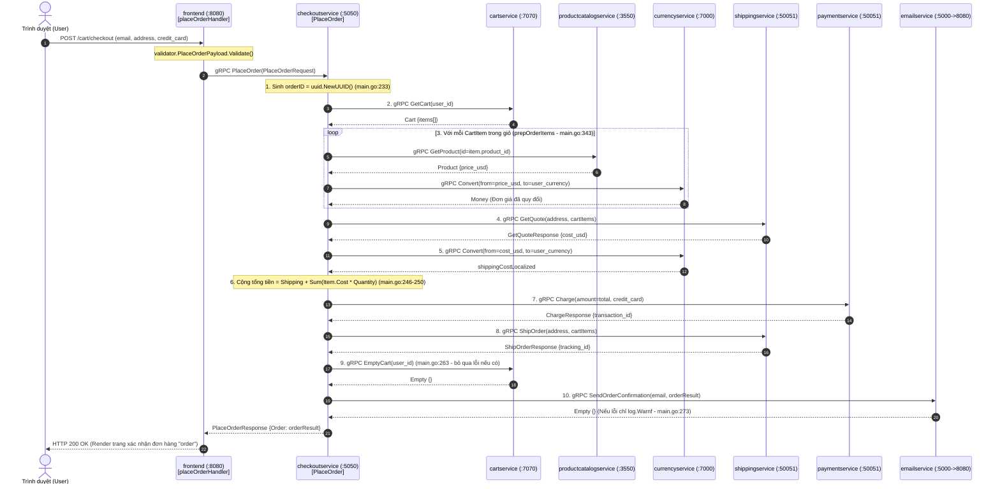

---

### 1.4. Physical / Deployment View (Góc nhìn Vật lý & Triển khai Kubernetes)

**Mối quan tâm:** Mã nguồn sau khi đóng gói thành Container Image được triển khai lên cụm Kubernetes như thế nào? Có bao nhiêu `Deployment`, `Pod`, `Service`, `ServiceAccount`? Dịch vụ nào public ra ngoài, dịch vụ nào chỉ giao tiếp nội bộ (`ClusterIP`)? Giới hạn tài nguyên (`requests`/`limits`) và cơ chế kiểm tra sức khỏe (`readinessProbe`/`livenessProbe`) được cấu hình ra sao?

#### Sơ đồ Physical / Deployment View (Dựa trên `release/kubernetes-manifests.yaml`)
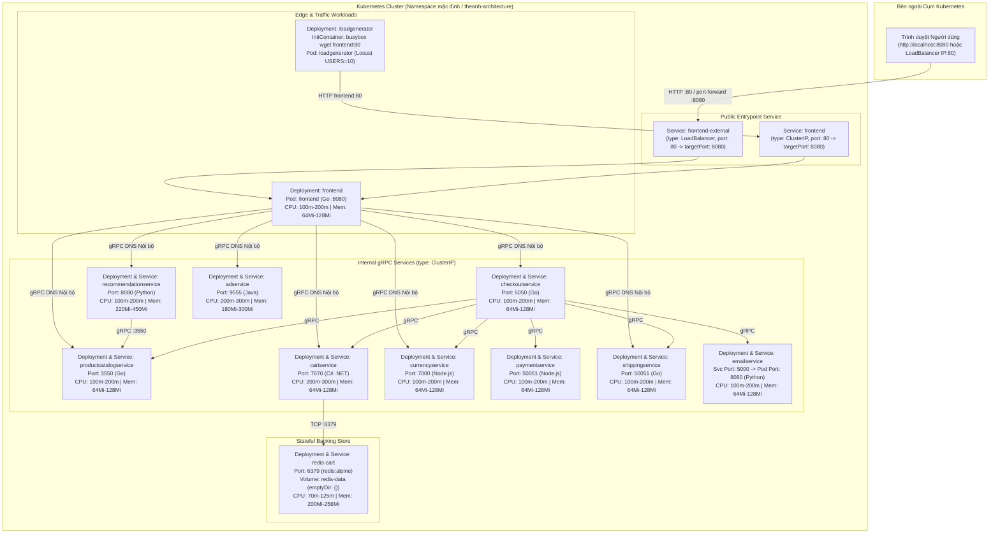

#### Bảng Tổng hợp Thông số Triển khai Kubernetes (`release/kubernetes-manifests.yaml`)

| Workload (`Deployment`) | Kubernetes `Service` | Loại Service | Service Port $\rightarrow$ Target Port | Health Probes (`readiness` / `liveness`) | CPU (`req` / `lim`) | Memory (`req` / `lim`) | Lưu trữ / Volume |
| :--- | :--- | :--- | :--- | :--- | :--- | :--- | :--- |
| `frontend` | `frontend` & `frontend-external` | `ClusterIP` & `LoadBalancer` | `80 -> 8080` | `httpGet /_healthz:8080` (kèm Cookie probe) | `100m / 200m` | `64Mi / 128Mi` | Không (`readOnlyRootFilesystem: true`) |
| `checkoutservice` | `checkoutservice` | `ClusterIP` | `5050 -> 5050` | Native `grpc` probe port `5050` | `100m / 200m` | `64Mi / 128Mi` | Không (`readOnlyRootFilesystem: true`) |
| `productcatalogservice` | `productcatalogservice` | `ClusterIP` | `3550 -> 3550` | Native `grpc` probe port `3550` | `100m / 200m` | `64Mi / 128Mi` | Không (JSON đóng gói sẵn trong image) |
| `cartservice` | `cartservice` | `ClusterIP` | `7070 -> 7070` | Native `grpc` probe port `7070` (delay 15s) | `200m / 300m` | `64Mi / 128Mi` | Không (`readOnlyRootFilesystem: true`) |
| `redis-cart` | `redis-cart` | `ClusterIP` | `6379 -> 6379` | `tcpSocket` port `6379` (period 5s) | `70m / 125m` | `200Mi / 256Mi` | `mountPath: /data` $\rightarrow$ `emptyDir: {}` |
| `currencyservice` | `currencyservice` | `ClusterIP` | `7000 -> 7000` | Native `grpc` probe port `7000` | `100m / 200m` | `64Mi / 128Mi` | Không (JSON đóng gói sẵn trong image) |
| `paymentservice` | `paymentservice` | `ClusterIP` | `50051 -> 50051` | Native `grpc` probe port `50051` | `100m / 200m` | `64Mi / 128Mi` | Không (`readOnlyRootFilesystem: true`) |
| `shippingservice` | `shippingservice` | `ClusterIP` | `50051 -> 50051` | Native `grpc` probe port `50051` | `100m / 200m` | `64Mi / 128Mi` | Không (`readOnlyRootFilesystem: true`) |
| `emailservice` | `emailservice` | `ClusterIP` | **`5000 -> 8080`** | Native `grpc` probe port `8080` | `100m / 200m` | `64Mi / 128Mi` | Không (`readOnlyRootFilesystem: true`) |
| `recommendationservice` | `recommendationservice` | `ClusterIP` | `8080 -> 8080` | Native `grpc` probe port `8080` | `100m / 200m` | `220Mi / 450Mi` | Không (`readOnlyRootFilesystem: true`) |
| `adservice` | `adservice` | `ClusterIP` | `9555 -> 9555` | Native `grpc` probe port `9555` (delay 20s) | `200m / 300m` | `180Mi / 300Mi` | Không (`readOnlyRootFilesystem: true`) |
| `loadgenerator` | *(Không có Service)* | Headless Client | Gọi `frontend:80` | `initContainer: frontend-check` (retry 12 lần) | `300m / 500m` | `256Mi / 512Mi` | Không (`readOnlyRootFilesystem: true`) |

> **Điểm đáng chú ý trong Deployment View:**
> 1. **Ánh xạ cổng khác biệt ở `emailservice`:** Container `emailservice` lắng nghe ở cổng `8080` (`containerPort: 8080`), nhưng Kubernetes `Service` của nó mở cổng `5000` (`port: 5000 -> targetPort: 8080` tại `kubernetes-manifests.yaml:391-393`). Do đó, biến môi trường ở `checkoutservice` được cấu hình là `EMAIL_SERVICE_ADDR: "emailservice:5000"`.
> 2. **Volume của `redis-cart` là `emptyDir: {}` (`kubernetes-manifests.yaml:889-891`):** Dữ liệu giỏ hàng tồn tại trong suốt vòng đời của Pod `redis-cart`, nhưng nếu Pod `redis-cart` bị xóa và tạo lại trên Node khác, `emptyDir` sẽ được khởi tạo mới (trống).

---

### 1.5. Scenarios View (`+1` — Các Kịch bản Kết nối 4 Views)

| Mã Kịch bản | Tên Kịch bản | Logical View | Development View | Process View | Physical / Deployment View |
| :--- | :--- | :--- | :--- | :--- | :--- |
| **S1** | **Duyệt danh mục & Đổi tiền tệ** (`GET /`, `POST /setCurrency`) | `frontend` $\rightarrow$ `productcatalog`, `currency`, `cart`, `ad` | `handlers.go:homeHandler` gọi `rpc.go` qua stub `genproto` | Gọi đồng bộ `ListProducts`, `GetCart`, và lặp `Convert` cho 9 sản phẩm | `frontend` Pod gọi DNS `productcatalogservice:3550`, `currencyservice:7000` |
| **S2** | **Thêm sản phẩm vào giỏ hàng** (`POST /cart`) | `frontend` $\rightarrow$ `productcatalog` $\rightarrow$ `cartservice` $\rightarrow$ `redis-cart` | `handlers.go:addToCartHandler` $\rightarrow$ `CartService.cs` $\rightarrow$ `RedisCartStore.cs` | Kiểm tra SP tồn tại $\rightarrow$ `AddItem` $\rightarrow$ `GetAsync` + `SetAsync` trong Redis $\rightarrow$ Redirect `302 /cart` | `cartservice:7070` đọc/ghi TCP vào `redis-cart:6379` (Volume `emptyDir`) |
| **S3** | **Đặt hàng thành công** (`POST /cart/checkout`) | `frontend` $\rightarrow$ `checkoutservice` điều phối 6 dịch vụ con | `checkoutservice/main.go:PlaceOrder` + package `money` tính tổng tiền | 10 bước RPC tuần tự: `GetCart` $\rightarrow$ `GetProduct` $\rightarrow$ `Convert` $\rightarrow$ `GetQuote` $\rightarrow$ `Charge` $\rightarrow$ `ShipOrder` $\rightarrow$ `EmptyCart` $\rightarrow$ `SendOrderConfirmation` | `checkoutservice:5050` kết nối gRPC tới 6 ClusterIP Services trong cụm |
| **S4** | **Chịu lỗi: Dịch vụ phụ trợ chết vs. Dịch vụ cốt lõi chết** (`Failure & Recovery`) | Phân biệt Non-critical (`ad`, `recommendation`, `email`) vs. Critical (`redis-cart`, `productcatalog`, `payment`) | `handlers.go:178-181` & `chooseAd` bắt lỗi trả cảnh báo; `RedisCartStore.cs:62-65` ném `RpcException(FailedPrecondition)` | Nếu `adservice` hoặc `recommendationservice` tắt $\rightarrow$ trang sản phẩm vẫn trả `HTTP 200`. Nếu `redis-cart` hoặc `productcatalogservice` tắt $\rightarrow$ `frontend` trả `HTTP 500` | Scale `replicas: 0` cho `adservice` (hệ thống vẫn chạy) vs. scale `replicas: 0` cho `redis-cart` (giỏ hàng lỗi ngay, khôi phục khi scale lại `replicas: 1`) |

---

## Phần 2: Mô hình C4 (C4 Model — Levels 1, 2, 3, 4)

### 2.1. C4 Level 1 — System Context Diagram (Bối cảnh Hệ thống)
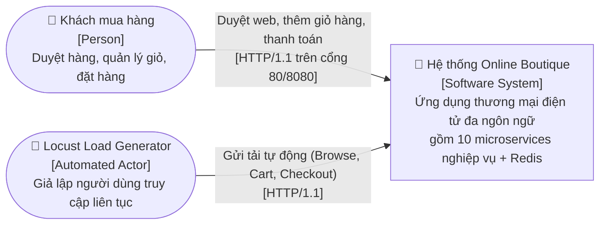

---

### 2.2. C4 Level 2 — Container Diagram (Sơ đồ Container / Dịch vụ)
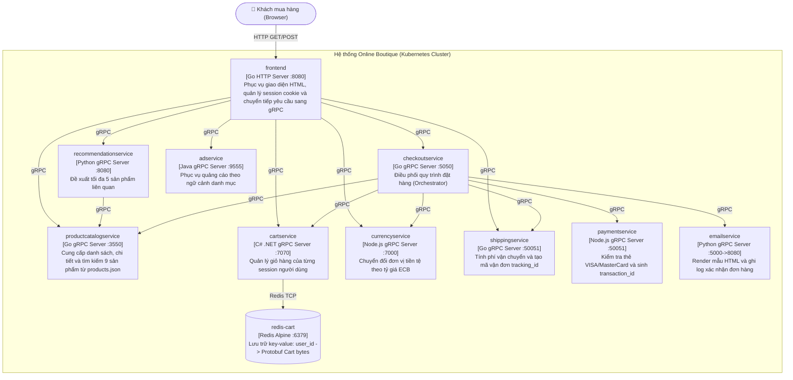

---

### 2.3. C4 Level 3 — Component Diagram (Bên trong `frontend`, `checkoutservice` và `cartservice`)
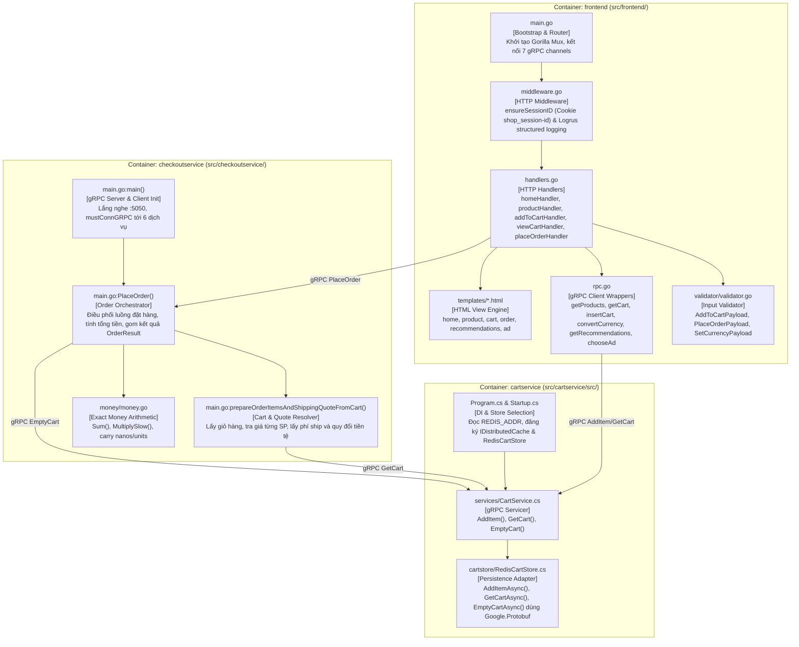

---

### 2.4. C4 Level 4 — Code Diagram (Chi tiết cấu trúc lớp/hàm trong `checkoutservice`, `cartservice` và `protos/demo.proto`)
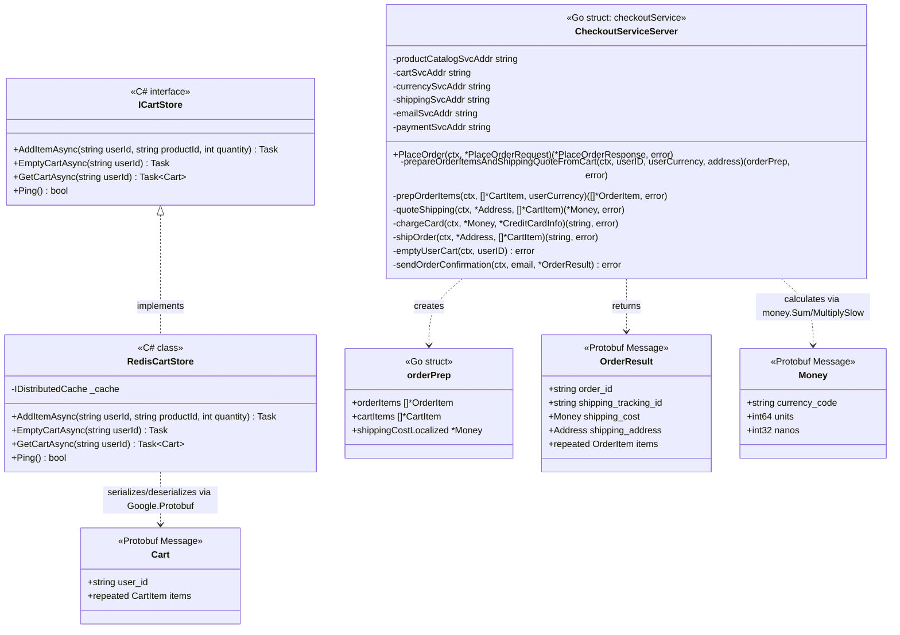

---

## Phần 3: Data Schema / Data Model (Redis, JSON Catalog & Protobuf Contracts)

> [!IMPORTANT]
> **Ghi chú trung thực theo đúng yêu cầu của `docs/TEAM-ASSIGNMENT.md` (Mục 5, dòng 68):**
> Bản chuẩn (baseline) của **Online Boutique KHÔNG sử dụng cơ sở dữ liệu quan hệ (RDBMS / SQL)** nên không có bảng SQL `CREATE TABLE`. Thay vào đó, trạng thái và mô hình dữ liệu của hệ thống được biểu diễn qua **3 lớp Schema thực tế trong code**:
> 1. **Redis Key-Value Schema (Binary Protobuf)** cho Giỏ hàng (`redis-cart`).
> 2. **JSON Document Schema** cho Danh mục sản phẩm (`products.json`) và Tỷ giá tiền tệ (`currency_conversion.json`).
> 3. **Protobuf Wire Contract Schema (`protos/demo.proto`)** định nghĩa toàn bộ cấu trúc bản tin truyền qua mạng và cấu trúc lưu trữ trong Redis.
> *(Trong tài liệu `cartservice` có hỗ trợ tùy chọn Spanner/AlloyDB/Memorystore nếu cấu hình biến môi trường GCP, nhưng ở cấu hình chuẩn `release/kubernetes-manifests.yaml` dòng 800, hệ thống chạy `REDIS_ADDR="redis-cart:6379"`).*

### 3.1. Sơ đồ Quan hệ Thực thể Logic & Lưu trữ Vật lý (Logical Data Model)
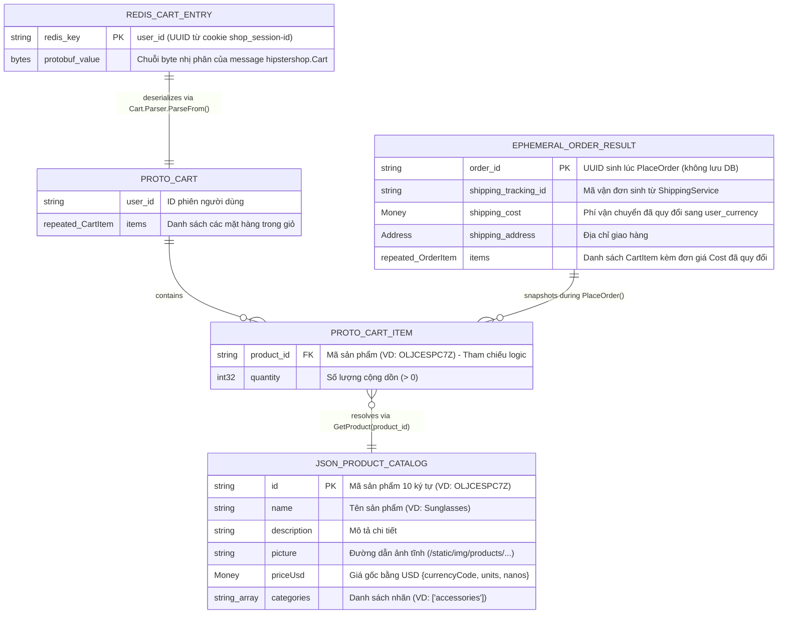

---

### 3.2. Chi tiết 3 Lớp Data Schema thực tế trong Mã nguồn

#### A. Schema Lưu trữ Giỏ hàng trong Redis (`src/cartservice/src/cartstore/RedisCartStore.cs`)
- **Engine:** `redis:alpine` chạy trên cổng `6379`, truy cập thông qua thư viện `Microsoft.Extensions.Caching.Distributed.IDistributedCache` (`StackExchangeRedisCache` được cấu hình tại `Startup.cs`).
- **Cấu trúc Key:** Chuỗi `userId` (chính là giá trị UUID của cookie `shop_session-id` do `frontend` cấp tại `src/frontend/middleware.go:103-116`).
- **Cấu trúc Value:** Mảng byte nhị phân (`byte[]`) được tuần tự hóa trực tiếp từ đối tượng Protobuf `Hipstershop.Cart` bằng phương thức `cart.ToByteArray()` (`RedisCartStore.cs:60`) và giải tuần tự hóa bằng `Hipstershop.Cart.Parser.ParseFrom(value)` (`RedisCartStore.cs:49, 94`).
- **Định nghĩa Schema `Cart` (`protos/demo.proto:29-50` & `src/cartservice/src/protos/Cart.proto`):**
  ```protobuf
  message CartItem {
      string product_id = 1; // Mã sản phẩm, VD: "OLJCESPC7Z"
      int32  quantity = 2;   // Số lượng mặt hàng
  }

  message Cart {
      string user_id = 1;          // UUID phiên người dùng
      repeated CartItem items = 2; // Danh sách mặt hàng trong giỏ
  }
  ```
- **Hành vi khi làm rỗng giỏ hàng (`EmptyCartAsync` — `RedisCartStore.cs:68-81`):** Thay vì xóa key (`DEL`), code khởi tạo một `new Hipstershop.Cart()` rỗng và ghi đè `cart.ToByteArray()` vào lại key `userId`.

#### B. Schema Danh mục Sản phẩm (`src/productcatalogservice/products.json`) & Tiền tệ (`src/currencyservice/data/currency_conversion.json`)
1. **Product Catalog JSON (`products.json` — 9 sản phẩm):**
   - Được nạp vào biến toàn cục `catalog pb.ListProductsResponse` khi khởi động `productcatalogservice` (`server.go:65` & `catalog_loader.go`) bằng `jsonpb.Unmarshal`.
   - Mỗi phần tử tuân thủ chặt chẽ message `hipstershop.Product` (`protos/demo.proto:77-87`):
     - `id` (`string`): Khóa định danh 10 ký tự chữ hoa + số (VD: `"OLJCESPC7Z"`, `"66VCHSJNUP"`, `"1YMWWN1N4O"`).
     - `name` (`string`), `description` (`string`), `picture` (`string`).
     - `priceUsd` (`Money`): Lưu giá gốc luôn tính bằng `"USD"` với 2 trường số nguyên `units` (phần nguyên, `int64`) và `nanos` (phần thập phân $10^{-9}$, `int32`) để **tránh sai số dấu phẩy động (floating-point precision error)**. Ví dụ: `$19.99` được lưu là `units: 19, nanos: 990000000`.
     - `categories` (`repeated string`): Mảng danh mục phục vụ lọc quảng cáo (VD: `["clothing", "tops"]`).
2. **Currency Conversion JSON (`currency_conversion.json`):**
   - Lưu bảng tỷ giá hối đoái quy chuẩn theo đồng `EUR` (ví dụ: `"USD": "1.1305"`, `"JPY": "126.40"`, `"GBP": "0.85970"`).
   - Khi chuyển đổi từ tiền tệ A sang tiền tệ B (`server.js:138-163`), `currencyservice` đổi từ `A -> EUR` rồi từ `EUR -> B`, sau đó gọi hàm `_carry(amount)` (`server.js:117-123`) để chuẩn hóa phần dư giữa `units` và `nanos`.

#### C. Trạng thái Đơn hàng khi Checkout (`OrderResult` — Ephemeral Snapshot)
- Trong `checkoutservice`, khi hàm `PlaceOrder()` (`src/checkoutservice/main.go:230-280`) chạy xong:
  - Nó giải quyết (resolve) từng `CartItem` sang `OrderItem` chứa **giá đã quy đổi tại thời điểm đặt hàng (`Cost: price`)** (`main.go:352-354`).
  - Nó đóng gói `OrderResult` (gồm `order_id`, `shipping_tracking_id`, `shipping_cost`, `shipping_address`, `items`) và trả trực tiếp về cho `frontend` để hiển thị trang kết quả đặt hàng (`templates/order.html`) đồng thời gửi sang `emailservice`.
  - **Không có Order Database:** `checkoutservice` không lưu `OrderResult` vào bất kỳ cơ sở dữ liệu nào sau khi trả response (đây là thiết kế chủ đích của Google cho ứng dụng demo stateless).

> **Đối chiếu bổ sung với Mini Shop (nếu giảng viên hỏi về ERD quan hệ / SQL Schema):**
> Trong trường hợp câu hỏi vấn đáp yêu cầu trình bày thêm về **Relational Database Schema (SQL)** có khóa chính/khóa ngoại và lưu trữ đơn hàng bền vững, bạn có thể dẫn chiếu ngay sang dự án phụ **[Mini Shop](../mini-shop/project-knowledge-application-implementation/01-concepts.md#phần-3-database-schema--data-model)** trong cùng thư mục Chủ đề 2 này (sử dụng 2 MySQL instances tách biệt `products-db` và `orders-db`, lưu snapshot `product_name` + `unit_price_vnd` vào bảng `order_items` và chống trùng đơn bằng `idempotency_key` + `request_hash` trong ACID transaction).
