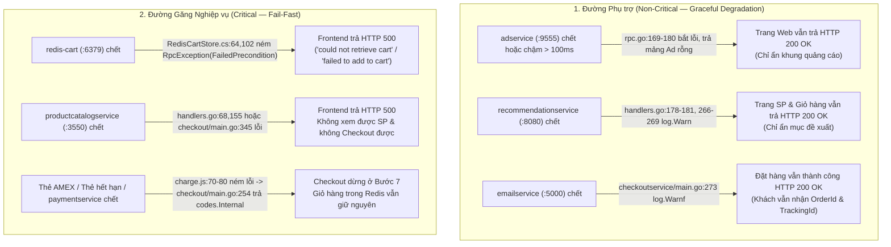
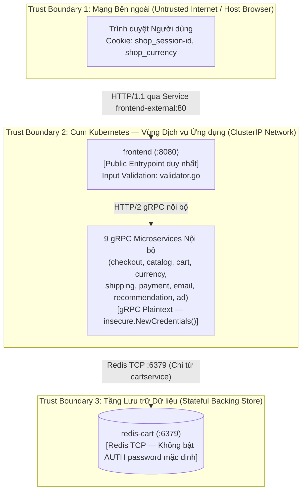
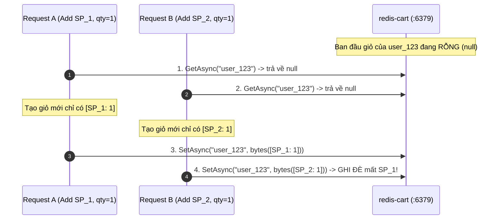

# 03. Chi tiết Triển khai, Security View & Concurrency View — Online Boutique

Tài liệu này đi sâu vào cơ chế thực thi thực tế trong mã nguồn của **Online Boutique** theo đúng yêu cầu của **Mục 5 (`docs/TEAM-ASSIGNMENT.md`, dòng 65, 67, 69)**: truy vết luồng `PlaceOrder()` và cơ chế lan truyền ngữ cảnh OpenTelemetry, phân tích hành vi khi xảy ra lỗi (Failure/Recovery), **Security View** (3 ranh giới tin cậy & cấu hình bảo mật Pod/Container) và **Concurrency View** (đa luồng gRPC & vấn đề tranh chấp dữ liệu trong Redis).

---

## Phần 1: Truy vết Chi tiết Luồng Điều phối Đặt hàng (`PlaceOrder` & Trace Context Propagation)

### 1.1. Lan truyền Ngữ cảnh Truy vết Phân tán (OpenTelemetry Trace Propagation)
- Ngay cả khi biến môi trường `ENABLE_TRACING` không được bật (`"0"`), các dịch vụ trong Online Boutique vẫn đăng ký **OpenTelemetry gRPC Interceptors / StatsHandlers** để tự động truyền `traceparent` và `baggage` qua HTTP/2 headers của mọi cuộc gọi gRPC:
  - Trong `frontend` (`src/frontend/main.go:118-120, 198`): Thiết lập `propagation.TraceContext{}` và gắn `grpc.WithStatsHandler(otelgrpc.NewClientHandler())` cho toàn bộ 7 kết nối gRPC client.
  - Trong `checkoutservice` (`src/checkoutservice/main.go:135-140, 216`): Server gRPC dùng `grpc.StatsHandler(otelgrpc.NewServerHandler())` và mọi gRPC client dùng `otelgrpc.NewClientHandler()`.
  - Trong `currencyservice` (`src/currencyservice/server.js:46-48`): Đăng ký `new GrpcInstrumentation()` ở mọi chế độ chạy.
- **Một chi tiết kỹ thuật rất đáng chú ý trong code (`src/checkoutservice/main.go:360`):**
  Trong hàm `convertCurrency(ctx context.Context, ...)` của `checkoutservice`, lập trình viên upstream đã truyền `context.TODO()` thay vì `ctx` vào lời gọi `Convert(context.TODO(), ...)`. Hệ quả là span của `currencyservice` khi được gọi từ `checkoutservice` sẽ bị đứt ngữ cảnh cha (`ctx`), trong khi các lời gọi `GetCart`, `GetProduct`, `GetQuote`, `Charge`, `ShipOrder` đều truyền `ctx` đúng chuẩn! Đây là một phát hiện đắt giá từ việc đọc code thực tế.

---

### 1.2. Giải phẫu 10 Bước trong Hàm `PlaceOrder()` (`src/checkoutservice/main.go:230-280`)

Khi người dùng nhấn nút **Place Order** (`POST /cart/checkout`), `frontend` kiểm tra form bằng `validator.PlaceOrderPayload.Validate()` (`src/frontend/handlers.go:349`) rồi gọi RPC `PlaceOrder` sang `checkoutservice:5050`. Tại đây, `PlaceOrder()` thực hiện tuần tự:

1. **Bước 1 — Khởi tạo định danh đơn hàng (`main.go:233-236`):**
   ```go
   orderID, err := uuid.NewUUID()
   ```
   Nếu lỗi sinh UUID $\rightarrow$ trả ngay `codes.Internal`.
2. **Bước 2 — Đọc giỏ hàng hiện tại (`main.go:290, 324-330`):**
   Gọi `CartService.GetCart(ctx, &pb.GetCartRequest{UserId: userID})` tới `cartservice:7070` $\rightarrow$ `RedisCartStore.GetCartAsync` đọc mảng byte từ `redis-cart:6379`.
3. **Bước 3 — Giải quyết thông tin & quy đổi giá từng mặt hàng (`prepOrderItems` — `main.go:294, 339-357`):**
   Với mỗi `CartItem` trong giỏ:
   - Gọi `ProductCatalogService.GetProduct(ctx, {Id: item.GetProductId()})` tới `productcatalogservice:3550` để lấy giá gốc `price_usd`.
   - Gọi `CurrencyService.Convert(context.TODO(), {From: price_usd, ToCode: userCurrency})` tới `currencyservice:7000`.
   - Đóng gói vào `pb.OrderItem{Item: item, Cost: price}` (chốt giá tại thời điểm thanh toán).
4. **Bước 4 — Lấy báo giá vận chuyển gốc USD (`quoteShipping` — `main.go:298, 313-322`):**
   Gọi `ShippingService.GetQuote(ctx, {Address: address, Items: cartItems})` tới `shippingservice:50051`.
5. **Bước 5 — Quy đổi phí vận chuyển sang tiền tệ người dùng (`main.go:302-305`):**
   Gọi `CurrencyService.Convert` để đổi `shippingUSD` sang `shippingCostLocalized`.
6. **Bước 6 — Tính tổng tiền thanh toán bằng số học chính xác (`main.go:243-250`):**
   Sử dụng package `money` (`src/checkoutservice/money/money.go`) để cộng `Units` và `Nanos` mà không dùng `float64`:
   $$\text{Total} = \text{shippingCostLocalized} + \sum_{i=1}^{N} (\text{OrderItem}_i.\text{Cost} \times \text{Quantity}_i)$$
7. **Bước 7 — Thu tiền thẻ tín dụng (`chargeCard` — `main.go:252-256, 369-377`):**
   Gọi `PaymentService.Charge(ctx, {Amount: &total, CreditCard: req.CreditCard})` tới `paymentservice:50051`. Tại `src/paymentservice/charge.js:61-85`, dịch vụ kiểm tra Luhn algorithm (`simple-card-validator`), chỉ cho phép `visa` hoặc `mastercard`, kiểm tra hạn thẻ $(Y_{\text{now}} \times 12 + M_{\text{now}}) \le (Y_{\text{exp}} \times 12 + M_{\text{exp}})$, rồi trả về `transaction_id` (UUID v4).
8. **Bước 8 — Tạo lệnh xuất kho & lấy mã vận đơn (`shipOrder` — `main.go:258-261, 386-394`):**
   Gọi `ShippingService.ShipOrder(ctx, {Address: req.Address, Items: prep.cartItems})` tới `shippingservice:50051` $\rightarrow$ nhận `shippingTrackingID`.
9. **Bước 9 — Làm rỗng giỏ hàng (`emptyUserCart` — `main.go:263, 332-337`):**
   Gọi `_ = cs.emptyUserCart(ctx, req.UserId)` tới `cartservice:7070`. Giá trị trả về `error` được gán vào `_` (bỏ qua lỗi nếu có để không làm thất bại đơn hàng đã thu tiền và tạo vận đơn).
10. **Bước 10 — Gửi email xác nhận & trả kết quả (`sendOrderConfirmation` — `main.go:273-279`):**
    Gọi `EmailService.SendOrderConfirmation(ctx, {Email: req.Email, Order: orderResult})` tới `emailservice:5000`. Nếu lỗi chỉ ghi `log.Warnf(...)`, sau đó trả `PlaceOrderResponse{Order: orderResult}` về cho `frontend`.

---

## Phần 2: Phân tích Hành vi Lỗi & Khôi phục (Failure Modes & Graceful Degradation)

Một trong những điểm mạnh nhất của kiến trúc Online Boutique là sự phân tách rõ ràng giữa **Critical Path (Đường găng bắt buộc)** và **Non-Critical Path (Đường phụ trợ có thể suy giảm êm dịu — Graceful Degradation)**:



---

## Phần 3: Security View (Góc nhìn Bảo mật — Trust Boundaries & Controls)

### 3.1. Sơ đồ 3 Ranh giới Tin cậy (Trust Boundaries)


### 3.2. Đối chiếu các Kiểm soát Bảo mật Đã Triển khai (Implemented) vs. Đề xuất (Proposed)

| Lớp Bảo mật | Kiểm soát ĐÃ CÓ THẬT trong Code & Manifest (`Implemented`) | Khoảng trống Hiện tại & Kiểm soát ĐỀ XUẤT (`Proposed`) |
| :--- | :--- | :--- |
| **1. Cô lập Mạng (Network Exposure)** | Chỉ duy nhất `frontend-external` có `type: LoadBalancer` (`kubernetes-manifests.yaml:584-595`). Toàn bộ 10 dịch vụ backend và `redis-cart` đều dùng `type: ClusterIP`, không thể bị gọi trực tiếp từ ngoài cụm Kubernetes. | Trong nội bộ cụm K8s mặc định, mọi Pod đều có thể gọi tới mọi `ClusterIP` (ví dụ `adservice` có thể kết nối thẳng vào `redis-cart:6379`). **Đề xuất:** Áp dụng `NetworkPolicy` chỉ cho phép `cartservice` gọi `redis-cart:6379`. |
| **2. Bảo mật Container & Pod (`securityContext`)** | **Làm rất chặt chẽ trong `release/kubernetes-manifests.yaml`:** Toàn bộ 12 Deployments đều cấu hình:<br/>- `runAsNonRoot: true`, `runAsUser: 1000`, `runAsGroup: 1000`, `fsGroup: 1000`<br/>- `readOnlyRootFilesystem: true`<br/>- `allowPrivilegeEscalation: false`, `privileged: false`<br/>- `capabilities: { drop: ["ALL"] }`<br/>- Mỗi Deployment có `ServiceAccount` riêng biệt. | `automountServiceAccountToken` chưa được tắt tường minh (`false`) cho các Pod không cần gọi Kubernetes API. |
| **3. Xác thực & Kiểm tra Đầu vào (Input Validation & Session)** | - `src/frontend/validator/validator.go`: Kiểm tra chặt `AddToCartPayload` (`quantity` từ 1 đến 10, `product_id` không rỗng), `SetCurrencyPayload`, và `PlaceOrderPayload` (định dạng email, địa chỉ, thẻ tín dụng).<br/>- `src/paymentservice/charge.js`: Kiểm tra Luhn, loại thẻ và hạn thẻ ở phía backend. | - **Session ID (`shop_session-id`) không có chữ ký HMAC/JWT:** Người dùng có thể tự sửa giá trị Cookie `shop_session-id` thành một chuỗi UUID khác để xem/sửa giỏ hàng của phiên đó nếu đoán hoặc biết được UUID.<br/>- **Đề xuất:** Ký Cookie bằng HMAC hoặc tích hợp OAuth2/OIDC. |
| **4. Mã hóa Đường truyền (Transport Security)** | Các kết nối gRPC nội bộ dùng `grpc.WithTransportCredentials(insecure.NewCredentials())` (`src/checkoutservice/main.go:215`, `src/frontend/main.go:197`). | Dữ liệu nhạy cảm như số thẻ tín dụng (`CreditCardInfo`) đi qua gRPC plaintext giữa `frontend -> checkoutservice -> paymentservice`. **Đề xuất:** Bật Istio Service Mesh với `PeerAuthentication` chế độ `STRICT` mTLS (đã có sẵn manifest mẫu trong `kustomize/components/service-mesh-istio/`). |

---

## Phần 4: Concurrency View (Góc nhìn Đồng thời & Trạng thái)

### 4.1. Mô hình Xử lý Đồng thời theo Từng Ngôn ngữ Runtime
1. **Go Services (`frontend`, `checkoutservice`, `productcatalogservice`, `shippingservice`):**
   - Server `net/http` và `google.golang.org/grpc` tự động tạo một **Goroutine nhẹ** cho mỗi HTTP request hoặc mỗi lời gọi RPC đến.
   - Các kết nối `grpc.ClientConn` được khởi tạo 1 lần duy nhất trong `main()` và được chia sẻ an toàn (thread-safe) giữa hàng ngàn Goroutines nhờ cơ chế ghép kênh HTTP/2 (HTTP/2 Streams Multiplexing).
2. **C# .NET Service (`cartservice`):**
   - Sử dụng bất đồng bộ hoàn toàn (`async` / `await` với `Task<Empty>`, `Task<Cart>`) trên .NET ThreadPool kết hợp với `StackExchange.Redis` multiplexer bất đồng bộ (`_cache.GetAsync`, `_cache.SetAsync`).
3. **Python Services (`recommendationservice`, `emailservice`):**
   - Khởi tạo `grpc.server(futures.ThreadPoolExecutor(max_workers=10))` (`recommendation_server.py:139`, `email_server.py:119`) — tối đa 10 luồng xử lý RPC đồng thời trên mỗi Pod.
4. **Node.js Services (`currencyservice`, `paymentservice`):**
   - Chạy trên Event Loop đơn luồng (Single-threaded non-blocking I/O) với `@grpc/grpc-js`.

---

### 4.2. Phân tích Race Condition (Lost Update) trong `RedisCartStore.AddItemAsync`

Khi phân tích mã nguồn `src/cartservice/src/cartstore/RedisCartStore.cs:33-61`, ta phát hiện một đặc điểm đồng thời rất quan trọng cần nêu rõ khi vấn đáp:

```csharp
// src/cartservice/src/cartstore/RedisCartStore.cs:40-60
var value = await _cache.GetAsync(userId); // Bước 1: Đọc mảng byte từ Redis
if (value == null) {
    cart = new Hipstershop.Cart();
    cart.UserId = userId;
    cart.Items.Add(new Hipstershop.CartItem { ProductId = productId, Quantity = quantity });
} else {
    cart = Hipstershop.Cart.Parser.ParseFrom(value); // Bước 2: Giải mã & cộng dồn trong RAM
    var existingItem = cart.Items.SingleOrDefault(i => i.ProductId == productId);
    if (existingItem == null) {
        cart.Items.Add(new Hipstershop.CartItem { ProductId = productId, Quantity = quantity });
    } else {
        existingItem.Quantity += quantity;
    }
}
await _cache.SetAsync(userId, cart.ToByteArray()); // Bước 3: Ghi đè toàn bộ mảng byte vào Redis
```

#### Kịch bản Tranh chấp (Race Condition — Lost Update):


- **Nguyên nhân:** `IDistributedCache` chỉ cung cấp `GetAsync` và `SetAsync` đơn lẻ, không có cơ chế khóa lạc quan (`WATCH` / `MULTI` / `EXEC` trong Redis) hoặc lưu giỏ hàng dưới dạng **Redis Hash** (`HINCRBY cart:<userId> <productId> <quantity>`).
- **Tại sao Online Boutique chấp nhận thiết kế này?**
  1. Key được phân mảnh theo từng `userId` (`shop_session-id`), nghĩa là hai người dùng khác nhau **không bao giờ tranh chấp cùng một key**. Tranh chấp chỉ xảy ra nếu chính một người dùng bấm thêm 2 sản phẩm ở 2 tab trình duyệt vào cùng một mili-giây.
  2. Dùng `IDistributedCache` giúp `cartservice` trừu tượng hóa tầng lưu trữ, dễ dàng chuyển đổi giữa Redis và bộ nhớ trong (`AddDistributedMemoryCache`) mà không phụ thuộc chặt vào cấu trúc dữ liệu đặc thù của Redis.

---

### 4.3. So sánh Cơ chế Đồng thời & Idempotency: Online Boutique vs. Mini Shop

| Tiêu chí | Online Boutique (`checkoutservice` + `cartservice`) | Mini Shop (`orders` service + MySQL) |
| :--- | :--- | :--- |
| **Lưu trữ Giỏ hàng** | Lưu phía Server trong `redis-cart` (`userId -> Protobuf Cart`) | Lưu phía Client (`localStorage` trên trình duyệt React) |
| **Lưu trữ Đơn hàng** | **Stateless / Ephemeral** (Tạo `OrderResult` trả về ngay, không lưu DB) | **Persistent Relational DB** (Lưu vào bảng `orders` và `order_items` trong `orders-db`) |
| **Chống trùng đơn khi bấm đúp Checkout (Idempotency)** | Không có `Idempotency-Key` ở `PlaceOrder`; tuy nhiên sau khi đặt hàng thành công thì giỏ hàng bị xóa (`EmptyCart`), nên request thứ hai nếu đến sau sẽ thấy giỏ hàng rỗng. Nếu 2 request `PlaceOrder` đến song song cùng lúc trước khi `EmptyCart` chạy, cả 2 đều có thể tạo đơn! | Có cơ chế **`Idempotency-Key` + `request_hash` (SHA-256)** kết hợp ràng buộc `UNIQUE` và `BEGIN...COMMIT` trong MySQL (`ER_DUP_ENTRY` $\rightarrow$ trả lại đúng đơn cũ `200 OK` hoặc báo lỗi `409 Conflict`). |
