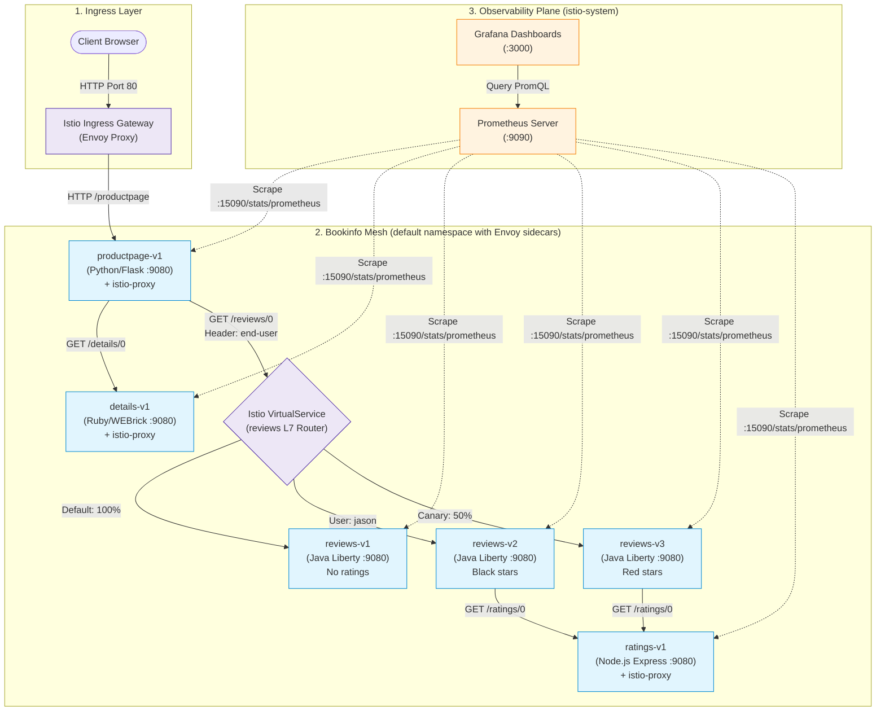

# Bảng ánh xạ thành phần (Component Mapping) — Bookinfo

Tài liệu này chi tiết hóa mối liên kết giữa kiến trúc logic, mã nguồn, cấu hình Docker container, tài nguyên Kubernetes và hạ tầng Istio Service Mesh của toàn bộ 4 microservices trong Bookinfo.

---

## 1. Sơ đồ Tô-pô Tương tác giữa các Thành phần

---

## 2. Bảng Ánh xạ Toàn bộ Thành phần (Component Mapping Table)

| Tên Microservice | Ngôn ngữ / Framework | Vị trí Source Code | Container Port / Service Port | Tài nguyên Kubernetes | Nhãn (Labels) | Phụ thuộc Downstream | Vai trò trong Hệ thống |
|---|---|---|---|---|---|---|---|
| **`productpage`** | Python 3.7+ / Flask, OpenTelemetry, Prometheus Client | `src/productpage/productpage.py` | `9080` / `9080` (ClusterIP) | Deployment `productpage-v1`, Service `productpage`, SA `bookinfo-productpage` | `app: productpage`, `version: v1` | `details:9080`, `reviews:9080` | Frontend UI / API Gateway Aggregator hiển thị thông tin sách và bài đánh giá |
| **`details`** | Ruby 2.7+ / WEBrick & Sinatra | `src/details/details.rb` | `9080` / `9080` (ClusterIP) | Deployment `details-v1`, Service `details`, SA `bookinfo-details` | `app: details`, `version: v1` | Không | Cung cấp thông tin metadata xuất bản của sách (thể loại, trang, NXB, ISBN) |
| **`reviews` (v1)** | Java 8+ / Open Liberty, JAX-RS | `src/reviews/reviews-application/` | `9080` / `9080` (ClusterIP) | Deployment `reviews-v1`, Service `reviews`, SA `bookinfo-reviews` | `app: reviews`, `version: v1` | Không (Ratings disabled) | Phiên bản baseline phục vụ bình luận sách dạng text thuần túy, không có sao đánh giá |
| **`reviews` (v2)** | Java 8+ / Open Liberty, JAX-RS | `src/reviews/reviews-application/` | `9080` / `9080` (ClusterIP) | Deployment `reviews-v2`, Service `reviews`, SA `bookinfo-reviews` | `app: reviews`, `version: v2` | `ratings:9080` | Phiên bản mở rộng gọi sang `ratings` và hiển thị sao màu đen (`STAR_COLOR=black`) |
| **`reviews` (v3)** | Java 8+ / Open Liberty, JAX-RS | `src/reviews/reviews-application/` | `9080` / `9080` (ClusterIP) | Deployment `reviews-v3`, Service `reviews`, SA `bookinfo-reviews` | `app: reviews`, `version: v3` | `ratings:9080` | Phiên bản canary nâng cao gọi sang `ratings` và hiển thị sao màu đỏ (`STAR_COLOR=red`) |
| **`ratings`** | Node.js 12+ / Express, httpdispatcher | `src/ratings/ratings.js` | `9080` / `9080` (ClusterIP) | Deployment `ratings-v1`, Service `ratings`, SA `bookinfo-ratings` | `app: ratings`, `version: v1` | Có thể nối MySQL/MongoDB | Cung cấp điểm số đánh giá từ 1 đến 5 sao theo từng reviewer |

---

## 3. Ánh xạ Hạ tầng Istio Service Mesh & Observability

| Thành phần Hạ tầng | Loại tài nguyên (Kind) | Vị trí file cấu hình | Port kết nối | Trách nhiệm và Chức năng |
|---|---|---|---|---|
| **Istio Ingress Gateway** | `Gateway` (`networking.istio.io/v1alpha3`) | `networking/bookinfo-gateway.yaml` | `80` (HTTP) / `443` (HTTPS) | Điểm tiếp nhận traffic từ ngoài Internet/Host vào cụm, mở cổng tiếp nhận cho host `*` |
| **Productpage VirtualService** | `VirtualService` (`networking.istio.io/v1alpha3`) | `networking/bookinfo-gateway.yaml` | `9080` | Định tuyến các URI `/productpage`, `/static`, `/login`, `/logout` từ Ingress Gateway vào Service `productpage` |
| **Destination Rules (All)** | `DestinationRule` (`networking.istio.io/v1alpha3`) | `networking/destination-rule-all.yaml` | N/A | Định nghĩa danh sách các Subsets dựa theo nhãn Kubernetes (`version: v1`, `version: v2`, `version: v3`) cho cả 4 services |
| **Canary Header VirtualService** | `VirtualService` (`networking.istio.io/v1alpha3`) | `networking/virtual-service-reviews-test-v2.yaml` | `9080` | Bắt header `end-user: jason` để route vào `reviews:v2`, các user khác vào `reviews:v1` |
| **Traffic Shifting VirtualService** | `VirtualService` (`networking.istio.io/v1alpha3`) | `networking/virtual-service-reviews-50-v3.yaml` | `9080` | Phân bổ tỉ lệ tải 50% vào `reviews:v1` và 50% vào `reviews:v3` |
| **Fault Injection VirtualService** | `VirtualService` (`networking.istio.io/v1alpha3`) | `networking/virtual-service-ratings-test-delay.yaml` | `9080` | Giả lập độ trễ cố định 7 giây (HTTP Delay) 100% request từ user `jason` khi gọi service `ratings` |
| **Envoy Sidecar (`istio-proxy`)** | Container nội bộ Pod | Tự động tiêm bởi Istiod qua Webhook | `15090` (Prometheus), `15021` (Health), `15001` (Outbound), `15006` (Inbound) | Chặn và xử lý toàn bộ traffic L4/L7, thực thi mTLS, thu thập metrics telemetry |
| **Prometheus Server** | Deployment / Service K8s | `../../istio/source/samples/addons/prometheus.yaml` | `9090` | Thu thập (scrape) định kỳ các metrics tiêu chuẩn từ cổng `:15090/stats/prometheus` của từng Envoy sidecar |
| **Grafana Dashboard** | Deployment / Service K8s | `../../istio/source/samples/addons/grafana.yaml` | `3000` | Trực quan hóa dữ liệu qua các dashboard chuyên dụng: Istio Mesh Dashboard, Istio Service Dashboard, Istio Workload Dashboard |

