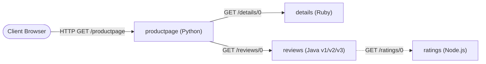
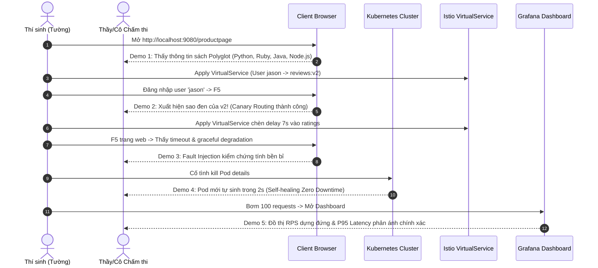

# Slide Deck: Microservices, Docker, Kubernetes, Istio, Prometheus, Grafana

> **Chủ đề 3**: Kiến trúc Microservices & Hạ tầng Cloud-Native  
> **Người báo cáo**: Tường  
> **Hệ thống minh chứng**: [Bookinfo](../../projects/bookinfo/README.md) & [Istio Service Mesh](../../projects/istio/README.md)  
> **Tài liệu thuyết trình kèm theo**: [Dàn ý chi tiết (outline.md)](outline.md) · [Lời thoại thuyết trình (speaker-notes.md)](speaker-notes.md) · [Cẩm nang toàn tập (HUONG-DAN-TOAN-TAP.md)](../HUONG-DAN-TOAN-TAP.md)

---

## Slide 1: Trang tiêu đề & Đặt vấn đề

### Tiêu đề:
**MICROSERVICES & CLOUD-NATIVE INFRASTRUCTURE**  
*Thiết kế, Triển khai, Điều phối & Giám sát với Docker, Kubernetes, Istio, Prometheus & Grafana*

### Thông tin báo cáo:
- **Học phần**: Kiến trúc Phần mềm (Software Architecture) — Báo cáo Giữa kỳ
- **Sinh viên thực hiện**: Tường
- **Hệ thống thực nghiệm**: Bookinfo (Canonical Istio Polyglot Microservices Sample) + Istio Service Mesh & Observability Addons

### Đặt vấn đề cốt lõi:
1. Vì sao các hệ thống hiện đại chuyển dịch từ Monolith sang Microservices?
2. Khi phân rã thành các dịch vụ độc lập, chúng ta giải quyết các bài toán hạ tầng sau bằng cách nào:
   - **Giao tiếp mạng & Định tuyến phiên bản** (Polyglot Networking & Canary Routing).
   - **Điều phối hạ tầng & Tự phục hồi** (Container Orchestration & Self-healing).
   - **Bảo mật & Kiểm soát luồng mạng** (Service Mesh & Zero Trust Security).
   - **Khả năng quan sát phân tán** (Distributed Observability & Telemetry).

---

## Slide 2: So sánh Kiến trúc — Monolith vs Modular Monolith vs Microservices

### 1. Bảng so sánh 3 mô hình kiến trúc

| Tiêu chí | Monolith | Modular Monolith | Microservices |
|---|---|---|---|
| **Cấu trúc Runtime** | 1 process duy nhất chạy toàn bộ logic | 1 process duy nhất nhưng chia rõ package/module | Mỗi service là một process riêng (Container) |
| **Cơ sở dữ liệu** | 1 Database dùng chung (Shared DB) | Thường 1 DB, phân schema theo module | Độc lập theo từng dịch vụ |
| **Công nghệ** | Đồng nhất 1 ngôn ngữ/framework | Đồng nhất 1 ngôn ngữ | **Polyglot** (đa dạng ngôn ngữ, tối ưu theo tác vụ) |
| **Blast Radius (Phạm vi ảnh hưởng)** | Rất lớn: Lỗi ở 1 module có thể làm crash toàn bộ app | Lớn: Lỗi runtime vẫn làm dừng process | Nhỏ: Lỗi được cô lập trong ranh giới service |
| **Khả năng mở rộng (Scale)** | Scale toàn bộ ứng dụng cồng kềnh | Scale toàn bộ process | Scale linh hoạt và có chọn lọc theo từng service |
| **Độ phức tạp vận hành** | Thấp (Deploy đơn giản) | Trung bình | **Cao** (Đòi hỏi K8s, Mesh, Observability) |

### 2. Kiến trúc Bookinfo (Minh chứng Polyglot Hoàn hảo)
- **Python (Flask)**: `productpage` (thuận tiện cho việc tổng hợp dữ liệu và render giao diện người dùng Jinja2).
- **Ruby (WEBrick/Sinatra)**: `details` (xử lý metadata sách nhanh chóng, cú pháp linh hoạt).
- **Java (Open Liberty / JAX-RS)**: `reviews` (nền tảng enterprise vững chắc, hỗ trợ đa phiên bản v1, v2, v3).
- **Node.js (Express)**: `ratings` (I/O bất đồng bộ nhẹ nhàng, tối ưu cho việc truy xuất điểm số đánh giá).

---

## Slide 3: Service Boundaries & Domain Decomposition trong Bookinfo

### 1. Phân rã theo Domain-Driven Design (DDD)
- Mỗi microservice trong Bookinfo đảm nhận một năng lực nghiệp vụ duy nhất (**Single Responsibility**):
  - **`productpage`**: Điểm tiếp nhận request từ khách hàng, điều phối gọi các dịch vụ downstream để hiển thị trang sách.
  - **`details`**: Cung cấp thông tin xuất bản của cuốn sách (thể loại, số trang, nhà xuất bản, ISBN).
  - **`reviews`**: Cung cấp các bài bình luận của độc giả.
  - **`ratings`**: Cung cấp số điểm đánh giá (sao) đi kèm mỗi bài bình luận.

### 2. Sơ đồ Luồng Tương tác Dữ liệu:

- **Tính độc lập phát triển**: Nhóm phát triển `reviews` có thể deploy phiên bản v3 (sao đỏ) hoàn toàn độc lập mà nhóm `details` không cần phải build hay deploy lại bất kỳ thành phần nào.

---

## Slide 4: Giao tiếp Liên Dịch vụ & Lan truyền Tracing Headers

### 1. Giao thức HTTP REST/JSON & Vấn đề Distributed Tracing
- Các microservice trong Bookinfo giao tiếp qua giao thức HTTP REST/JSON.
- Khi một request từ người dùng đi qua chuỗi `productpage` -> `reviews` -> `ratings`, nếu có lỗi hoặc độ trễ phát sinh, làm sao để liên kết các log và trace của 3 container khác nhau?

### 2. Cơ chế Lan truyền Header (`getForwardHeaders` trong `productpage.py`)
```python
def getForwardHeaders(request):
    headers = {}
    # Trích xuất và tiêm B3 tracing context qua OpenTelemetry
    ctx = propagator.extract(carrier={k.lower(): v for k, v in request.headers})
    propagator.inject(headers, ctx)

    # Chuyển tiếp danh tính người dùng phục vụ Canary Routing
    if 'user' in session:
        headers['end-user'] = session['user']

    # Chuyển tiếp request-id tiêu chuẩn của Istio Envoy
    if 'x-request-id' in request.headers:
        headers['x-request-id'] = request.headers['x-request-id']

    return headers
```
- **Ý nghĩa sống còn**: Header `end-user` giúp Envoy proxy nhận diện người dùng `jason` để định tuyến sang phiên bản `reviews:v2`. Header `x-request-id` và `x-b3-*` giúp kết nối toàn bộ hành trình request trên distributed tracing (Zipkin/Jaeger).

---

## Slide 5: Dockerization & Multi-stage Build trong Bookinfo

### 1. Nguyên lý Container hóa & Linux Kernel Primitives
- **Namespaces**: Cung cấp môi trường cách ly (PID - tiến trình, NET - mạng, MNT - hệ thống file, IPC - bộ nhớ chia sẻ).
- **Cgroups**: Áp đặt giới hạn trần tài nguyên (CPU limits, Memory limits) ngăn chặn một container làm cạn kiệt tài nguyên máy chủ vật lý.

### 2. Phân tích Multi-stage Build trong `src/reviews/Dockerfile`
```dockerfile
# Stage 1: Build bằng Gradle trên OpenJDK 8 Alpine
FROM gradle:4.8.1-jdk8-alpine as builder
COPY --chown=gradle:gradle . /home/gradle/src
WORKDIR /home/gradle/src/reviews-wlpcfg
RUN gradle build

# Stage 2: Runtime Image cực kỳ nhỏ gọn
FROM open-liberty:kernel-slim
COPY --chown=1001:0 --from=builder /home/gradle/src/reviews-wlpcfg/build/libs/wlp/usr/servers/defaultServer /opt/ibm/wlp/usr/servers/defaultServer
EXPOSE 9080
```
- **Hiệu quả**: Loại bỏ hoàn toàn Gradle compiler và mã nguồn thô khỏi image cuối cùng. Giảm kích thước image từ >800MB xuống còn ~150MB, đồng thời giảm thiểu bề mặt tấn công bảo mật (Attack Surface).

---

## Slide 6: Kubernetes Workload Modeling trong Bookinfo

### 1. Mô hình hóa Tài nguyên trên Kubernetes
- **Pod**: Đơn vị tính toán nhỏ nhất. Trong môi trường Service Mesh, mỗi Pod chứa **2 containers**:
  1. Container ứng dụng nghiệp vụ (`productpage`, `details`, `reviews`, hoặc `ratings`).
  2. Container `istio-proxy` (Envoy proxy) tiêm tự động qua Mutating Webhook.
- **ClusterIP Service**: Cung cấp Virtual IP và DNS nội bộ ổn định (`http://reviews:9080`), cân bằng tải mức L4.

### 2. Quản lý Đa Phiên bản qua Label Selectors
```text
Service 'reviews' (Port 9080, Selector: app=reviews)
    ├── Deployment 'reviews-v1' (Labels: app=reviews, version=v1) -> Pod: Không có sao
    ├── Deployment 'reviews-v2' (Labels: app=reviews, version=v2) -> Pod: Gọi ratings (Sao đen)
    └── Deployment 'reviews-v3' (Labels: app=reviews, version=v3) -> Pod: Gọi ratings (Sao đỏ)
```
- Mặc định, Kubernetes Service phân phối tải ngẫu nhiên (Round-Robin) giữa cả 3 Deployments. Khi kết hợp với Istio VirtualService, luồng tải sẽ được định tuyến thông minh theo nhu cầu.

---

## Slide 7: Kubernetes Self-healing, Pod Scaling & Rolling Updates

### 1. Cơ chế Tự phục hồi (Self-Healing)
- Kubernetes duy trì một vòng lặp đối soát (**Reconciliation Loop**):
  $$\text{Current State} \xrightarrow{\text{Compare}} \text{Desired State} \xrightarrow{\text{Action}} \text{Reconciled}$$
- Khi một Pod (ví dụ `details-v1`) bị crash hoặc bị xóa cưỡng bức:
  1. ReplicaSet Controller phát hiện số lượng Pod đang chạy (0) nhỏ hơn số lượng mong muốn (1).
  2. Ngay lập tức gọi API Server để khởi tạo Pod mới trên Node khả dụng trong vòng 2 giây.

### 2. Quy trình Rolling Update Không Gián Đoạn (Zero-Downtime)
1. Tạo Pod mới phiên bản mới song song với Pod cũ.
2. Kiểm tra `readinessProbe` thành công mới cho phép Pod mới gia nhập danh sách Service Endpoints.
3. Gửi tín hiệu `SIGTERM` tới Pod cũ, chờ xử lý nốt các request dở dang rồi mới dừng hoàn toàn.

---

## Slide 8: Kiến trúc Service Mesh & Istio

### 1. Tại sao cần Service Mesh?
- Khi số lượng microservices tăng lên, việc cài đặt thủ công mTLS, Retry, Circuit Breaker, và Telemetry vào code của 4 ngôn ngữ khác nhau (Python, Ruby, Java, Node.js) là bất khả thi và dễ sai sót.
- **Service Mesh tách biệt hoàn toàn Logic Nghiệp vụ khỏi Logic Mạng Hạ tầng**.

### 2. Kiến trúc 2 Tầng của Istio
```mermaid
flowchart TD
    subgraph ControlPlane ["Control Plane (istiod)"]
        Istiod["istiod<br/>(Pilot: Cấu hình Envoy<br/>Citadel: Cấp phát chứng chỉ x.509 mTLS)"]
    end

    subgraph DataPlane ["Data Plane (Envoy Sidecars)"]
        subgraph PodA ["Pod productpage"]
            AppA["productpage (Python)"] <-->|localhost| ProxyA["Envoy Sidecar (:15001/:15006)"]
        end
        subgraph PodB ["Pod reviews"]
            ProxyB["Envoy Sidecar (:15001/:15006)"] <-->|localhost| AppB["reviews (Java)"]
        end
    end

    Istiod -.->|xDS gRPC API: Push Config| ProxyA
    Istiod -.->|xDS gRPC API: Push Config| ProxyB
    ProxyA <==>|Mutual TLS (mTLS) + SPIFFE ID| ProxyB
```

---

## Slide 9: Traffic Management với Istio (Canary Routing & Fault Injection)

### 1. Bộ 3 Custom Resource Definitions (CRDs) Cốt lõi
- **`Gateway`**: Khai báo tiếp nhận traffic tại biên cụm (Edge Ingress) trên cổng 80/443.
- **`VirtualService`**: Định nghĩa luật định tuyến L7 (Path matching, Header matching, Traffic Splitting).
- **`DestinationRule`**: Định nghĩa các tập con (**Subsets** v1, v2, v3) và chính sách tải/mTLS.

### 2. Các Kịch bản Định tuyến Thông minh trong Bookinfo
- **Canary Routing theo Header người dùng**:
  ```yaml
  match:
  - headers:
      end-user:
        exact: jason
    route:
    - destination: { host: reviews, subset: v2 } # User jason thấy sao đen
  - route:
    - destination: { host: reviews, subset: v1 } # Các user khác thấy không sao
  ```
- **Weighted Traffic Shifting**: Chia 50% traffic vào v1 và 50% traffic vào v3 (sao đỏ) để thử nghiệm tải diện rộng.
- **Fault Injection (Chaos Testing)**: Chèn độ trễ 7 giây vào `ratings` để kiểm tra khả năng chịu lỗi và cơ chế timeout của hệ thống.

---

## Slide 10: Service Mesh Security: Zero Trust & Transparent mTLS

### 1. Triết lý Zero Trust trong Mạng Nội bộ
- Không tin tưởng bất kỳ kết nối nào bên trong mạng cụm Kubernetes (Perimeter Security đã lỗi thời).
- Mọi giao tiếp giữa các Pod đều phải được **Xác thực (Authentication)**, **Ủy quyền (Authorization)**, và **Mã hóa (Encryption)**.

### 2. Cơ chế Transparent mTLS của Istio
1. **Cấp phát Định danh**: Mỗi workload được gán một danh tính duy nhất theo chuẩn SPIFFE:  
   `spiffe://cluster.local/ns/default/sa/bookinfo-productpage`
2. **Xoay vòng Chứng chỉ Tự động**: `istiod` đóng vai trò CA cấp phát chứng chỉ số X.509 ngắn hạn cho từng Envoy sidecar qua giao thức SDS (Secret Discovery Service).
3. **Mã hóa Hai Chiều Tự động**: Lưu lượng giữa `productpage` và `reviews` được mã hóa mTLS hoàn toàn trong suốt với ứng dụng. Chế độ `PeerAuthentication` STRICT ngăn chặn bất kỳ traffic không có sidecar nào.

---

## Slide 11: Cloud-Native Observability: 3 Trụ cột & 4 Golden Signals

### 1. Ba Trụ cột của Khả năng Quan sát (Observability Pillars)
- **Metrics**: Số liệu thống kê theo thời gian (Time-series) giúp phát hiện sự cố nhanh chóng ("Hệ thống có bất thường không?").
- **Logs**: Bản ghi sự kiện chi tiết kèm ngữ cảnh lỗi ("Lỗi gì đã xảy ra tại thời điểm t?").
- **Traces**: Bản đồ hành trình phân tán của request qua các bước nhảy microservice ("Nút thắt cổ chai nằm ở service nào?").

### 2. Bốn Tín hiệu Vàng của Google SRE (4 Golden Signals)
1. **Latency (Độ trễ)**: Thời gian xử lý một request (đo lường theo p50, p90, p99).
2. **Traffic (Lưu lượng)**: Nhu cầu gửi đến hệ thống (RPS - Requests Per Second).
3. **Errors (Tỉ lệ lỗi)**: Tỉ lệ các request bị thất bại (HTTP 5xx, gRPC error codes).
4. **Saturation (Độ bão hòa)**: Mức độ sử dụng tài nguyên (CPU, Memory, Connection Pool).

---

## Slide 12: Prometheus: Thu thập Số liệu & Truy vấn PromQL trong Bookinfo

### 1. Cơ chế Pull-based Scraping
- Prometheus định kỳ gửi HTTP GET cào metrics từ cổng quản trị `:15090/stats/prometheus` của từng container Envoy sidecar.
- Dữ liệu được nén và lưu trữ trong Time-Series Database (TSDB) của Prometheus kèm nhãn đa chiều.

### 2. Các Truy vấn PromQL Thực tế trên Hệ thống Bookinfo
- **Đo tổng lưu lượng Request Per Second (RPS)**:
  ```promql
  sum(rate(istio_requests_total{reporter="destination"}[1m])) by (destination_workload)
  ```
- **Đo tỉ lệ lỗi hệ thống**:
  ```promql
  sum(rate(istio_requests_total{response_code=~"5.*"}[1m]))
  ```
- **Đo độ trễ P95 của dịch vụ Productpage**:
  ```promql
  histogram_quantile(0.95, sum(rate(istio_request_duration_milliseconds_bucket{destination_workload="productpage-v1"}[1m])) by (le))
  ```

---

## Slide 13: Kịch bản Live Demo Thực tế (5 Phút Vấn Đáp)



---

## Slide 14: Tổng kết & Đánh đổi Kiến trúc (Architectural Trade-offs)

### 1. Bảng Đánh đổi Toàn diện khi Triển khai

| Khía cạnh | Lợi thế vượt trội đạt được | Chi phí & Đánh đổi thực tế |
|---|---|---|
| **Polyglot Microservices** | Tự do chọn công nghệ tối ưu cho từng tác vụ; blast radius nhỏ; deploy độc lập. | Quản lý phức tạp nhiều runtime, thư viện và công cụ build khác nhau. |
| **Envoy Sidecar Pattern** | Tách 100% logic mạng, mTLS, và telemetry ra khỏi code ứng dụng. | Tăng độ trễ mạng (+1.5–3ms hop latency) và tốn tài nguyên (30–50MB RAM/Pod). |
| **Zero Trust mTLS** | Mã hóa 100% lưu lượng mạng nội bộ tự động, chống tấn công nghe lén. | Tiêu tốn thêm năng lực tính toán CPU cho việc bắt tay mã hóa TLS liên tục. |
| **Prometheus Telemetry** | Thu thập chỉ số Golden Signals tập trung, phát hiện sự cố nhanh chóng. | Tần suất cào metrics (scrape interval) tạo thêm lưu lượng mạng nội bộ. |

### 2. Lời kết
- Microservices, Kubernetes và Istio Service Mesh không phải là giải pháp "miễn phí" — chúng giải quyết xuất sắc bài toán quy mô, độc lập triển khai và an ninh phân tán với cái giá là độ phức tạp vận hành và độ trễ hạ tầng được kiểm soát.
