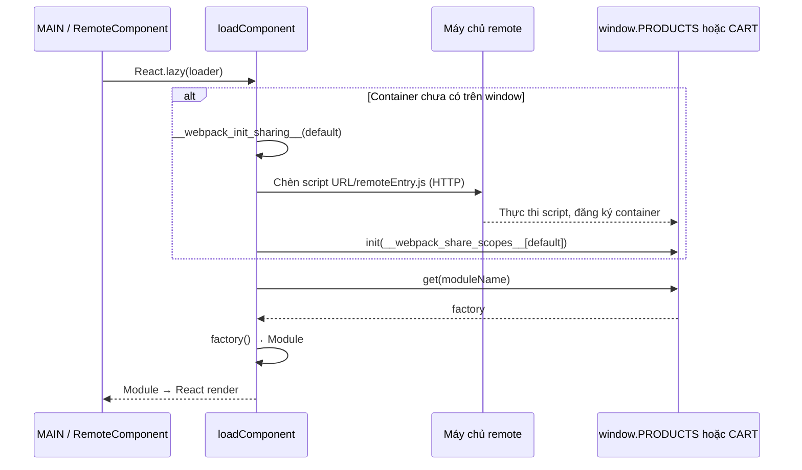

# Luồng hoạt động của Micro-Frontend

## Tải remote lúc chạy



MAIN quyết định module cần hiển thị theo route/header. `RemoteComponent` bao lazy component bằng Suspense và ErrorBoundary. `loadComponent` kiểm tra container toàn cục; nếu chưa có thì khởi tạo chia sẻ và gọi `fetchRemote`. Trình duyệt mới là nơi tải và chạy mã; máy chủ remote chỉ phân phối tệp. `remoteEntry.js` không nhất thiết là toàn bộ mã feature: factory có thể cần chunks khác.

`script.onerror` reject promise khi lỗi tải; không có timeout/retry rõ trong loader. Việc kiểm tra `window` không gộp các promise đang tải: hai lần tải đầu đồng thời có thể cùng chèn script. Container đã nạp có thể tiếp tục được dùng dù đổi URL; UI điều khiển URL yêu cầu Reload để phân giải lại. Đây là nhận xét từ source, không phải lỗi vừa tái hiện.

## Thêm / bớt giỏ hàng và refresh

```mermaid
sequenceDiagram
    participant P as PRODUCTS / ProductCard
    participant B as MAIN / window.fsEvents
    participant C as CART / Zustand
    participant LS as localStorage của host
    P->>B: publish(addItem, {name, price?})
    B->>C: callback addItem (đồng bộ)
    C->>C: Tăng quantity / thêm mặt hàng
    C->>B: publish(cart, {cart: newCart})
    B->>P: callback snapshot → setCart
    C->>LS: setItem(fruit-shop-cart, JSON)
    C->>C: set trả state mới → UI CART render
    Note over P,C: removeItem tương tự; payload có name, quantity
    Note over C,LS: Khi reload: đọc localStorage, phát snapshot, tạo store
```

Theo `updateLocalState`, CART **publish snapshot trước rồi ghi localStorage**; callback chạy ngay trong call stack. Sau đó updater trả `{cart}` để Zustand cập nhật state. Đây không phải chuỗi message bất đồng bộ với transaction. Nếu callback ném lỗi hoặc ghi storage thất bại, không có rollback phân tán hay durable retry.

Store đăng ký `addItem`, `removeItem` lúc module nạp. ProductCard subscribe `cart` trong effect và unsubscribe khi unmount. Cart subscription ở scope module sống theo vòng đời module, không cùng vòng đời từng ProductCard. Bus giữ snapshot cho topic `cart`, không giữ lịch sử lệnh. `persistedMessages.cart` khởi tạo `{}`; subscriber nhận trước snapshot đầu tiên có thể không có mảng cart. Không biến rủi ro theo thứ tự khởi tạo thành kết luận lỗi luôn xảy ra.

Reload tạo lại RAM/browser app; store đọc `fruit-shop-cart` và bus phát lại trạng thái ban đầu. Đổi origin/port host đổi vùng localStorage. Giỏ không được phục hồi từ server và không tự đồng bộ nhiều tab/thiết bị bằng bus hiện tại.

## Checkout và giới hạn phát hành độc lập

`cart/src/features/checkout/index.tsx` và `CheckoutPanel` import helper từ MAIN, danh mục/giá từ PRODUCTS. ProductCard có thể được lấy qua remote nhưng priceMap đã được biên dịch trong CART. Vì thế đổi remote Products mới không tự cập nhật giá tính tổng của CART cũ. Checkout hiển thị dữ liệu và tổng tiền; không có API xác nhận giá, tạo đơn hay thanh toán.

## Liên hệ 4+1 khi được hỏi sâu

Logic: shell/danh mục/giỏ. Development: ba workspace, Webpack, import chéo. Process: hai sequence trên. Physical: browser thực thi, ba dev server phục vụ tệp; bản copy Docker là biến thể riêng. +1: xem danh mục, add/remove, checkout, refresh, mất remote. Một thao tác thêm hàng nối cả bốn view nhưng không biến chúng thành bốn loại UML bắt buộc.
