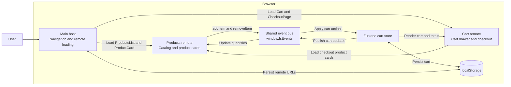

# Logical view

The demo runs three React micro frontends in one browser. The main host owns
navigation, remote URL settings, and the shared event bus. Webpack Module
Federation loads Products and Cart at runtime and shares React between them.

Cart owns the Zustand store. Product cards publish actions through the host's
event bus; the store applies them, saves the cart, and publishes updates back to
the product cards. Checkout uses the Products remote's product cards and a
product price list imported at build time. There is no backend or database;
cart data and remote URL overrides are saved in the browser's localStorage.

# Local deployment

`docker compose up --build -d` builds all three applications and serves their
static output from a single Nginx container:

| URL | Content |
| --- | --- |
| http://localhost:9001/ | Main host |
| http://localhost:9001/checkout | Host checkout route |
| http://localhost:9001/products/remoteEntry.js | Products federation entry |
| http://localhost:9001/cart/remoteEntry.js | Cart federation entry |

Each remote's other JavaScript chunks and images are served under its own
directory. The host and both remotes use the same origin, and the published
Docker port is bound to `127.0.0.1`. The container restarts unless stopped.
The standalone remote pages are build artifacts; use the main host for the
complete shopping and checkout flow, since it initializes shared services.

To stop the deployment, run `docker compose down` from the project directory.
