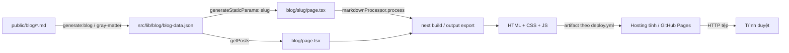
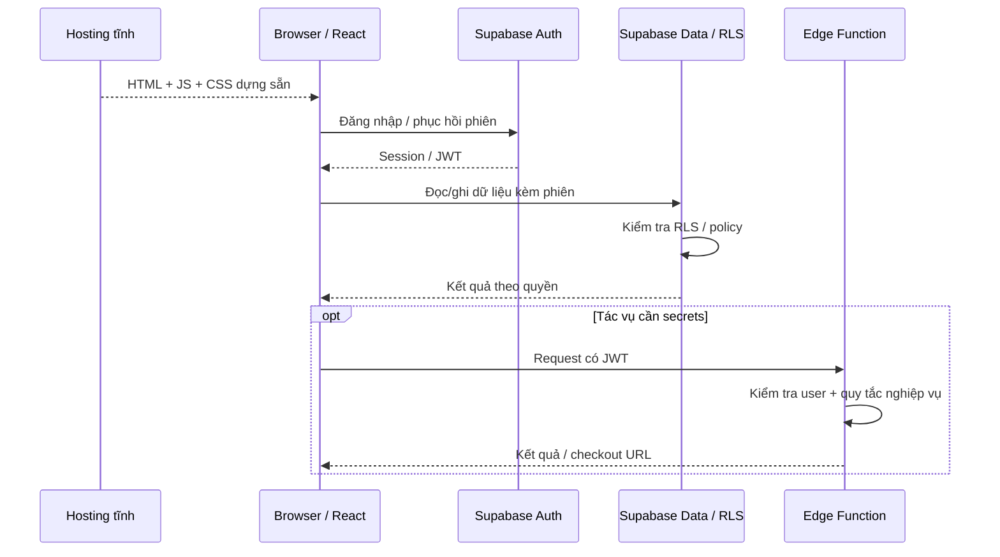

# ScriptHammer: pipeline, runtime và rebuild

## Từ Markdown đến HTML

`generate-blog-data.js` đọc `public/blog`, parse frontmatter bằng gray-matter, chuẩn hóa metadata và giữ Markdown trong JSON. Trang danh sách đọc JSON bằng `fs.readFile`; trang slug cũng đọc JSON, sinh params và dùng `markdownProcessor.process` để dựng nội dung. Không có local HTTP `api.ts` trong luồng này. `generateStaticParams` liệt kê slug lúc build, không truy vấn CMS tại mỗi request.

**Điểm nối dễ bỏ sót:** script `generate:blog` tồn tại, nhưng `prebuild` không gọi nó; `deploy.yml` gọi build mà không có bước `generate:blog`. Vì vậy chỉ sửa file Markdown không đủ bảo đảm JSON và HTML cập nhật. Quy trình chuẩn bị nội dung cần sinh JSON rõ ràng trước build. Đây là nhận định từ các scripts hiện tại, không phải một lần CI vừa thất bại.

## API động sau khi tải frontend tĩnh

AuthContext điều phối trạng thái phiên; Supabase client giao tiếp backend. RLS thực thi ở DB, không ở Pages. Với checkout, frontend chuyển hướng theo URL trả về; backend webhook xác minh chữ ký/provider event để xử lý trạng thái. Redirect thành công phía browser không tự là xác nhận cuối cùng thanh toán. Không thực hiện giao dịch để chuẩn bị tài liệu này.

## Rebuild và cache: giải thích bản A / bản B

1. **Bản A đang serve:** HTML là artifact của build A. Thay Markdown trong source không thay tệp đã publish.
2. **Chuẩn bị B:** `pnpm run generate:blog` tạo JSON mới; build/export sinh HTML B cho slug. Kiểm tra JSON và HTML để biết thay đổi đã đi hết pipeline.
3. **Phát hành B:** workflow ghép output và Storybook thành `merged-output`, upload artifact rồi deploy Pages. Build local thành công chưa đồng nghĩa host đã nhận B.
4. **Client cũ:** browser cache/SW/tab đang mở có thể còn A. So sánh tệp export, phiên sạch và phiên đã có cache. Không dùng việc sửa file Markdown được copy dưới `public` làm bằng chứng trang `/blog/<slug>/` đã thay.

Build gọi `strip-css-script-tags.mjs`, rồi `stamp-sw-version.mjs`; workflow cố giữ chunks cũ 14 ngày để client cũ ít lỗi hơn. Bước retention cho phép tiếp tục khi lỗi; không bảo đảm HTML/chunks/cache luôn đồng bộ. Cập nhật dữ liệu Supabase là đường runtime riêng, không đòi rebuild nội dung blog.

## Offline và lỗi

SW chỉ xử lý request theo quy tắc, bỏ request không phải GET và một số đường như `_next`/payload `.txt`. IndexedDB phục vụ cache/queue; gửi tin offline còn cần phiên, khóa và dữ liệu hội thoại khả dụng. Không kết luận mọi trang/API/auth chạy offline.

Nếu API mất mạng, shell được cache có thể vẫn mở nhưng thao tác dữ liệu mới có thể lỗi/đợi sync. Queue có `content` rõ phục vụ UI trong dữ liệu pending; không mô tả toàn bộ IndexedDB chỉ chứa ciphertext. Nếu generator/JSON cũ, kiểm tra đầu vào trước khi quy lỗi CDN. Nếu URL assets sai, kiểm tra `basePath`, `assetPrefix`, env và artifact chứ không chỉ refresh.

Các sơ đồ mô tả trách nhiệm và thứ tự logic. Không xác nhận deployment, SQL policies hoặc Edge Functions thực đang ở đúng phiên bản này.
